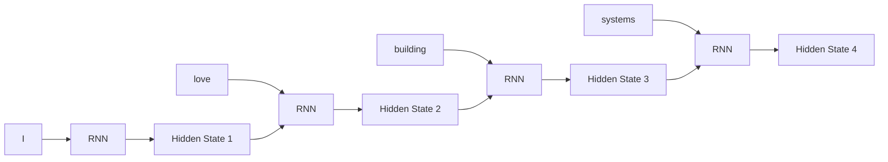
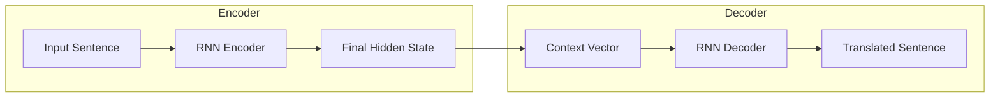
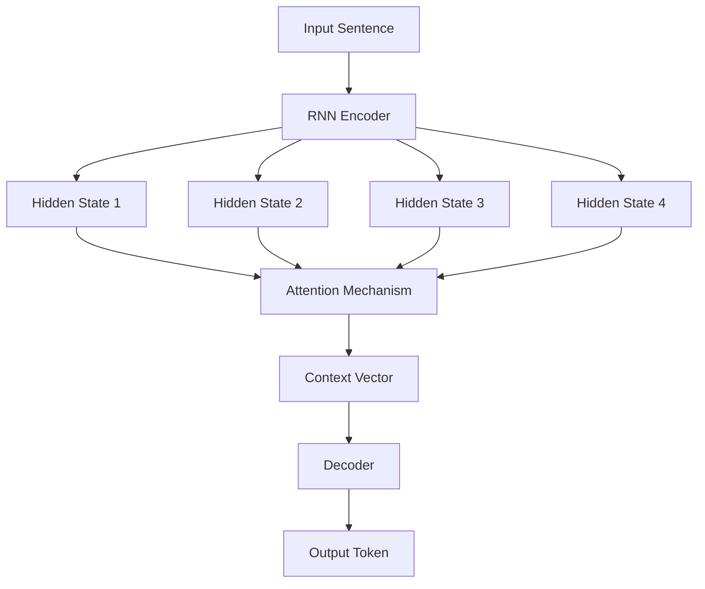
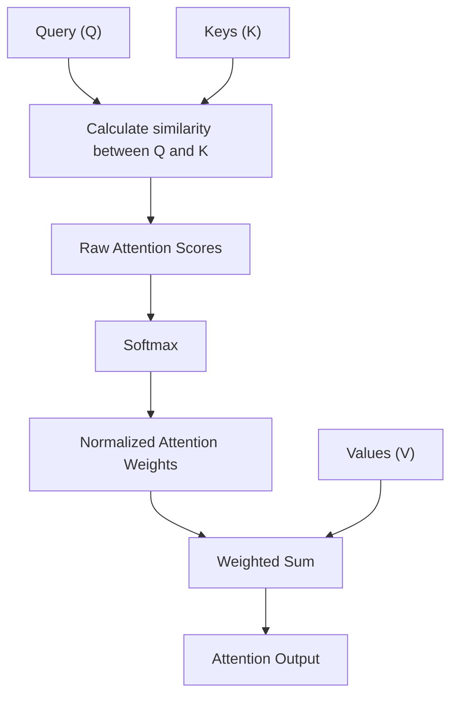
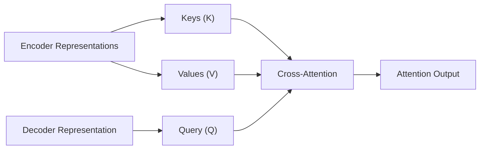
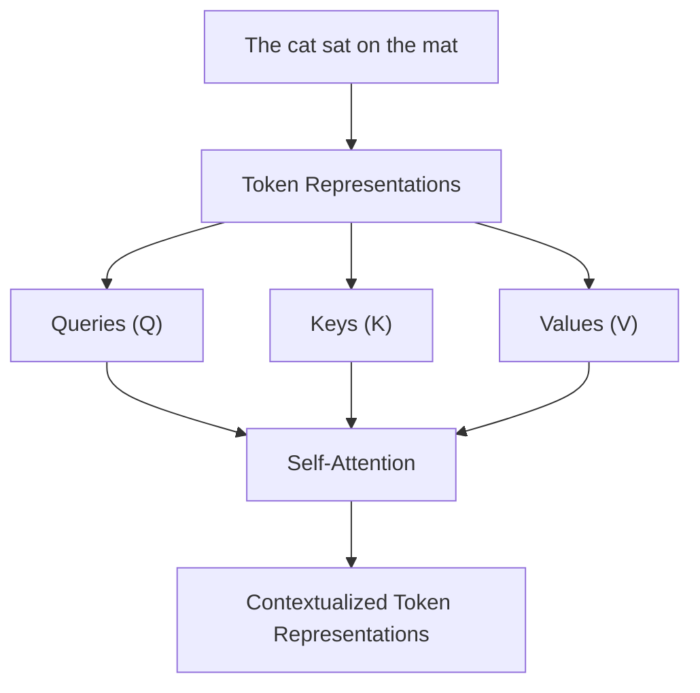

# Introduction

Attention is one of the fundamental concepts behind modern deep learning architectures, particularly Large Language Models (LLMs). At its core, attention is a mechanism that allows a neural network to identify which parts of its input are relevant when processing a particular piece of information. Rather than treating every input element as equally important, the model dynamically assigns different levels of importance to different elements and uses that information to construct a more meaningful representation.

Consider the following sentence:

> The animal didn't cross the street because it was too tired.

To understand this sentence correctly, a language model needs to determine what the word `it` refers to. Although the sentence contains several nouns, the most likely reference is `the animal`, rather than `the street`. Establishing this relationship requires the model to understand how different words relate to one another, even when they are separated by several other words.

This is precisely the kind of problem attention helps solve. When processing the word `it`, the model can assign a higher attention weight to `animal`, allowing information from that word to influence the representation of `it`. Similarly, when processing `cross`, the model might pay attention to `street` because those words have a meaningful relationship in the sentence.

The important idea is that the relevance of an input element depends on what the model is currently processing. A word that is important when interpreting one token might be relatively unimportant when interpreting another. Attention provides a mathematical mechanism for learning these relationships dynamically.

## Why Do We Need Attention?

To understand why attention was introduced, it helps to examine how earlier sequence-processing architectures handled natural language. Language is inherently sequential, meaning that the interpretation of a word often depends on information appearing before or after it. Traditional architectures such as Recurrent Neural Networks (RNNs) were designed to process this kind of sequential information.

### Understanding Recurrent Neural Networks

An RNN processes an input sequence one element at a time, maintaining a hidden state that carries information from previously processed elements. For example, when processing the sentence "I love building distributed systems", the network first processes `I`, then `love`, followed by `building`, and finally `distributed systems`. At every step, it combines the current input with the previous hidden state to produce a new hidden state.

<div style={{textAlign: 'center'}}>



</div>

The hidden state acts as a summary of the information encountered so far, allowing the network to retain some understanding of the preceding sequence without having to process the entire input again. However, this approach introduces a fundamental limitation: information from earlier tokens must pass through multiple recurrent steps before reaching later tokens. As sequences become longer, preserving information from distant positions becomes increasingly difficult, particularly because of the vanishing gradient problem during training.

### The Information Bottleneck Problem

The limitations of recurrent processing became particularly apparent in early sequence-to-sequence architectures, which were commonly used for tasks such as machine translation. These architectures typically consisted of two components: an encoder that processed the input sentence and a decoder that generated the corresponding output sentence.

The encoder read the entire input sequence and compressed its information into a fixed-size representation, commonly called a context vector. The decoder then used this context vector to generate the translated sentence, one token at a time.

<div style={{textAlign: 'center'}}>



</div>

The problem with this architecture is that the entire input sentence must be represented by a single fixed-size context vector, regardless of whether the sentence contains five words or several hundred words. This creates an information bottleneck because the encoder must compress all relevant information into a representation with limited capacity, making it increasingly difficult to preserve the details required by the decoder when processing longer sequences.

There is another limitation worth understanding: once the encoder has generated the final context vector, the decoder does not have a direct mechanism to retrieve individual encoder representations when generating each output token. It must rely primarily on the information compressed into that final representation.

### How Attention Solves This Problem

Attention addresses the information bottleneck by allowing the decoder to access the individual hidden states generated by the encoder instead of relying entirely on one fixed-size context vector. Whenever the decoder needs to generate an output token, it can examine the encoder's hidden states and determine which parts of the original input are most relevant to the current generation step.

For example, while translating an English sentence into French, the decoder might focus heavily on a particular English word when generating its corresponding French translation. When generating another word, it can calculate a different set of attention weights and focus on another part of the input.

<div style={{textAlign: 'center'}}>



</div>

The important difference is that the context vector is no longer a single representation calculated once for the entire input. Instead, it is dynamically calculated using the encoder's hidden states for each decoder step, allowing the model to retrieve different information depending on what it needs to generate.

**Attention therefore solves the information retrieval problem by allowing a model to dynamically access relevant parts of an input rather than depending entirely on a fixed-size representation of the entire sequence.**

## How Does Attention Work?

Now that we understand why attention was introduced, let's examine how it actually works. At a conceptual level, attention performs three operations: it calculates how relevant different input representations are to the current request, converts those relevance scores into normalized weights, and uses those weights to combine the information contained in the corresponding representations.

To understand these operations, we first need to understand three fundamental concepts: Query, Key, and Value.

### Query, Key and Value

Attention is commonly explained using an analogy involving a search or information retrieval system. Imagine searching for a document in a database: you provide a search query, the system compares it against the metadata associated with available documents, and it retrieves the actual document contents that best match your request.

Attention works in a similar manner. The Query represents what information the model is currently looking for, the Keys represent the information available for matching against that request, and the Values contain the actual information that will be retrieved and combined.

| Component | Meaning                                            | Search analogy          |
| --------- | -------------------------------------------------- | ----------------------- |
| Query (Q) | Represents what information is being requested     | Search request          |
| Key (K)   | Represents information used to determine relevance | Searchable metadata     |
| Value (V) | Contains the information that will be retrieved    | Actual document content |

The distinction between Keys and Values is particularly important. The Key is used to determine how relevant an input element is to a Query, whereas the Value contains the information that contributes to the final attention output. In other words, Keys help determine where to look, while Values determine what information is retrieved.

### Step 1: Calculate Attention Scores

The first operation is to compare the Query against the available Keys to determine how relevant each input element is to the current request. Every Query-Key comparison produces a numerical value called an attention score, where a higher score generally indicates a stronger match between the two representations.

Suppose we have three input tokens: `Machine`, `Learning`, and `Rocks`. When processing a particular Query, the attention mechanism compares it against the Key associated with each token and produces the following hypothetical scores:

| Token    | Attention score |
| -------- | --------------: |
| Machine  |             2.0 |
| Learning |             4.0 |
| Rocks    |             1.0 |

These scores indicate that `Learning` has the strongest relationship with the current Query, while `Rocks` has the weakest relationship. However, these are raw scores rather than probabilities, meaning that they are not constrained to fall between zero and one and do not necessarily add up to one.

### Step 2: Apply Softmax

To convert raw attention scores into normalized weights, the attention mechanism applies the Softmax function. Softmax transforms a collection of numerical values into a probability distribution in which every value is between zero and one and the sum of all values equals one.

The mathematical definition is:

```text
Softmax(x_i) = exp(x_i) / Σ_j exp(x_j)
```

Here, `x_i` represents an individual attention score, while the denominator represents the sum of the exponentials of all scores being normalized. Because Softmax uses the exponential function, higher scores receive disproportionately larger weights, allowing the model to emphasize more relevant information.

Applying Softmax to our previous scores:

```text
Input scores = [2, 4, 1]
```

Produces approximately:

```text
Attention weights = [0.114, 0.844, 0.042]
```

The resulting attention weights are:

| Token     | Raw score | Attention weight |
| --------- | --------: | ---------------: |
| Machine   |       2.0 |            0.114 |
| Learning  |       4.0 |            0.844 |
| Rocks     |       1.0 |            0.042 |
| **Total** |           |        **1.000** |

The result indicates that approximately 84.4% of the attention weight is assigned to `Learning`, compared with 11.4% for `Machine` and 4.2% for `Rocks`. These weights determine how much each corresponding Value contributes to the final attention output.

### Step 3: Calculate the Weighted Sum of Values

Once the attention weights have been calculated, the mechanism uses them to combine the corresponding Value vectors. This operation is called a weighted sum because each Value is multiplied by its attention weight before all the resulting vectors are added together.

Suppose our three tokens have the following hypothetical Value vectors:

| Token    | Value vector |
| -------- | ------------ |
| Machine  | [1, 0]       |
| Learning | [0, 2]       |
| Rocks    | [1, 1]       |

We already calculated the attention weights as:

```text
Attention weights = [0.114, 0.844, 0.042]
```

The final output is calculated as:

```text
Output =
    (0.114 × [1, 0])
  + (0.844 × [0, 2])
  + (0.042 × [1, 1])
```

Expanding the individual contributions:

```text
Output =
    [0.114, 0]
  + [0, 1.688]
  + [0.042, 0.042]
```

Therefore:

```text
Output = [0.156, 1.730]
```

The resulting vector contains information from all three Values, but the contribution from `Learning` is significantly higher because it received the largest attention weight. This is the central operation of attention: instead of selecting only one input element, the mechanism constructs a new representation by combining information from multiple sources according to their relevance.

### Complete Attention Workflow

The entire process can be summarized using the following diagram, which connects the three fundamental operations into one continuous workflow.

<div style={{textAlign: 'center'}}>



</div>

Remember that Query and Key determine the attention weights, while Value vectors are combined using those weights to produce the output. This distinction is fundamental to understanding every attention-based architecture, including the Transformer.

## How Are Attention Scores Calculated?

We now understand what attention scores represent, but we still need to understand how a model calculates them. There are multiple approaches to measuring the relevance between a Query and a Key, with Additive Attention and Dot-Product Attention being two important examples from the development of attention-based neural networks.

### Additive Attention

Additive Attention, introduced by Bahdanau and colleagues in their work on neural machine translation, calculates relevance using a small neural network rather than directly calculating the dot product between Query and Key vectors.

Its mathematical formulation is:

```text
e_ij = vᵀ × tanh(W_q × q_i + W_k × k_j)
```

Here, `q_i` represents a Query vector and `k_j` represents a Key vector, while `W_q` and `W_k` are learnable weight matrices that transform the two vectors into compatible representations. These transformed representations are combined, passed through the hyperbolic tangent activation function, and then multiplied by another learnable weight vector `v` to produce a single scalar attention score `e_ij`.

The important point is that the model learns how to compare Queries and Keys through the parameters of this small neural network. This gives the mechanism flexibility in determining which combinations of features indicate relevance.

### Dot-Product Attention

Dot-Product Attention uses the mathematical dot product between Query and Key vectors to calculate their similarity. Unlike Additive Attention, it does not require a separate neural network to calculate the score, making it computationally efficient and particularly suitable for matrix-based operations.

The formula is:

```text
Scores = Q × Kᵀ
```

For an individual Query and Key vector, the calculation becomes:

```text
Score(q, k) = q · k
```

Suppose we have the following vectors:

```text
q = [1, 2]
k = [3, 4]
```

Their dot product is:

```text
Score(q, k) = (1 × 3) + (2 × 4)
             = 3 + 8
             = 11
```

The resulting score is 11, indicating a positive alignment between the two vectors. In a neural network, the Query and Key vectors are learned representations, so their dot product measures alignment in the learned vector space rather than simple semantic similarity between words.

### Scaled Dot-Product Attention

Although dot-product attention is computationally efficient, it introduces a potential problem when the dimensionality of Query and Key vectors becomes large. As the number of dimensions increases, the magnitude of their dot products can also increase, potentially causing the Softmax function to produce extremely peaked distributions.

When Softmax produces an extremely peaked distribution, most attention weights become very close to zero, which can result in small gradients and make optimization more difficult during training. The Transformer architecture addresses this problem by introducing a scaling factor before applying Softmax.

The resulting operation is called Scaled Dot-Product Attention:

```text
Attention(Q, K, V) = Softmax((Q × Kᵀ) / √d_k) × V
```

Here, `Q`, `K`, and `V` represent the Query, Key, and Value matrices, while `d_k` represents the dimensionality of each Key vector. The dot product between Queries and Keys is divided by the square root of the Key dimension before Softmax is applied, helping keep the magnitude of the attention scores under control.

For example, if the Key dimension is 64, then the scaling factor is:

```text
√d_k = √64 = 8
```

A raw attention score of 40 would therefore become:

```text
Scaled score = 40 / 8 = 5
```

This scaling helps prevent excessively large attention scores and supports more stable gradient-based optimization.

**Scaled Dot-Product Attention is the fundamental attention operation used inside the original Transformer architecture.**

## Different Types of Attention

Attention is a general mechanism, and its behavior depends partly on where the Query, Key, and Value representations originate. Two particularly important variations are Cross-Attention and Self-Attention, which are distinguished by whether the information being queried comes from the same sequence or a different sequence.

### Cross-Attention

Cross-Attention occurs when the Query originates from one sequence, while the Keys and Values originate from another sequence. This is particularly useful in encoder-decoder architectures, where one component processes the input and another component generates the output.

Consider a machine translation system in which an encoder processes an English sentence and a decoder generates its French translation. The decoder needs to retrieve information from the encoded English sentence whenever it generates an output token, so its current representation is used to produce the Query, while the encoder representations provide the Keys and Values.

<div style={{textAlign: 'center'}}>



</div>

This allows the decoder to retrieve the parts of the input sentence that are most relevant to its current generation step. For example, when generating a French word corresponding to a particular English word, the decoder can assign higher attention weights to the relevant encoder representations.

The key characteristic of Cross-Attention is that the Query and the Key/Value representations originate from different sequences.

### Self-Attention

Self-Attention is a special form of attention in which Queries, Keys, and Values are all generated from the same input sequence. Rather than retrieving information from a separate sequence, each token can use information from other tokens in its own sequence to construct a context-aware representation.

Consider the sentence:

> The cat sat on the mat.

The model first converts each token into a numerical representation. It then generates Query, Key, and Value vectors from these representations, allowing each token to compare its Query against the Keys associated with the other tokens in the sentence.

<div style={{textAlign: 'center'}}>



</div>

For example, when calculating the contextual representation of `cat`, the mechanism can retrieve information from `The`, `sat`, and other tokens in the sentence according to their learned relevance. The resulting representation of `cat` therefore incorporates information from its surrounding context instead of depending only on its original token representation.

This process is performed for every token, producing a new set of contextualized representations. The exact attention distribution depends on the learned Query and Key vectors, and it is not necessarily the case that a token will always attend most strongly to its nearest neighbors.

| Attention type  | Query originates from | Keys and Values originate from |
| --------------- | --------------------- | ------------------------------ |
| Cross-Attention | One sequence          | Another sequence               |
| Self-Attention  | Same sequence         | Same sequence                  |

Self-Attention is particularly important because it is the foundation of the Transformer architecture and the mechanism that allows tokens to exchange contextual information efficiently.

## What Does Attention Actually Learn?

An important distinction is that attention does not simply identify important words according to predefined linguistic rules. Instead, the model learns relationships between numerical representations through training, adjusting its parameters to produce useful attention patterns for the task it is trying to solve.

Consider the sentence:

> The bank was crowded because people were waiting to withdraw money.

The word `bank` can have multiple meanings, including a financial institution and the side of a river. Its interpretation depends heavily on the surrounding context, particularly words such as `withdraw` and `money`, which suggest that the sentence refers to a financial institution.

Through attention, the representation of `bank` can incorporate information from these surrounding words, allowing the model to construct a more context-aware representation. If the same word appeared in a sentence about fishing near a river, its surrounding context would be different, potentially resulting in a different contextual representation.

This is one of the most important properties of attention-based language models: **the representation of a token can change depending on the context in which that token appears.**

## Important Properties and Limitations of Attention

Attention provides several important capabilities that make it useful for processing sequential data. Because attention weights are calculated dynamically from the input representations, the mechanism can assign different importance to different tokens depending on the context. Additionally, because the weighted combination incorporates information from multiple Values, it can construct representations that contain information from several relevant parts of the input rather than selecting only one element.

Another important property is that attention is differentiable. Operations such as matrix multiplication and Softmax allow gradients to flow through the mechanism during backpropagation, meaning that the model can learn the parameters responsible for generating useful Query, Key, and Value representations through gradient descent.

However, attention also introduces computational costs, particularly when processing long sequences.

### Computational Complexity

In self-attention, every token potentially compares its Query against the Key of every other token in the sequence. If the sequence contains `n` tokens, the resulting attention score matrix contains `n × n` entries, meaning that the computational and memory requirements of calculating the full attention matrix grow quadratically with sequence length.

```text
Complexity = O(n²)
```

For example:

| Sequence length | Attention score entries |
| --------------: | ----------------------: |
|             100 |                  10,000 |
|           1,000 |               1,000,000 |
|          10,000 |             100,000,000 |
|         100,000 |          10,000,000,000 |

This becomes a significant challenge when processing long documents or large context windows because doubling the sequence length approximately quadruples the number of attention score entries.

Modern implementations use optimizations such as FlashAttention to improve memory efficiency and computational performance, while other approaches explore sparse or linear attention to reduce the cost of processing long sequences.

### Attention Weights Are Not Complete Explanations

Another important limitation is that attention weights should not automatically be interpreted as explanations of a model's reasoning. A high attention weight indicates that a particular Value contributes significantly to a specific attention output, but it does not necessarily mean that the corresponding token is the most important factor behind the model's final prediction.

The final prediction is influenced by multiple attention layers, feed-forward transformations, residual connections, and learned parameters. Therefore, interpreting a model's behavior requires examining the complete architecture rather than relying exclusively on an individual attention distribution.

## Summary

Attention is a mechanism that allows neural networks to dynamically retrieve and combine relevant information from a collection of representations. It was originally introduced to address the information bottleneck in sequence-to-sequence models, allowing decoders to access individual encoder representations rather than relying entirely on a single fixed-size context vector.

The fundamental operation consists of comparing Queries against Keys to calculate relevance scores, applying Softmax to convert those scores into normalized attention weights, and using those weights to calculate a weighted sum of the corresponding Values.

| Concept      | Responsibility                                         |
| ------------ | ------------------------------------------------------ |
| Query        | Represents what information is being requested         |
| Key          | Determines how relevant an available representation is |
| Value        | Contains the information being retrieved               |
| Softmax      | Converts raw scores into normalized weights            |
| Weighted Sum | Combines Values according to their attention weights   |

The important attention variations introduced in this chapter are:

| Mechanism                    | Description                                        |
| ---------------------------- | -------------------------------------------------- |
| Additive Attention           | Uses a small neural network to calculate relevance |
| Dot-Product Attention        | Uses dot products to calculate relevance           |
| Scaled Dot-Product Attention | Scales dot-product scores before applying Softmax  |
| Cross-Attention              | Retrieves information from another sequence        |
| Self-Attention               | Retrieves information from the same sequence       |
