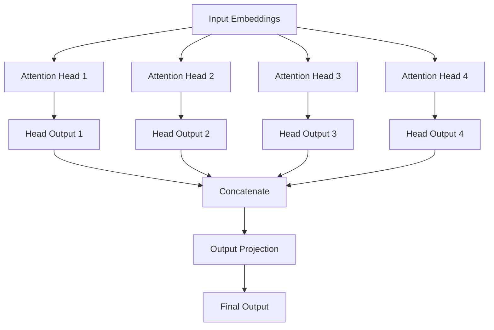
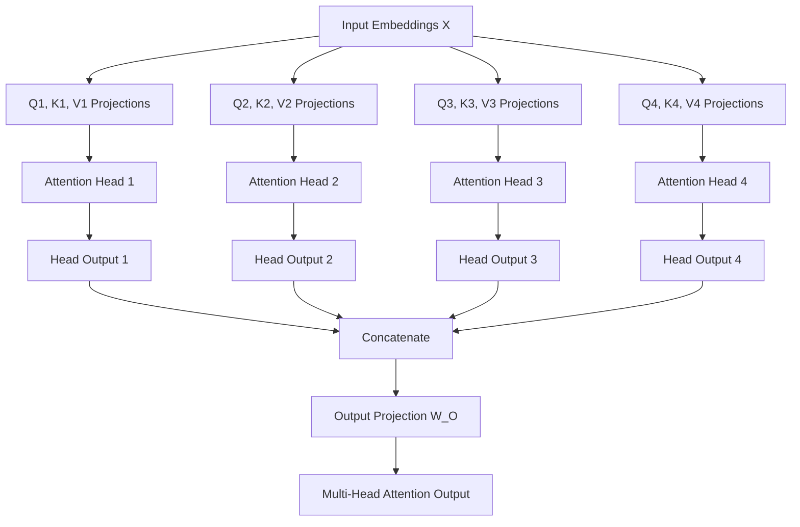

# Multi-Head Attention

Attention allows a model to use Queries, Keys, and Values to identify relevant information in an input sequence. In Self-Attention, every token can retrieve information from other tokens in the same sequence, allowing the model to construct contextualized representations.

However, there is an interesting limitation in the basic attention mechanism: a single attention operation calculates one attention distribution for each Query. This means that the model uses one learned set of Query, Key, and Value projections to determine which information is relevant and how that information should be combined.

Consider the sentence:

> The developer deployed the application because it was ready.

When processing the word `it`, the model needs to understand that it refers to `the application`. However, understanding a sentence involves much more than identifying references between words. The model may also need to understand grammatical relationships, semantic relationships, subject-object relationships, positional relationships, and other contextual patterns.

A single attention operation can learn to capture multiple relationships simultaneously, but it must represent all those relationships through the same attention calculation. This creates a limitation in how the model can independently represent different types of relationships.

**Multi-Head Attention addresses this limitation by allowing the model to perform multiple attention operations in parallel, with each operation learning its own Query, Key, and Value projections.**

Instead of calculating attention using one set of projections, the model creates multiple attention heads, where each head can learn to focus on different aspects of the input sequence. The outputs from all these heads are then combined to produce a richer representation.

This is one of the fundamental components of the Transformer architecture and is used extensively in modern LLMs.

## Why Do We Need Multi-Head Attention?

To understand why multiple attention heads are useful, let's first revisit what happens inside a single attention operation.

In standard Self-Attention, the model receives a sequence of input embeddings and generates Query, Key, and Value vectors using learned projection matrices. It then calculates attention scores between Queries and Keys, applies Softmax to obtain attention weights, and uses those weights to combine the corresponding Values.

The result is a contextualized representation for every token in the sequence.

The important point is that the entire process uses one set of learned projection matrices. Consequently, the model has one attention representation through which it must capture the relationships that matter for the task.

### Different Relationships Between Tokens

Consider the following sentence:

> The animal crossed the road because it was frightened.

When processing the word `it`, the model might need to understand several different relationships:

- **Reference relationship:** `It` refers to `animal`.
- **Grammatical relationship:** `Animal` is the subject associated with `crossed`.
- **Semantic relationship:** `Frightened` describes the emotional state of the animal.
- **Contextual relationship:** `Road` and `crossed` are related in the context of movement.

These relationships are not necessarily represented in the same way. For example, determining what a pronoun refers to is different from identifying a grammatical dependency or understanding the meaning of an action.

A model benefits from having multiple independent attention operations because they can learn different ways of representing and retrieving contextual information.

It is important to understand that we do not manually assign one head to grammatical relationships and another to semantic relationships. Instead, each attention head has its own learned parameters, and different heads may develop different attention patterns during training.

### The Core Idea

Multi-Head Attention takes the same input sequence and processes it through multiple attention heads in parallel. Every head has its own Query, Key, and Value projection matrices, allowing each head to calculate attention using a different learned representation of the input.

For example, if a model uses four attention heads, it performs four independent attention calculations using the same original input embeddings but different projection matrices.

<div style={{textAlign: 'center'}}>



</div>

Each head produces its own contextualized representation of the input sequence. The model then concatenates these representations and passes the combined result through another learned linear transformation to produce the final output.

The important distinction is that Multi-Head Attention does not simply calculate attention multiple times using identical parameters. Every head learns its own projections, which allows the heads to develop different representations and attention patterns.

## How Does Multi-Head Attention Work?

Now that we understand the motivation, let's examine the actual process. Multi-Head Attention can be understood through five major operations:

1. Generate independent Query, Key, and Value projections for each head.
2. Calculate attention independently within every head.
3. Combine the outputs of all heads through concatenation.
4. Apply a final output projection.
5. Pass the resulting representation to the next component of the Transformer.

Let's examine each operation in detail.

### Step 1: Input Embeddings

The process begins with a sequence of input embeddings. These embeddings are numerical representations of the tokens, and they provide the information that will be processed by the attention mechanism.

Suppose we have the following input sentence:

> I love machine learning.

Assume that the tokenizer produces four tokens, and the embedding dimension is 512. The input can therefore be represented as a matrix with four rows and 512 columns.

```text
Input Embeddings: X

Shape = 4 × 512

4    = Number of tokens
512  = Embedding dimension
```

Each row represents one token, while each column represents one dimension of its embedding.

The input matrix is shared across all attention heads. This means that every head receives the same original input representations, but each head processes them using its own learned projection matrices.

### Step 2: Generate Query, Key, and Value for Each Head

Every attention head needs its own Query, Key, and Value representations. These are generated by multiplying the original input embeddings by three learned projection matrices.

For a single head, the operations are:

```text
Q = X × W_Q
K = X × W_K
V = X × W_V
```

Here, `X` represents the input embedding matrix, while `W_Q`, `W_K`, and `W_V` represent the learned projection matrices associated with that head.

In Multi-Head Attention, every head has its own set of projection matrices. Therefore, if we have four attention heads, we have four independent sets of Query, Key, and Value projection matrices.

```text
Head 1:
Q1 = X × W_Q1
K1 = X × W_K1
V1 = X × W_V1

Head 2:
Q2 = X × W_Q2
K2 = X × W_K2
V2 = X × W_V2

Head 3:
Q3 = X × W_Q3
K3 = X × W_K3
V3 = X × W_V3

Head 4:
Q4 = X × W_Q4
K4 = X × W_K4
V4 = X × W_V4
```

Notice that all four heads use the same input matrix `X`, but their projection matrices are different. Because these matrices are learned independently, each head can transform the original token embeddings into a different representation space.

For example, one head might learn projections that produce useful representations for identifying relationships between nearby tokens, while another might learn projections that are useful for capturing relationships between tokens that are farther apart. These are illustrative possibilities rather than fixed responsibilities assigned to the heads.

### Understanding the Dimensions

Before proceeding, it is important to understand how the dimensions of these matrices are chosen.

In the original Transformer architecture, the model dimension is commonly represented by `d_model`, and the number of attention heads is represented by `h`.

The dimension of each individual head is calculated as:

```text
d_k = d_model / h
```

For the original Transformer configuration, consider:

```text
d_model = 512
h       = 8

d_k = 512 / 8
d_k = 64
```

This means that every attention head operates with a dimension of 64 rather than the full embedding dimension of 512.

The dimensions of the matrices for one attention head are therefore:

| Matrix                 | Shape    |
| ---------------------- | -------- |
| Input embeddings (X)   | 4 × 512  |
| Query projection (W_Q) | 512 × 64 |
| Key projection (W_K)   | 512 × 64 |
| Value projection (W_V) | 512 × 64 |
| Query output (Q)       | 4 × 64   |
| Key output (K)         | 4 × 64   |
| Value output (V)       | 4 × 64   |

The matrix multiplication works because the number of columns in the input matrix matches the number of rows in the projection matrix.

For example:

```text
X × W_Q

(4 × 512) × (512 × 64)

Result = 4 × 64
```

The resulting Query matrix contains one 64-dimensional Query vector for every token in the sequence.

The same process is performed independently for Keys and Values.

### Step 3: Calculate Attention Independently for Each Head

Once every head has generated its own Query, Key, and Value matrices, it performs the standard Scaled Dot-Product Attention operation.

The formula is:

```text
Attention(Q, K, V) = Softmax((Q × Kᵀ) / √d_k) × V
```

Each head performs this attention calculation independently using that head's own Query, Key, and Value matrices.

For example, with four heads:

```text
Head 1 Output = Attention(Q1, K1, V1)

Head 2 Output = Attention(Q2, K2, V2)

Head 3 Output = Attention(Q3, K3, V3)

Head 4 Output = Attention(Q4, K4, V4)
```

Each head produces an output matrix containing a contextualized representation for every token in the sequence.

Since the input sequence contains four tokens and each head operates with a dimension of 64, the output of every head has the following shape:

```text
Head Output Shape = 4 × 64
```

The outputs are calculated independently, which means that each head can learn a different attention distribution and use that distribution to retrieve different information from the sequence.

### Step 4: Concatenate the Outputs

After all attention heads have completed their calculations, their output matrices are combined using an operation called concatenation.

Concatenation means joining the outputs along their feature dimensions. It does not mean adding the matrices together or calculating their average.

Suppose we have four attention heads, each producing an output matrix of shape 4 × 64.

```text
Head 1 Output = 4 × 64
Head 2 Output = 4 × 64
Head 3 Output = 4 × 64
Head 4 Output = 4 × 64
```

When these matrices are concatenated along the feature dimension, the resulting matrix has the following shape:

```text
Concatenated Output = 4 × 256
```

This happens because the feature dimensions of all four heads are joined together:

```text
64 + 64 + 64 + 64 = 256
```

In the original Transformer configuration, eight heads each produce 64-dimensional representations. Concatenating all eight outputs therefore produces a representation with 512 dimensions.

```text
8 Heads × 64 Dimensions = 512 Dimensions
```

The sequence length remains unchanged because concatenation only combines the feature dimensions, not the token positions.

### Step 5: Apply the Output Projection

After concatenating the outputs, the model applies another learned linear transformation, commonly called the output projection.

The operation is:

```text
MultiHeadOutput = Concat(Head1, Head2, ..., Headh) × W_O
```

Here, `W_O` represents the output projection matrix.

In our four-head example, the concatenated representation has a dimension of 256. If the model dimension is 256, the output projection matrix has a shape of 256 × 256.

```text
Concatenated Output = 4 × 256

Output Projection = 256 × 256

Final Output = 4 × 256
```

The output projection allows the model to learn how information from different attention heads should be combined. Rather than simply keeping the outputs as separate blocks of features, the projection can mix information across all heads and transform the combined representation into the model's expected dimensional space.

This is an important part of Multi-Head Attention because the model does not necessarily want to preserve every head's output independently. It needs a mechanism to combine the information learned by different heads into one useful representation.

## Complete Multi-Head Attention Workflow

We can now put all the operations together.

The input embedding matrix is first transformed into separate Query, Key, and Value representations for every attention head. Each head independently performs Scaled Dot-Product Attention, producing its own contextualized output. These outputs are concatenated along the feature dimension and passed through a final output projection.

<div style={{textAlign: 'center'}}>



</div>

The complete mathematical formulation is:

```text
MultiHead(Q, K, V) =
    Concat(head_1, head_2, ..., head_h) × W_O
```

Where:

```text
head_i = Attention(Q × W_Qi, K × W_Ki, V × W_Vi)
```

This is the central mathematical idea behind Multi-Head Attention. Instead of relying on a single attention operation, the Transformer performs several independent attention operations and combines their outputs into a single representation.

## A Complete Numerical Example

Let's walk through a simplified example to make the process easier to understand. We will use a small input sequence with an embedding dimension of four and two attention heads, allowing us to examine the dimensions without dealing with unnecessarily large matrices.

Suppose our input contains two tokens:

> I learn.

Assume their embeddings are represented by the following matrix:

```text
X = [
    [1, 0, 1, 0],
    [0, 1, 0, 1]
]

Shape = 2 × 4
```

We will use two attention heads, each operating with a dimension of two.

```text
d_model = 4
h       = 2

d_k = 4 / 2 = 2
```

For simplicity, we will use identity-like projection matrices that select different pairs of input dimensions. These are illustrative matrices rather than learned parameters from a trained model.

**Head 1 projections:**

```text
W_Q1 = [
    [1, 0],
    [0, 1],
    [0, 0],
    [0, 0]
]
```

**Head 2 projections:**

```text
W_Q2 = [
    [0, 0],
    [0, 0],
    [1, 0],
    [0, 1]
]
```

For this simplified example, we will use the same matrices for the Key and Value projections within each head.

### Generate the Projections

For Head 1:

```text
Q1 = X × W_Q1

Q1 = [
    [1, 0],
    [0, 1]
]
```

For Head 2:

```text
Q2 = X × W_Q2

Q2 = [
    [1, 0],
    [0, 1]
]
```

Because we selected the first two dimensions for Head 1 and the last two dimensions for Head 2, both heads happen to produce identical numerical matrices for this particular input. However, their representations come from different input dimensions, which is the important distinction.

The Key and Value matrices are calculated in exactly the same way.

### Calculate Attention in Each Head

Each head now performs its own attention calculation.

For Head 1, the Query and Key matrices are:

```text
Q1 = [
    [1, 0],
    [0, 1]
]

K1 = [
    [1, 0],
    [0, 1]
]
```

The raw attention scores are calculated using:

```text
Scores1 = Q1 × K1ᵀ
```

Therefore:

```text
Scores1 = [
    [1, 0],
    [0, 1]
]
```

Because the head dimension is two, we divide the scores by the square root of two before applying Softmax.

The resulting attention weights are approximately:

```text
Attention Weights1 = [
    [0.67, 0.33],
    [0.33, 0.67]
]
```

This means that the first token assigns approximately 67% of its attention weight to itself and 33% to the second token. The second token assigns approximately 33% to the first token and 67% to itself.

The attention output is calculated by multiplying these weights by the Value matrix:

```text
Head Output 1 = Attention Weights1 × V1
```

Which produces approximately:

```text
Head Output 1 = [
    [0.67, 0.33],
    [0.33, 0.67]
]
```

Head 2 performs its own independent attention calculation using its own Query, Key, and Value projections. In this simplified example, it produces the same numerical output:

```text
Head Output 2 = [
    [0.67, 0.33],
    [0.33, 0.67]
]
```

In an actual trained model, different projection matrices can produce different attention distributions and outputs.

### Concatenate the Outputs

We now have two output matrices, each containing two tokens and two features.

```text
Head Output 1 = [
    [0.67, 0.33],
    [0.33, 0.67]
]

Head Output 2 = [
    [0.67, 0.33],
    [0.33, 0.67]
]
```

Concatenating them along the feature dimension gives:

```text
Concatenated Output = [
    [0.67, 0.33, 0.67, 0.33],
    [0.33, 0.67, 0.33, 0.67]
]
```

The resulting shape is 2 × 4, which matches our original model dimension.

### Apply the Output Projection

Finally, the concatenated representation is multiplied by the output projection matrix.

```text
Final Output = Concatenated Output × W_O
```

For this simplified example, we can assume that `W_O` is an identity matrix, meaning that the output remains unchanged.

The final result is therefore:

```text
Final Output = [
    [0.67, 0.33, 0.67, 0.33],
    [0.33, 0.67, 0.33, 0.67]
]
```

In a real Transformer, the output projection is learned during training and generally mixes information from the different heads.

The purpose of this example is not to demonstrate meaningful language understanding through two tokens. Instead, it illustrates how separate attention operations generate outputs, how those outputs are concatenated, and how the final projection produces a representation with the original model dimension.

## What Does Each Attention Head Learn?

One of the most interesting aspects of Multi-Head Attention is that different heads can develop different attention patterns even though they receive the same original input sequence.

During training, every head's projection matrices are updated through backpropagation. Since the heads have independent parameters, they can learn different ways to represent the input and calculate relationships between tokens.

For example, in a sentence such as:

> The engineer fixed the server because it had stopped responding.

Different attention heads might develop patterns that help capture:

- Relationships between pronouns and the nouns they refer to.
- Relationships between verbs and their subjects or objects.
- Relationships between words that frequently appear together.
- Dependencies between tokens that are far apart in the sequence.

These are possible patterns, not fixed responsibilities. The architecture does not explicitly instruct a particular head to identify pronouns or another head to identify verbs. Their behavior emerges from the training objective and the data.

It is also important to understand that attention heads are not necessarily independent in the broader sense of learning completely separate linguistic capabilities. Their outputs are combined through the output projection, and subsequent Transformer layers process the combined representations. The useful information produced by one head can therefore interact with information produced by other heads.

### Do Different Heads Always Learn Different Things?

Not necessarily. Although different heads have separate parameters, this does not guarantee that every head learns a completely unique pattern.

Some heads may learn similar attention distributions, while others may contribute relatively little to the final model output. Researchers have observed that attention heads can sometimes be redundant, which means that removing or combining certain heads may have little effect on model performance.

This is one reason why Multi-Head Attention should be understood as a way of increasing the model's capacity to learn different relationships, rather than as a guarantee that every head will discover a distinct linguistic function.

## Multi-Head Attention in the Transformer Architecture

Multi-Head Attention is not a standalone component used only once in a Transformer. It is part of the Transformer layer, and its output is combined with other neural network operations to progressively transform token representations.

In the original Transformer architecture, Multi-Head Attention is used in two important places:

1. Encoder Self-Attention.
2. Decoder Self-Attention and Encoder-Decoder Cross-Attention.

### Multi-Head Self-Attention in the Encoder

In the Transformer encoder, each token can attend to every other token in the input sequence. This allows the encoder to construct contextualized representations using information from the entire input.

For example, when processing a sentence, a token appearing near the beginning can retrieve information from a token appearing near the end, provided that the attention mechanism assigns it a suitable weight.

The encoder's Multi-Head Self-Attention therefore operates on the same input sequence for Queries, Keys, and Values.

### Masked Multi-Head Self-Attention in the Decoder

The decoder in an autoregressive language model, such as GPT, uses causal masking to prevent a token from accessing information from future positions.

Consider:

> I love building software.

When predicting the next token after `I love`, the model must not use information from `building` or `software`, because those tokens are not yet available during generation.

The attention mechanism therefore applies a causal mask that prevents future positions from contributing to the attention calculation.

This masking is applied within every attention head, ensuring that all heads follow the same autoregressive constraint.

### Cross-Attention in the Original Encoder-Decoder Transformer

In the original Transformer architecture, decoder layers also contain an additional Multi-Head Cross-Attention operation.

In this operation, the decoder's current representations generate the Queries, while the encoder's output representations generate the Keys and Values. This allows the decoder to retrieve relevant information from the original input sequence while generating its output.

This is particularly useful in sequence-to-sequence tasks such as machine translation.

An important distinction is that the original Transformer uses encoder-decoder Cross-Attention, whereas decoder-only architectures such as GPT generally do not have a separate encoder and therefore do not use this particular Cross-Attention block.

## Multi-Head Attention vs Single-Head Attention

Now that we understand the complete workflow, let's compare Multi-Head Attention with a standard single-head attention operation.

| Property                       | Single-Head Attention             | Multi-Head Attention                           |
| ------------------------------ | --------------------------------- | ---------------------------------------------- |
| Number of attention operations | One                               | Multiple                                       |
| Projection matrices            | One set of Q, K, V                | Separate sets for every head                   |
| Attention distributions        | One per token                     | Multiple per token                             |
| Representation capacity        | Uses one attention representation | Combines multiple attention representations    |
| Output                         | One contextualized representation | Concatenated and projected representations     |
| Computational cost             | Lower                             | Higher than a comparable single-head operation |

The key advantage of Multi-Head Attention is that it gives the model multiple learned representation spaces through which it can examine relationships between tokens. This can make it easier to capture different contextual patterns without requiring a single attention operation to represent everything.

However, Multi-Head Attention also requires additional projection parameters and introduces more computation than using a single head with the same full dimensionality.

## Computational Complexity and Efficiency

Multi-Head Attention performs multiple attention calculations, so it is important to understand how the number of heads affects computational requirements.

Suppose a model has:

```text
Sequence length = n
Model dimension = d_model
Number of heads = h
Head dimension = d_model / h
```

Every head calculates an attention score matrix containing `n × n` entries. Since there are `h` heads, the combined attention score matrices contain:

```text
Total attention score entries = h × n × n
```

However, each head operates on a smaller feature dimension. When the total model dimension is kept constant, the overall computational complexity of the attention matrix operations remains approximately:

```text
Complexity = O(n² × d_model)
```

This is an important distinction: increasing the number of heads does not automatically multiply the overall attention computation by the number of heads when the model dimension remains fixed, because the dimension allocated to each head decreases accordingly.

In practice, there are still additional costs associated with managing multiple heads, including separate attention score matrices and intermediate representations. Memory consumption and implementation efficiency also depend on the exact attention implementation.

The most significant computational limitation remains the quadratic dependence on sequence length, because every token potentially attends to every other token.

## Important Design Considerations

### Why Not Use One Very Large Attention Head?

One might wonder why the Transformer does not simply use a single attention head with the entire model dimension instead of splitting it into multiple smaller heads.

A single large attention head can theoretically represent complex relationships, but it must use one attention distribution for each Query to retrieve and combine information. Multiple heads allow the model to calculate several attention distributions independently and combine their results afterward.

This provides a more flexible representation mechanism because different heads can learn different projection spaces and attend to different parts of the input.

### Why Is the Number of Heads Usually a Hyperparameter?

The number of attention heads is a design choice made when configuring a Transformer architecture. It is not something the model generally decides dynamically for each input.

For example, a Transformer configuration might use:

```text
Model dimension = 768
Number of heads = 12

Dimension per head = 768 / 12
                   = 64
```

Changing the number of heads changes the dimension allocated to each head when the overall model dimension is fixed.

A larger number of heads creates more separate attention operations with smaller per-head dimensions, while a smaller number of heads creates fewer operations with larger per-head dimensions. The best configuration depends on the architecture, model size, training setup, and computational constraints.

### Can We Keep Increasing the Number of Heads?

Increasing the number of heads indefinitely is not necessarily beneficial. When the model dimension is fixed, increasing the number of heads reduces the dimension available to each head.

If the head dimension becomes too small, each individual head has less representational capacity. Furthermore, additional heads introduce overhead, and some heads may learn redundant patterns.

Consequently, the number of heads is selected as part of the model architecture rather than increased without limit.

## Summary

Multi-Head Attention extends the standard attention mechanism by performing multiple independent attention operations in parallel. Every head receives the same original input embeddings but uses its own learned Query, Key, and Value projection matrices, allowing different heads to learn different ways of representing and retrieving contextual information.

The outputs of all heads are concatenated along the feature dimension and passed through a learned output projection. This produces a combined representation that incorporates information from all the attention heads while maintaining the model's expected embedding dimension.

The complete workflow is:

```text
Input Embeddings
       |
       v
Generate Q, K, V for each head
       |
       v
Perform independent attention calculations
       |
       v
Collect all head outputs
       |
       v
Concatenate the outputs
       |
       v
Apply output projection
       |
       v
Final Multi-Head Attention Output
```

The most important concepts from this lecture are:

| Concept           | Explanation                                                                     |
| ----------------- | ------------------------------------------------------------------------------- |
| Attention Head    | An independent attention operation with its own learned Q, K, and V projections |
| Multiple Heads    | Allow the model to learn different attention patterns in parallel               |
| Head Dimension    | The feature dimension allocated to each attention head                          |
| Concatenation     | Combines the output features from all attention heads                           |
| Output Projection | Learns how to mix the information from different heads                          |
| Causal Masking    | Prevents decoder attention heads from accessing future tokens                   |

The central mathematical formulation is:

```text
MultiHead(Q, K, V) =
    Concat(head_1, head_2, ..., head_h) × W_O
```

Where each head independently calculates:

```text
head_i = Attention(Q × W_Qi, K × W_Ki, V × W_Vi)
```

**The central takeaway is that Multi-Head Attention allows a Transformer to examine the same input sequence through multiple learned attention representations and combine the resulting information into a richer contextual representation.**
