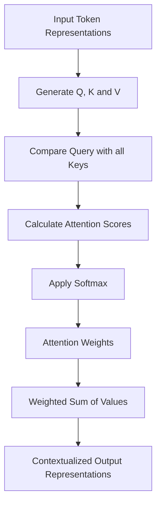
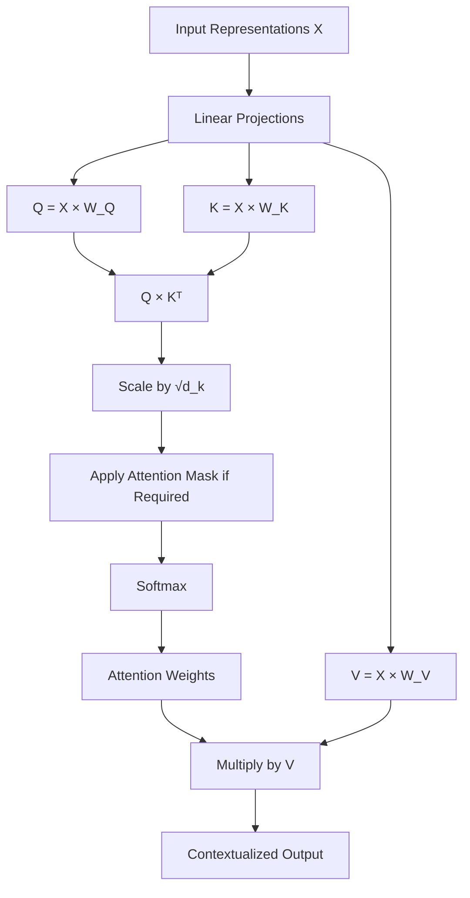

# Self-Attention

Self-Attention is one of the fundamental mechanisms used in Transformer architectures. It allows a model to understand relationships between different tokens in a sequence by letting each token examine the other tokens and retrieve information that is relevant to its meaning. Instead of processing words independently or relying only on their immediate neighbours, Self-Attention allows every token to gather contextual information from other positions in the same sequence.

Consider the sentence:

> The developer deployed the application because it was ready.

To understand this sentence correctly, a model needs to understand what the word `it` refers to. The word `it` is connected to `the application`, and understanding that relationship requires looking beyond the immediately preceding word. A mechanism that only considers nearby words may struggle to capture this relationship, especially when the relevant information is separated by several tokens.

Self-Attention addresses this problem by allowing each token to calculate how relevant every other token is to its own representation. For example, when processing `it`, the model can assign a higher attention score to `application` because that token provides useful contextual information for understanding the pronoun.

The important idea is that each token starts with its own representation, examines the representations of other tokens, calculates their relevance, and combines their information to produce a new representation. This new representation contains information about the token itself as well as relevant information gathered from the surrounding sequence.

The term Self-Attention describes where the attention operation takes place: the Queries, Keys, and Values are all generated from the same input sequence. This is what distinguishes Self-Attention from Cross-Attention, where Queries come from one sequence and Keys and Values come from another.

## Why Do We Need Self-Attention?

### Understanding Words Requires Context

The meaning of a word often depends on the other words around it. A word does not always have a fixed meaning that can be understood independently of its sentence.

Consider the following two sentences:

> The bank approved the loan.
>
> We sat beside the river bank.

The word `bank` appears in both sentences, but its meaning is different. In the first sentence, it refers to a financial institution, whereas in the second sentence, it refers to the land beside a river.

A language model needs to produce different representations of `bank` depending on the context in which it appears. If the model represents every occurrence of `bank` using exactly the same information, it will not adequately capture the difference between these meanings.

Self-Attention allows the representation of `bank` to incorporate information from other tokens in the sentence. In the first sentence, it can gather information from `approved` and `loan`, while in the second sentence, it can gather information from `river` and `sat`. These surrounding tokens provide different contextual clues, allowing the model to construct different representations of the same word.

This is an important property of Self-Attention: a token's representation can change depending on the other tokens in the sequence.

### Understanding Relationships Between Distant Tokens

Relationships between words are not necessarily limited to neighbouring positions. A token may depend on information that appears much earlier or later in the sentence.

Consider:

> The animal crossed the road because it was frightened.

To understand the sentence, the model needs to recognize that `it` refers to `the animal`. These two tokens are separated by several other words, but they have a meaningful relationship.

A model that relies only on nearby tokens may need several processing steps to propagate information from `animal` to `it`. Self-Attention provides a more direct way to establish this relationship because every token can examine every other token in the sequence during the same attention operation.

When processing `it`, the model can assign a high attention weight to `animal` and use its information to construct a more context-aware representation of `it`.

This ability to connect distant tokens is particularly useful when processing long sentences, paragraphs, and documents, where important information may appear far away from the token currently being processed.

### Building Contextual Representations

The objective of Self-Attention is not simply to identify which words are related. It also uses those relationships to update the representation of each token.

Suppose a sentence contains the following tokens:

> The developer deployed the application.

Each token initially has its own representation. However, the representation of `deployed` becomes more informative when it incorporates information from `developer` and `application`. Similarly, the representation of `application` can incorporate information from `deployed` to understand what happened to it.

Self-Attention performs this contextualization for every token in the sequence. Each token calculates its own attention distribution and uses it to gather information from the other tokens.

As a result, the output is not simply a collection of independent word representations. It is a collection of contextualized representations in which each token can contain information about other relevant tokens.

## Understanding the Core Idea

Before looking at the mathematical operations, it is useful to understand the complete process conceptually.

Self-Attention takes a sequence of token representations as input. For every token, it generates three vectors called Query, Key, and Value. These vectors serve different purposes in the attention calculation.

- **Query:** Represents what the current token is looking for in the other tokens.
- **Key:** Represents what information a token can be matched against.
- **Value:** Represents the actual information that a token contributes when another token attends to it.

The model compares the Query of a token with the Keys of all tokens in the sequence. These comparisons produce attention scores, which indicate how relevant each token is to the current token.

The scores are then passed through Softmax to convert them into attention weights. These weights determine how much information should be gathered from each token's Value vector.

Finally, the model calculates a weighted sum of the Value vectors to produce the output representation for the current token.

This process is repeated for every token in the sequence. Therefore, every token gets its own attention distribution and its own output representation.

### A Simple Example

Consider the sentence:

> The developer deployed the application.

Suppose the model is currently calculating the new representation for the word `deployed`.

Its Query vector represents the information that `deployed` is looking for. The model compares this Query with the Key vectors of all tokens:

- `The`
- `developer`
- `deployed`
- `the`
- `application`

These comparisons produce scores that indicate how relevant each token is to `deployed`.

For example, the model might assign higher attention weights to `developer` and `application` because they provide useful information about the action being described.

The model then uses these weights to combine the corresponding Value vectors. The resulting representation of `deployed` contains information gathered from the other relevant tokens.

The same process happens independently for `The`, `developer`, `the`, and `application`. Each token has its own Query and therefore its own attention distribution.

The following diagram illustrates the overall idea:

<div style={{textAlign: 'center'}}>



</div>

## How Does Self-Attention Work?

Now that the conceptual process is clear, we can examine the mathematical operations involved in Self-Attention.

Consider an input sequence containing `N` tokens. Each token is represented by a vector of dimension `d_model`.

The input can be represented as a matrix `X` with dimensions:

```text
N × d_model
```

Each row of `X` represents one token, and each column represents one feature of that token's representation.

For example, if a sequence contains four tokens and each token has a representation of dimension 4, the input matrix will have dimensions:

```text
4 × 4
```

The Self-Attention operation transforms this input matrix into a new matrix containing contextualized representations of all the tokens.

It performs this transformation through the following steps.

### Step 1: Generate Query, Key, and Value Matrices

The first step is to generate Query, Key, and Value vectors for every token in the input sequence.

These vectors are generated by multiplying the input matrix `X` with three separate learnable weight matrices:

```text
Q = X × W_Q
K = X × W_K
V = X × W_V
```

Here:

- `X` represents the input token representations.
- `W_Q` represents the Query projection weight matrix.
- `W_K` represents the Key projection weight matrix.
- `W_V` represents the Value projection weight matrix.
- `Q` represents the resulting Query matrix.
- `K` represents the resulting Key matrix.
- `V` represents the resulting Value matrix.

The three weight matrices are learned during model training. They allow the model to transform the original token representations into three different representation spaces, each serving a different purpose in the attention operation.

The Query matrix contains one Query vector for each input token. The Key matrix contains one Key vector for each input token, and the Value matrix contains one Value vector for each input token.

If the input matrix has dimensions `N × d_model` and the Query, Key, and Value dimensions are `d_k`, `d_k`, and `d_v` respectively, then the resulting dimensions are:

- `Q`: `N × d_k`
- `K`: `N × d_k`
- `V`: `N × d_v`

For simplicity, many explanations use the same dimension for all three projections.

An important detail is that every token produces its own Query, Key, and Value vectors, but the projection weight matrices are shared across all token positions within the same attention layer.

This means the model does not learn a separate Query projection matrix for every word. Instead, it applies the same learned transformation to every token representation.

### Step 2: Calculate Attention Scores

After generating the Query and Key matrices, the next step is to calculate how relevant each token is to every other token.

This is done by multiplying the Query matrix `Q` with the transpose of the Key matrix `K`.

```text
Attention Scores = Q × Kᵀ
```

The transpose is required because we want to compare every Query vector against every Key vector.

If `Q` has dimensions `N × d_k` and `K` has dimensions `N × d_k`, then `Kᵀ` has dimensions `d_k × N`.

Therefore:

```text
Attention Scores = (N × d_k) × (d_k × N)
```

The resulting attention score matrix has dimensions:

```text
N × N
```

Each row represents one Query token, and each column represents one Key token.

The value at position `(i, j)` represents the similarity between the Query of token `i` and the Key of token `j`. A higher score generally means that token `j` is more relevant to token `i` according to the learned representations.

For example, consider the sentence:

> The developer deployed the application.

The attention score matrix contains a score for every possible Query-Key pair. The row corresponding to `deployed` contains scores indicating how strongly `deployed` relates to `The`, `developer`, `deployed`, `the`, and `application`.

This calculation is performed for every token simultaneously through matrix multiplication.

#### Understanding the Attention Score Matrix

For a sequence of four tokens, the attention score matrix will have four rows and four columns.

```text
                 Keys
             The  developer  deployed  application

Queries  The   s11    s12       s13        s14
         developer
               s21    s22       s23        s24
         deployed
               s31    s32       s33        s34
         application
               s41    s42       s43        s44
```

Each row tells us how one token relates to all tokens in the sequence.

For example:

- Row 1 contains the attention scores for the Query of `The`.
- Row 2 contains the attention scores for the Query of `developer`.
- Row 3 contains the attention scores for the Query of `deployed`.
- Row 4 contains the attention scores for the Query of `application`.

The diagonal entries represent a token comparing its own Query with its own Key. These comparisons are included in ordinary Self-Attention because a token is allowed to attend to itself.

At this stage, the matrix contains raw scores rather than normalized attention weights. The next step converts these scores into weights that can be used to combine the Value vectors.

### Step 3: Scale the Attention Scores

Before applying Softmax, the attention scores are divided by the square root of the Key dimension.

```text
Scaled Scores = (Q × Kᵀ) / √d_k
```

This scaling operation is important because the magnitude of dot-product scores can become large when the dimensionality of the Query and Key vectors increases.

When the scores become very large, Softmax can produce probabilities that are extremely close to zero or one. In such situations, the resulting distribution becomes highly concentrated, and the gradients used during training can become very small.

Dividing the scores by `√d_k` helps control their magnitude and makes the Softmax operation more stable.

For example, if the Key dimension is 64, the scaling factor is:

```text
√d_k = √64 = 8
```

Every attention score is therefore divided by 8 before applying Softmax.

This scaling operation is a defining part of Scaled Dot-Product Attention, which is the attention calculation commonly used in Transformer architectures.

### Step 4: Apply Softmax to Obtain Attention Weights

After scaling the attention scores, the next step is to apply Softmax.

Softmax converts a collection of raw scores into probabilities that sum to 1.

For each Query token, Softmax is applied across the scores corresponding to all available Key tokens.

The formula is:

```text
Softmax(x_i) = exp(x_i) / Σ_j exp(x_j)
```

Here, `x_i` is one scaled attention score, and the denominator is the sum of the exponentials of all scores in the same row.

The operation is applied independently to each row of the attention score matrix.

For example, suppose the scaled attention scores for the Query of `deployed` are:

```text
[1.2, 2.5, 1.0, 2.0]
```

After applying Softmax, we might get an attention distribution similar to:

```text
[0.13, 0.47, 0.11, 0.29]
```

The exact values depend on the input scores, but the important property is that all weights are non-negative and their sum is 1.

These weights tell us how much information the current token should gather from each token's Value vector.

In this example, the Query corresponding to `deployed` assigns the highest attention weight to `developer`. This means that, according to the learned representations, `developer` contributes the largest share of information to the new representation of `deployed`.

The attention weight matrix has the same dimensions as the original attention score matrix:

```text
N × N
```

Each row contains a probability distribution over the tokens that the corresponding Query is allowed to attend to.

### Step 5: Calculate the Weighted Sum of Value Vectors

Once the attention weights have been calculated, the model uses them to combine the Value vectors.

The output of Self-Attention is calculated as:

```text
Attention Output = Attention Weights × V
```

Using the complete expression:

```text
Attention Output = Softmax((Q × Kᵀ) / √d_k) × V
```

The dimensions of this operation are:

- Attention Weights: `N × N`
- `V`: `N × d_v`
- Output: `N × d_v`

Each row of the output matrix represents the new contextualized representation of one token.

To understand this operation, suppose the attention weights for a particular token are:

```text
[0.10, 0.50, 0.15, 0.25]
```

The corresponding Value vectors are:

```text
V1, V2, V3, V4
```

The output representation is calculated as:

```text
Output = 0.10 × V1 + 0.50 × V2 + 0.15 × V3 + 0.25 × V4
```

This means the output contains 10% of the information from the first Value vector, 50% from the second, 15% from the third, and 25% from the fourth.

The model performs this weighted sum independently for every Query token.

Consequently, every token receives a new representation containing information from the other tokens, with the amount of information gathered from each token determined by its attention weights.

This completes the fundamental Self-Attention operation.

## A Complete Numerical Example

The previous section explained the mathematical operations involved in Self-Attention. In this section, we will walk through a small numerical example so that every calculation is clear.

To keep the calculations manageable, consider the following two-token input sequence:

> I learn.

Assume that each token is represented by a vector of dimension 2.

The input matrix is:

```text
X =

[1  0]
[0  1]
```

The first row represents `I`, and the second row represents `learn`.

For this example, assume the following projection matrices:

```text
W_Q =

[1  0]
[0  1]


W_K =

[1  0]
[0  1]


W_V =

[1  0]
[0  1]
```

These identity matrices are chosen only to simplify the arithmetic. In a real Transformer, the projection matrices contain learned values.

### Generate the Projections

We first calculate the Query matrix:

```text
Q = X × W_Q
```

Since `W_Q` is an identity matrix:

```text
Q =

[1  0]
[0  1]
```

Similarly, the Key matrix is:

```text
K = X × W_K
```

```text
K =

[1  0]
[0  1]
```

Finally, the Value matrix is:

```text
V = X × W_V
```

```text
V =

[1  0]
[0  1]
```

We now have Query, Key, and Value vectors for both tokens.

### Calculate the Attention Scores

The next step is to multiply `Q` with the transpose of `K`.

```text
Attention Scores = Q × Kᵀ
```

Since `K` is:

```text
K =

[1  0]
[0  1]
```

Its transpose is:

```text
Kᵀ =

[1  0]
[0  1]
```

Now calculate the multiplication:

```text
Attention Scores =

[1  0]   [1  0]   [1  0]
[0  1] × [0  1] = [0  1]
```

The resulting attention score matrix is:

```text
[1  0]
[0  1]
```

The first token has a score of 1 against itself and 0 against the second token. The second token has a score of 1 against itself and 0 against the first token.

### Scale the Attention Scores

The Query and Key dimensions are both 2, so:

```text
d_k = 2

√d_k = √2 ≈ 1.414
```

We divide every attention score by 1.414:

```text
Scaled Scores =

[1/1.414   0/1.414]
[0/1.414   1/1.414]
```

Therefore:

```text
Scaled Scores =

[0.707   0]
[0       0.707]
```

### Apply Softmax

Softmax is applied independently to each row.

For the first row:

```text
Softmax([0.707, 0])
```

The exponential values are approximately:

- `exp(0.707) = 2.028`
- `exp(0) = 1`

Their sum is:

```text
2.028 + 1 = 3.028
```

The resulting probabilities are:

- `2.028 / 3.028 ≈ 0.670`
- `1 / 3.028 ≈ 0.330`

The same calculation applies to the second row, with the probabilities appearing in the opposite order.

The attention weight matrix becomes:

```text
[0.670   0.330]
[0.330   0.670]
```

This matrix tells us that the first token assigns approximately 67% of its attention to itself and 33% to the second token. The second token assigns approximately 33% of its attention to the first token and 67% to itself.

### Calculate the Weighted Sum of Values

The final step is to multiply the attention weight matrix with the Value matrix.

```text
Attention Output = Attention Weights × V
```

```text
[0.670   0.330]   [1  0]
[0.330   0.670] × [0  1]
```

The resulting output is:

```text
[0.670   0.330]
[0.330   0.670]
```

Therefore, the final contextualized representations are:

- The new representation of `I` is `[0.670, 0.330]`.
- The new representation of `learn` is `[0.330, 0.670]`.

Notice that the original representations were:

- `I`: `[1, 0]`
- `learn`: `[0, 1]`

After Self-Attention, both representations contain information from both tokens. The first token retains a larger contribution from its own original Value vector, while the second token also retains a larger contribution from its own original Value vector.

This example demonstrates the complete mathematical process, from generating `Q`, `K`, and `V` to calculating the final contextualized representations.

In a real Transformer, the projection matrices are learned, the input representations are much larger, and the sequence can contain hundreds or thousands of tokens. However, the underlying calculation remains the same.

## Understanding the Output of Self-Attention

One of the most important things to understand about Self-Attention is what actually changes after the operation.

The input to Self-Attention consists of token representations that contain information from the embedding process and, depending on the architecture, positional information. The output consists of new representations that incorporate contextual information gathered from the sequence.

This means that the output representation of a token is not simply its original embedding. It is a weighted combination of the Value vectors produced from the input representations.

### Does Self-Attention Change the Original Embedding?

Yes, but it is important to understand exactly what this means.

Self-Attention does not directly modify the original token embedding. Instead, it uses the input representations to generate Query, Key, and Value vectors, and then calculates new contextualized representations from the Values.

For example, suppose the original representation of `bank` is the same in two different sentences. After Self-Attention, its output representation can differ because the surrounding tokens are different.

Consider:

> The bank approved the loan.
>
> We sat beside the river bank.

In the first sentence, the representation of `bank` can gather information from `approved` and `loan`. In the second sentence, it can gather information from `river` and `beside`.

The resulting representations can therefore encode different contextual meanings, even though the same word appears in both sentences.

### Does Every Token Attend to Every Other Token?

In standard unmasked Self-Attention, yes. Every token can attend to every token in the same sequence, including itself.

For a sequence containing `N` tokens, each Query is compared against `N` Keys. This creates `N × N` attention scores.

However, not every Transformer architecture allows unrestricted attention. Some architectures use masks to prevent certain tokens from accessing information from particular positions.

For example, a decoder used for autoregressive language generation cannot allow a token to attend to future tokens because those tokens have not yet been generated. This restriction is implemented using a Causal Mask, which we will examine later.

### Can a Token Ignore Other Tokens?

Yes. The attention weights determine how much information each token gathers from the others.

If a token assigns a very small attention weight to another token, that token contributes very little to its output representation. If the attention weight is close to zero, its contribution is almost negligible.

This allows the model to focus on relevant information without treating every token as equally important.

However, an attention weight should not always be interpreted as a direct explanation of the model's reasoning. It describes the contribution of a Value vector in a particular attention operation, but the complete model may combine information across many layers and attention heads.

## Positional Information in Self-Attention

An important characteristic of Self-Attention is that its core operation does not inherently understand the order of tokens.

The attention calculation compares Query and Key vectors and combines Value vectors. If the input representations contain no positional information, the operation has no explicit way to distinguish whether one token appeared before or after another.

Consider these two sequences:

> The dog chased the cat.
>
> The cat chased the dog.

The same words appear in both sentences, but their order changes the meaning significantly.

If a model receives only token representations without any information about their positions, Self-Attention alone cannot adequately represent this difference in word order.

To address this problem, Transformer architectures incorporate positional information into token representations.

### Positional Encoding

In the original Transformer architecture, positional encodings are added to the token embeddings before they are passed into the encoder or decoder.

The input representation is calculated as:

```text
Input Representation = Token Embedding + Positional Encoding
```

The token embedding represents the token's identity and learned semantic information, while the positional encoding provides information about where the token appears in the sequence.

For example, the representation of `dog` at position 2 will be different from the representation of `dog` at position 5 because the positional information is different.

The original Transformer used sinusoidal positional encodings based on sine and cosine functions of different frequencies.

For a position `pos` and embedding dimension index `i`:

```text
PE(pos, 2i) = sin(pos / 10000^(2i / d_model))

PE(pos, 2i + 1) = cos(pos / 10000^(2i / d_model))
```

The purpose of these functions is to provide each position with a distinct pattern of values that the model can use to identify token positions and relationships between positions.

Modern Transformer architectures use several other approaches to positional information, including learned positional embeddings and Rotary Positional Embeddings (RoPE). These approaches differ in how positional information is represented and incorporated into attention.

The important concept is that Self-Attention needs access to positional information if the model is expected to understand the order of tokens.

## Masking in Self-Attention

Masking is a technique used to restrict which tokens can participate in the attention calculation.

The attention score matrix contains a score for every Query-Key pair. By applying a mask before Softmax, the model can prevent certain positions from receiving attention.

The most common examples are Padding Masks and Causal Masks.

### Padding Mask

When processing a batch of sequences, models often need to make all sequences the same length because matrix operations work more conveniently with consistent dimensions.

Consider two sequences:

> The developer writes code.
>
> The engineer builds software today.

Suppose the first sequence contains four tokens and the second contains five tokens. The shorter sequence can be padded with a special token so that both sequences have the same length.

```text
Sequence 1: The developer writes code
Sequence 2: The engineer builds software today

After padding:

Sequence 1: The developer writes code [PAD]
Sequence 2: The engineer builds software today
```

The padding token exists only to make the sequence lengths consistent. It does not contain meaningful language information that should influence the representations of the actual tokens.

A Padding Mask prevents the model from attending to these padding positions.

The mask is applied to the attention scores before Softmax. Scores corresponding to padding positions are replaced with negative infinity, so their Softmax probabilities become zero.

This ensures that padding tokens do not contribute information to the attention output.

### Causal Mask

A Causal Mask is used when a model needs to generate a sequence one token at a time without accessing future tokens.

Consider the sequence:

> The developer deployed the application.

Suppose the model is generating this sentence from left to right. When it is processing the token `deployed`, it can use information from:

- `The`
- `developer`
- `deployed`

However, it must not use information from:

- `the`
- `application`

Those future tokens have not been generated yet.

If the model could attend to future tokens during training, it would gain access to information that would not be available during actual text generation. This would create a mismatch between training and inference.

A Causal Mask prevents this by allowing each token to attend only to itself and earlier positions.

For a sequence of four tokens, the attention mask can be represented as:

```text
                 Keys
             1    2    3    4

Queries  1   1    0    0    0
         2   1    1    0    0
         3   1    1    1    0
         4   1    1    1    1
```

A value of 1 indicates that attention is allowed, while 0 indicates that attention is blocked.

The corresponding attention score positions that are blocked are replaced with negative infinity before Softmax.

The resulting attention weights have the following structure:

```text
[1.00   0.00   0.00   0.00]
[0.45   0.55   0.00   0.00]
[0.20   0.30   0.50   0.00]
[0.10   0.20   0.25   0.45]
```

These values are illustrative. The important property is that every row assigns zero attention weight to future positions.

The first token can only attend to itself. The second token can attend to the first and second tokens. The third token can attend to the first three tokens, and so on.

This is how decoder-only language models preserve the left-to-right generation constraint.

### Padding Mask vs Causal Mask

Although both techniques modify the attention calculation, they solve different problems.

| Aspect            | Padding Mask                 | Causal Mask                     |
| ----------------- | ---------------------------- | ------------------------------- |
| Purpose           | Ignore padding tokens        | Prevent access to future tokens |
| Common use        | Batched sequence processing  | Autoregressive generation       |
| Restriction       | Blocks padding positions     | Blocks future positions         |
| Attention pattern | Depends on padding locations | Lower-triangular pattern        |

Some architectures apply both masks simultaneously. For example, a decoder may need to prevent attention to future positions while also ignoring padding tokens.

## Where Is Self-Attention Used?

Self-Attention is used in different parts of Transformer architectures. The attention operation itself remains the same, but the rules governing which tokens can attend to one another depend on the task and the architecture.

### Bidirectional Self-Attention

In bidirectional Self-Attention, every token can attend to every other token in the sequence, including tokens that appear both before and after it.

Consider:

> The developer deployed the application because it was ready.

When processing `it`, the model can access information from both earlier and later positions. It can use information from `application` and `ready` to construct a contextualized representation.

This is useful for tasks where the model needs to understand the complete input rather than generate it one token at a time.

BERT is a well-known example of a model that uses bidirectional Self-Attention.

### Causal Self-Attention

Causal Self-Attention restricts each token to attending only to itself and earlier tokens.

This is necessary for autoregressive language models that generate text from left to right.

For example, when predicting the next token after:

> The developer deployed

the model can use the representations of `The`, `developer`, and `deployed`, but it cannot use information from tokens that have not yet been generated.

GPT-style decoder-only models use causal Self-Attention to enforce this restriction.

### Self-Attention in an Encoder-Decoder Architecture

In the original Transformer encoder-decoder architecture, Self-Attention is used in both the encoder and decoder.

The encoder uses bidirectional Self-Attention to build contextual representations of the input sequence.

The decoder uses causal Self-Attention to process the output tokens generated so far. It also uses a separate attention operation to retrieve information from the encoder's output.

This allows the decoder to understand its generated sequence while also consulting the original input.

The distinction between these operations is important:

- Encoder Self-Attention operates within the encoder input sequence.
- Decoder Self-Attention operates within the decoder sequence and uses a causal mask.
- Encoder-Decoder Cross-Attention connects the decoder to the encoder output.

## Computational Complexity of Self-Attention

Self-Attention is powerful because every token can directly interact with every other token. However, this flexibility comes with a computational cost that becomes significant as sequence length increases.

For a sequence containing `N` tokens, the attention score matrix has dimensions:

```text
N × N
```

This means that the number of Query-Key comparisons grows quadratically with the sequence length.

The main attention calculation involves:

```text
Attention Scores = Q × Kᵀ
```

If the Query and Key dimensions are `d_k`, this operation has a computational complexity of approximately:

```text
O(N² × d_k)
```

The weighted sum of Values also requires approximately:

```text
O(N² × d_v)
```

Therefore, the overall attention calculation has quadratic dependence on sequence length.

### Why Does Sequence Length Matter?

Suppose a model processes a sequence of 1,000 tokens.

The attention score matrix contains:

```text
1,000 × 1,000 = 1,000,000 scores
```

If the sequence length increases to 2,000 tokens, the matrix contains:

```text
2,000 × 2,000 = 4,000,000 scores
```

Doubling the sequence length results in four times as many attention scores.

This quadratic growth affects both computation and memory consumption because the model needs to calculate and process a much larger attention matrix.

### Why Is This a Problem for Large Language Models?

Large language models frequently process long contexts containing thousands or even hundreds of thousands of tokens.

As the context length increases, the attention calculation becomes increasingly expensive. This can increase GPU memory requirements, computation time, and inference costs.

Several techniques have been developed to address these limitations, including FlashAttention, Sparse Attention, Sliding Window Attention, and other memory-efficient attention approaches.

These methods aim to reduce the cost of calculating or storing attention information while preserving as much useful contextual information as possible.

## Important Design Considerations

### Why Can Every Token Attend to Itself?

In standard Self-Attention, a token is allowed to attend to its own representation.

This is useful because the model should not discard the information already contained in the token when constructing its contextualized representation.

The token's own Value vector contributes to the weighted sum, allowing the resulting representation to retain information from the token itself alongside information gathered from other positions.

The model learns how much attention to assign to itself and the other tokens through its learned projection matrices.

### Are Attention Weights the Same as Similarity Scores?

No. Attention scores and attention weights are related, but they are not the same.

Attention scores are calculated using the dot product between Queries and Keys. They are raw values that can be positive, negative, or zero.

Attention weights are produced after applying Softmax to the scaled attention scores. They are non-negative and sum to 1 across the allowed positions in each row.

The attention scores determine the relative preference between tokens, while the attention weights determine how much each Value vector contributes to the final representation.

### Does Self-Attention Understand the Meaning of Words?

Self-Attention does not independently understand language in the human sense. It performs learned mathematical operations over token representations.

During training, the model adjusts its projection matrices so that the attention mechanism can identify useful relationships for the language-modeling or other training objectives.

The resulting representations can capture semantic, syntactic, and contextual relationships, but this behavior emerges from the training process rather than from manually defined linguistic rules.

### Does One Self-Attention Operation Understand the Entire Sentence?

A single Self-Attention operation allows every token to gather information from all other accessible tokens in the sequence. However, this does not mean that one operation captures every possible relationship or fully understands the sentence.

Transformer models typically stack multiple layers. The output of one layer becomes the input to the next, allowing contextual information to be refined and combined repeatedly.

As information passes through multiple layers, the model can construct increasingly sophisticated representations of the sequence.

## Complete Self-Attention Workflow

The complete Self-Attention operation can be summarized as follows:

1. Start with the input token representations.
2. Generate Query, Key, and Value matrices using three learned projection matrices.
3. Multiply the Query matrix by the transpose of the Key matrix to calculate attention scores.
4. Divide the attention scores by the square root of the Key dimension.
5. Apply any required attention masks.
6. Apply Softmax to convert the scores into attention weights.
7. Multiply the attention weights with the Value matrix to calculate the contextualized output representations.

The complete mathematical expression is:

```text
Self-Attention(Q, K, V) = Softmax((Q × Kᵀ) / √d_k) × V
```

The following diagram summarizes the complete calculation:

<div style={{textAlign: 'center'}}>



</div>

## Summary

Self-Attention is a mechanism that allows every token in a sequence to gather relevant information from other tokens in the same sequence. It solves an important limitation of processing tokens independently by allowing their representations to incorporate contextual information from the surrounding sequence.

The operation begins by generating Query, Key, and Value vectors from each input token representation using three learned projection matrices. The Query vectors are compared with the Key vectors to calculate attention scores, which are then scaled and passed through Softmax to obtain attention weights.

These attention weights determine how much information should be gathered from each token's Value vector. By calculating a weighted sum of the Value vectors, the model produces a new contextualized representation for every token.

The mechanism also supports different attention restrictions through masks. Padding Masks prevent the model from attending to padding tokens, while Causal Masks prevent decoder tokens from accessing future positions during autoregressive generation.

Self-Attention is used in different Transformer architectures, including bidirectional encoders and autoregressive decoders. Although the attention calculation remains fundamentally the same, the masking rules determine which tokens can exchange information.

One of its main limitations is its quadratic computational complexity with respect to sequence length, because every token needs to calculate attention scores against the other tokens in the sequence.

Self-Attention is therefore a fundamental building block of Transformer architectures. It provides the mechanism through which tokens can establish relationships with one another and construct contextualized representations.
