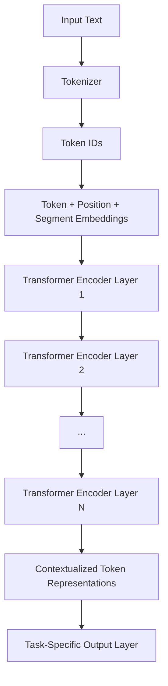
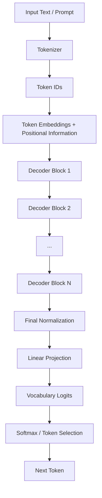
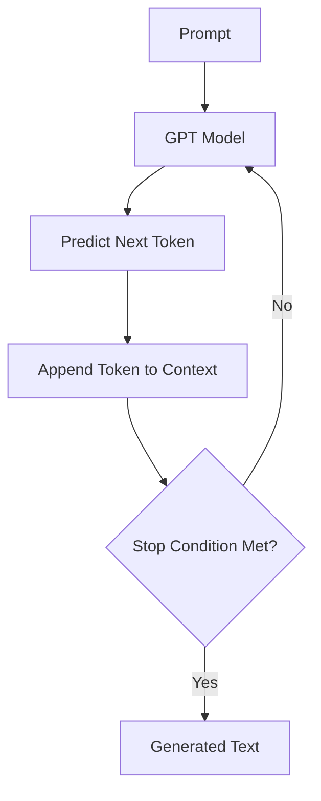
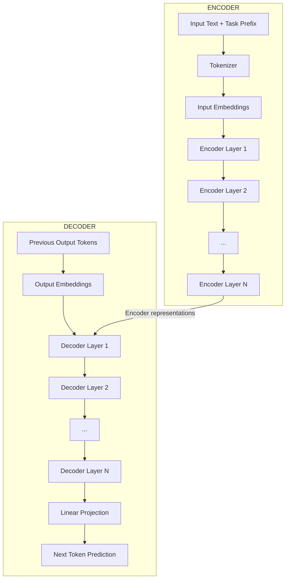

# Transformer-Based Language Models: BERT, GPT, and T5

The Transformer architecture provides a general framework for building neural networks that process and generate sequences of data. However, the architecture itself does not determine exactly how a model learns language, what objective it is trained to optimize, or what kinds of tasks it is best suited to perform. These decisions depend on how the Transformer is structured and how it is trained.

Three important model families illustrate different ways of using the Transformer architecture:

- **BERT (Bidirectional Encoder Representations from Transformers):** Uses the Encoder component to understand text by learning from both preceding and following context.
- **GPT (Generative Pre-trained Transformer):** Uses the Decoder component to predict the next token, making it particularly suitable for generating text.
- **T5 (Text-to-Text Transfer Transformer):** Uses both the Encoder and Decoder, treating different language tasks as transformations from input text to output text.

Although all three models are based on the Transformer architecture, they differ in their attention mechanisms, training objectives, input and output structures, and intended applications.

Understanding these differences is important because modern language models are not all built in the same way. Some are designed primarily to understand an input, some are designed to generate a continuation, and others are designed to transform one sequence into another.

## BERT: Bidirectional Encoder Representations from Transformers

### What Is BERT?

BERT is a language model introduced by Google in 2018 through the research paper _BERT: Pre-training of Deep Bidirectional Transformers for Language Understanding_.

BERT uses the Encoder component of the Transformer architecture. Its primary purpose is to learn contextual representations of text, allowing it to understand the meaning of words based on the surrounding context.

The most important characteristic of BERT is that it uses bidirectional self-attention. This means that when BERT processes a token, it can gather information from tokens appearing both before and after it in the input sequence.

Consider the following sentence:

```text
The developer deployed the application because it was ready.
```

To understand what `it` refers to, the model needs to consider the surrounding context. The word `application` is a likely reference, and the word `developer` provides additional context about the sentence.

BERT can examine the complete sentence simultaneously, allowing the representation of `it` to incorporate information from both earlier and later tokens.

This is different from a causal language model, which cannot use future tokens when predicting the current token.

### BERT Architecture

BERT uses a stack of Transformer Encoder layers. It does not contain the Decoder component of the original Encoder-Decoder Transformer.

Its high-level architecture is:

<div style={{textAlign: 'center'}}>



</div>

The input text is converted into token IDs, which are then transformed into embeddings. Positional information and segment information are also incorporated before the representations enter the Encoder layers.

Each Encoder layer applies bidirectional Multi-Head Self-Attention and a Feed-Forward Neural Network, along with residual connections and Layer Normalization.

The final Encoder output contains a contextualized representation for every input token.

BERT's original configurations included:

| Configuration            |                 BERT Base |                BERT Large |
| ------------------------ | ------------------------: | ------------------------: |
| Number of Encoder layers |                        12 |                        24 |
| Hidden dimension         |                       768 |                      1024 |
| Attention heads          |                        12 |                        16 |
| Feed-Forward dimension   |                      3072 |                      4096 |
| Total parameters         | Approximately 110 million | Approximately 340 million |

These configurations illustrate how the same basic Encoder architecture can be scaled by changing its dimensions and number of layers.

### Input Representation in BERT

BERT combines three types of embeddings to construct its input representation:

1. Token embeddings.
2. Position embeddings.
3. Segment embeddings.

The combined representation is calculated as:

```text
Input Representation =
    Token Embedding
    + Position Embedding
    + Segment Embedding
```

**Token embeddings** represent the identity of each token, while **position embeddings** identify where each token appears in the sequence. Segment embeddings indicate which input segment a token belongs to, which is useful when BERT receives a pair of sentences.

For example, consider two sentences:

```text
Sentence A: The developer deployed the application.
Sentence B: The application is ready.
```

BERT can combine these sentences into a single input:

```text
[CLS] The developer deployed the application.
[SEP] The application is ready. [SEP]
```

The `[CLS]` token is a special classification token placed at the beginning of the input, while `[SEP]` separates the input segments and can mark the end of the input.

The segment embeddings distinguish the two sentences:

```text
Sentence A → Segment ID 0
Sentence B → Segment ID 1
```

The model can therefore identify which tokens belong to the first sentence and which belong to the second sentence.

BERT uses WordPiece tokenization, which can divide words into smaller subword units. This helps the model handle words that do not appear as complete entries in its vocabulary.

### Bidirectional Self-Attention

The defining characteristic of BERT is that its Encoder uses bidirectional self-attention without a causal mask.

This allows every token to attend to all valid token positions in the input sequence, including tokens that appear later.

For example:

```text
The developer deployed the application because it was ready.
```

When calculating the contextual representation of `it`, BERT can attend to:

- `The`
- `developer`
- `deployed`
- `the`
- `application`
- `because`
- `was`
- `ready`

The attention mechanism determines how much information should be retrieved from each token.

This is useful for language-understanding tasks because the meaning of a word often depends on the complete sentence rather than only on the words that precede it.

### How Is BERT Trained?

BERT was originally trained using two objectives:

1. Masked Language Modeling (MLM).
2. Next Sentence Prediction (NSP).

These objectives help BERT learn contextual relationships between tokens and relationships between sentence pairs.

#### Masked Language Modeling

Masked Language Modeling is the primary pre-training objective used by BERT.

During training, some tokens in the input sequence are selected and hidden from the model. BERT receives the partially corrupted sentence and learns to predict the original tokens.

Consider the sentence:

```text
The developer deployed the application.
```

A training example might look like:

```text
Input:
The developer [MASK] the application.

Expected prediction:
deployed
```

The model must use the surrounding context to determine which token belongs in the masked position.

Because BERT uses bidirectional self-attention, it can use information from both sides of the masked token.

For example, the words `The developer` provide information about the subject, while `the application` provides information about what is being deployed.

The model learns to predict the original token using the contextual representations generated by the Encoder.

The MLM objective can be expressed as:

```text
MLM Loss = -Σ_i log P(x_i | corrupted input)
```

Here:

- `x_i` represents an original token selected for prediction.
- `corrupted input` represents the input after selected tokens have been modified or masked.
- `P(x_i | corrupted input)` represents the probability assigned to the correct original token.
- The negative logarithm penalizes the model when it assigns a low probability to the correct token.

The model minimizes this loss during training, gradually learning contextual relationships between words.

An important detail is that the original BERT training procedure did not replace every selected token with `[MASK]`. It selected 15% of the input token positions for prediction, and among those selected positions:

- 80% were replaced with `[MASK]`.
- 10% were replaced with a random token.
- 10% were left unchanged.

This strategy helped reduce the mismatch between pre-training and downstream tasks, where the `[MASK]` token would not normally appear in the input.

#### Next Sentence Prediction

The second original BERT objective was Next Sentence Prediction (NSP).

NSP was designed to help BERT understand relationships between two sentences, particularly whether one sentence logically follows another.

During training, BERT receives two sentences and predicts whether the second sentence is the actual continuation of the first sentence in the original text.

For example:

```text
Sentence A:
The developer deployed the application.

Sentence B:
The application is now available to users.
```

These sentences form a consecutive pair, so the expected label is:

```text
IsNext
```

Now consider:

```text
Sentence A:
The developer deployed the application.

Sentence B:
The weather is pleasant today.
```

These sentences are randomly paired rather than consecutive in the original text, so the expected label is:

```text
NotNext
```

BERT uses the representation of the special `[CLS]` token to predict whether the two sentences are consecutive.

The NSP objective is:

```text
NSP Loss = -log P(correct relationship | Sentence A, Sentence B)
```

The total original BERT pre-training objective combines MLM and NSP:

```text
Total Loss = MLM Loss + NSP Loss
```

The model learns to predict masked tokens while also learning relationships between sentence pairs.

An important qualification is that NSP was part of the original BERT training design, but subsequent research found that it was not always beneficial. For example, RoBERTa removed NSP and used a different training setup while improving performance on several benchmarks.

### How Is BERT Used?

After pre-training, BERT can be adapted to specific language-understanding tasks through fine-tuning.

Fine-tuning means taking a model that has already learned general language representations and training it further on a smaller dataset for a particular task.

The same BERT Encoder can support different applications by attaching an appropriate task-specific output layer.

#### Text classification

Consider a customer review:

```text
The application is easy to use and works perfectly.
```

BERT processes the sentence and produces contextualized representations. The representation associated with `[CLS]` can be passed to a classification layer to predict a category such as positive or negative sentiment.

#### Named Entity Recognition (NER)

Consider:

```text
Abhishek works at SurveyMonkey.
```

BERT produces a representation for each token. A classification layer can predict labels such as:

```text
Abhishek     → PERSON
SurveyMonkey → ORGANIZATION
```

#### Question answering

Consider:

```text
Context:
The application was deployed on Monday.

Question:
When was the application deployed?
```

BERT can process the context and question together and predict the start and end positions of the answer within the context.

The model learns to identify the relevant text span rather than generate an arbitrary continuation.

### Limitations of BERT

Although BERT is effective for language understanding, its architecture has limitations when used as a general-purpose text generator.

**1. It is not autoregressive.**

BERT uses bidirectional attention, allowing a token to examine both preceding and following tokens. This makes it unsuitable for ordinary left-to-right next-token generation without changing its training objective and inference setup.

**2. It relies on masked-token prediction during pre-training.**

The original MLM objective trains the model to reconstruct selected tokens from corrupted input. It does not directly train BERT to generate a complete sequence one token at a time.

**3. It has limited native support for open-ended generation.**

BERT can be adapted for certain text-generation tasks, but its original Encoder-only design is not naturally structured for autoregressive generation in the way GPT is.

**4. Its representations depend on the complete input sequence.**

Because BERT uses bidirectional attention, the representation of a token depends on the surrounding input. This is valuable for understanding text, but it does not provide the causal structure needed for straightforward next-token prediction.

## GPT: Generative Pre-trained Transformer

### What Is GPT?

GPT is a family of language models developed by OpenAI. The original GPT model was introduced in 2018 through the research paper _Improving Language Understanding by Generative Pre-Training_.

Unlike BERT, which uses the Encoder component of the Transformer, GPT uses the Decoder-style architecture.

Its primary objective is to predict the next token based on the tokens that came before it. This makes GPT an autoregressive language model.

Consider:

```text
The developer deployed the
```

GPT receives this sequence and predicts what token is likely to come next.

For example:

```text
Input:
The developer deployed the

Possible next token:
application
```

After predicting the token, the model appends it to the input and repeats the prediction process.

This simple objective allows GPT to learn language structure, grammar, factual associations, and patterns that appear in its training data.

### GPT Architecture

GPT uses a stack of Transformer Decoder-style blocks with causal self-attention.

Unlike the original Encoder-Decoder Transformer, a standard GPT architecture does not contain a separate Encoder or Encoder-Decoder cross-attention sublayer.

Its high-level architecture is:

<div style={{textAlign: 'center'}}>



</div>

Each Decoder block contains:

- Causal Multi-Head Self-Attention.
- A Feed-Forward Network.
- Residual connections.
- Normalization operations.

The precise arrangement can vary between GPT generations and implementations. For example, modern GPT-style models commonly use Pre-Layer Normalization and may use RMSNorm instead of the original Layer Normalization arrangement.

### Causal Self-Attention

The most important architectural property of GPT is causal self-attention.

Unlike BERT, GPT cannot attend to future tokens. Every token can only use information from earlier positions and its own position.

Consider:

```text
The developer deployed the application.
```

When predicting the token at position 3, GPT can use the tokens at positions 1, 2, and 3, but it cannot use tokens at positions 4, 5, or later.

The causal attention mask ensures that future positions are blocked.

For a sequence containing four tokens, the mask looks like this:

```text
             Key Positions
             1    2    3    4

Query 1      1    0    0    0
Query 2      1    1    0    0
Query 3      1    1    1    0
Query 4      1    1    1    1
```

A value of `1` means that the attention position is allowed, while `0` means that it is blocked.

The causal mask is applied to the attention scores before Softmax:

```text
Masked Scores = Attention Scores + Causal Mask

Attention Weights = Softmax(Masked Scores)
```

The blocked positions receive zero attention weight after Softmax.

This prevents the model from using future information when predicting a token.

### How Is GPT Trained?

GPT is trained using an autoregressive language modeling objective, commonly called next-token prediction.

During training, the model receives a sequence of tokens and learns to predict the next token at every position.

Consider:

```text
The developer deployed the application.
```

The training examples can be viewed as:

| Input                                  | Expected next token |
| -------------------------------------- | ------------------- |
| The                                    | developer           |
| The developer                          | deployed            |
| The developer deployed                 | the                 |
| The developer deployed the             | application         |
| The developer deployed the application | End-of-sequence     |

The model learns to assign a probability distribution over the vocabulary at every prediction position.

The training objective is:

```text
P(x_1, x_2, ..., x_n) =
    ∏_t P(x_t | x_1, ..., x_{t-1})
```

Here:

- `x_t` represents the token at position `t`.
- `x_1, ..., x_{t-1}` represent all preceding tokens.
- `P(x_t | x_1, ..., x_{t-1})` represents the probability of the current token given its preceding context.

The corresponding training loss is:

```text
Loss = -Σ_t log P(x_t | x_1, ..., x_{t-1})
```

This is the negative log-likelihood objective. It penalizes the model when it assigns a low probability to the correct next token.

The model is trained on large collections of text, and its parameters are adjusted to minimize this prediction loss.

An important detail is that GPT does not need to process one training example at a time for every token position. During training, the model can calculate predictions for many positions simultaneously because the causal mask prevents information from flowing from future positions to earlier positions.

This allows parallel training even though the model's prediction objective is autoregressive.

### How Does GPT Generate Text?

During inference, GPT generates text one token at a time.

Suppose the prompt is:

```text
The developer deployed the
```

The model calculates a probability distribution over its vocabulary and selects a token according to the chosen decoding strategy.

For example:

```text
Step 1

Input:
The developer deployed the

Predicted token:
application
```

The predicted token is appended to the input.

```text
Step 2

Input:
The developer deployed the application

Predicted token:
because
```

The process continues:

```text
Step 3

Input:
The developer deployed the application because

Predicted token:
it
```

Eventually, the model produces a complete continuation.

```text
The developer deployed the application because it was ready.
```

This process is called autoregressive generation because each new token depends on the previously available sequence.

The basic generation loop is:

<div style={{textAlign: 'center'}}>



</div>

The model may stop when it generates an end-of-sequence token, reaches a maximum generation length, or satisfies another configured stopping condition.

### Understanding Token Selection

GPT does not necessarily select the token with the highest probability every time. Several decoding strategies can be used to determine which token is generated.

#### Greedy decoding

Greedy decoding selects the token with the highest probability at every step.

For example:

```text
Token:          Probability:

application     0.70
service         0.15
website         0.10
other           0.05
```

The model selects `application` because it has the highest probability.

This approach is simple and deterministic, but it can sometimes produce repetitive or predictable text.

#### Temperature

Temperature changes the distribution of token probabilities before selection.

The operation is:

```text
P(token) = Softmax(logits / temperature)
```

A lower temperature makes the distribution more concentrated around high-probability tokens, while a higher temperature makes the distribution flatter and allows lower-probability tokens to be selected more frequently.

For example:

- A temperature of 0 makes selection effectively greedy in common implementations.
- A temperature below 1 makes generation more conservative.
- A temperature of 1 leaves the original probability distribution unchanged.
- A temperature above 1 increases randomness.

#### Top-k sampling

Top-k sampling restricts token selection to the `k` most probable tokens. The probabilities of the remaining tokens are excluded, and the remaining distribution is normalized before sampling.

#### Top-p sampling

Top-p sampling, also known as nucleus sampling, selects from the smallest set of tokens whose cumulative probability reaches a specified threshold.

For example, if the threshold is 0.90, the model considers the smallest collection of highest-probability tokens whose combined probability is at least 90%.

These techniques influence the diversity and predictability of generated text.

### Pre-training and Instruction Tuning

A model trained only on next-token prediction learns to continue text based on patterns in its training data. However, predicting the next token does not automatically make a model good at following user instructions.

Modern GPT-style systems therefore commonly use additional training stages.

#### Pre-training

The model learns general language patterns by predicting the next token across a large training corpus.

#### Supervised fine-tuning

The model is trained on examples of prompts and desirable responses, helping it learn how to respond to instructions and conversational requests.

#### Preference optimization

The model may receive additional training based on human preferences or other preference signals, encouraging responses that are more useful and aligned with the desired behavior.

These additional stages build on the pre-trained model rather than replacing its underlying Decoder-style architecture.

The exact training procedures differ across GPT generations and implementations.

### KV Cache and Efficient Generation

Autoregressive generation repeatedly processes an expanding context.

Without optimization, the model would repeatedly calculate Key and Value representations for tokens it had already processed.

A Key-Value cache stores these previously calculated representations so that they can be reused when predicting subsequent tokens.

For example:

```text
First generation step:
Process: [A]
Cache:   K(A), V(A)

Second generation step:
Process: [A, B]
Reuse:   K(A), V(A)
Calculate: K(B), V(B)

Third generation step:
Process: [A, B, C]
Reuse:   K(A), V(A), K(B), V(B)
Calculate: K(C), V(C)
```

This reduces repeated computation during generation.

The KV cache is particularly important when generating long sequences, although it increases memory consumption because the model must retain Key and Value representations for the cached tokens.

### Limitations of GPT

**1. It generates tokens sequentially.**

The next token depends on previously generated tokens, so autoregressive inference cannot generate an entire sequence independently in one ordinary decoding step.

**2. It can produce incorrect information.**

The model predicts likely continuations based on learned patterns. A fluent response is not necessarily a factually correct response.

**3. Its context window is limited.**

The model can only process a finite amount of context in a given inference request, although different models support different context lengths.

**4. Generation quality depends on the training data and objective.**

The next-token prediction objective does not guarantee that the model will always reason correctly, follow instructions, or distinguish reliable information from unreliable information.

**5. Generation has computational costs.**

Every newly generated token requires additional model computation, and the KV cache consumes memory as the context grows.

## T5: Text-to-Text Transfer Transformer

### What Is T5?

T5, or Text-to-Text Transfer Transformer, is a Transformer-based language model introduced by Google in 2019 through the research paper _Exploring the Limits of Transfer Learning with a Unified Text-to-Text Transformer_.

Unlike BERT and GPT, T5 uses both the Encoder and Decoder components of the Transformer architecture.

Its defining idea is to represent different natural language processing tasks as text-to-text transformations.

This means that regardless of the task, the model receives text as input and generates text as output.

For example:

#### Translation

```text
Input:
translate English to French: The developer deployed the application.

Output:
Le développeur a déployé l'application.
```

#### Summarization

```text
Input:
summarize: The application was deployed on Monday and is now available to users.

Output:
The application is now available to users.
```

#### Classification

```text
Input:
sentiment: The application is easy to use and works perfectly.

Output:
positive
```

The model does not require a completely separate architecture for every task. Instead, a task-specific text prefix tells it what transformation is expected.

### T5 Architecture

T5 uses the original Encoder-Decoder Transformer structure.

Its architecture consists of:

- An Encoder that processes the complete input sequence using bidirectional self-attention.
- A Decoder that generates the output sequence using causal self-attention and cross-attention over the Encoder representations.

The high-level structure is:

<div style={{textAlign: 'center'}}>



</div>

The Encoder builds contextualized representations from the input, while the Decoder generates the output sequence using those representations.

This allows T5 to perform tasks where the output is a transformed version of the input rather than simply a continuation of it.

### How Does T5 Process Input?

T5 uses a text prefix to identify the task the model should perform.

For example:

```text
translate English to French: The developer deployed the application.
```

The prefix `translate English to French:` indicates the expected operation.

The complete input is tokenized and passed into the Encoder. The Encoder processes the entire sequence and generates contextualized representations.

The Decoder then generates the translated sentence one token at a time.

The same architecture can handle a different task by changing the input prefix.

For example:

```text
summarize: The application was deployed on Monday and is now available to users.
```

The model receives a different instruction in the form of a task prefix, but the underlying Encoder-Decoder architecture remains the same.

This is an important design decision because it allows multiple tasks to share the same model parameters.

### How Is T5 Trained?

The original T5 model was pre-trained using an objective called Span Corruption.

Instead of masking individual tokens independently as in BERT, T5 selects spans of consecutive tokens and replaces each selected span with a special sentinel token.

The model then learns to reconstruct the missing text using the Decoder.

Consider the sentence:

```text
The developer deployed the application because it was ready.
```

Suppose two spans are selected:

```text
developer deployed
```

and:

```text
it was
```

The corrupted input might become:

```text
The <extra_id_0> the application because <extra_id_1> ready.
```

The expected target sequence is:

```text
<extra_id_0> developer deployed
<extra_id_1> it was
```

The Encoder processes the corrupted input, while the Decoder learns to generate the missing spans in the correct order.

The model uses special sentinel tokens to indicate where each missing span begins.

This objective encourages the model to understand relationships across the input sequence and reconstruct missing portions of text.

The training objective can be represented as:

```text
Loss = -Σ_t log P(target token | corrupted input, previous target tokens)
```

Here:

- `corrupted input` represents the original text after selected spans have been replaced.
- `target token` represents a token in the reconstructed text.
- `previous target tokens` represents the output tokens generated before the current prediction.
- The model learns to assign high probability to the correct reconstructed sequence.

Unlike BERT's original MLM objective, which predicts selected masked tokens using an Encoder, T5 uses an Encoder to process corrupted input and a Decoder to generate the missing text.

### Text-to-Text Framework

One of T5's most important contributions is its unified approach to NLP tasks.

Instead of designing separate output structures for translation, summarization, classification, and other tasks, T5 represents all of them as text generation.

Consider the following examples:

| Task               | Input                                                                      | Output             |
| ------------------ | -------------------------------------------------------------------------- | ------------------ |
| Translation        | `translate English to French: Hello`                                       | `Bonjour`          |
| Summarization      | `summarize: Long article...`                                               | `Short summary...` |
| Classification     | `sentiment: This is excellent`                                             | `positive`         |
| Question answering | `question: What is the capital of France? context: France is in Europe...` | `Paris`            |

The model uses the same fundamental Encoder-Decoder architecture for each task.

The task prefix provides information about what the model is expected to do, while the input text supplies the content to process.

This design makes it possible to train a single model across multiple tasks and reuse its learned representations.

### How Does T5 Generate Output?

T5 generates its output autoregressively, just like GPT.

However, there is an important difference: GPT generates continuations based on its input context, while T5 generates output conditioned on the representations produced by its Encoder.

For example:

```text
Input:
translate English to French: Hello.
```

The Encoder processes the complete input and produces contextualized representations.

The Decoder then generates:

```text
Step 1:
<START> → Bonjour

Step 2:
<START> Bonjour → <END>
```

The final output is:

```text
Bonjour
```

The Decoder uses causal self-attention to process previously generated output tokens and cross-attention to retrieve information from the Encoder.

This combination allows T5 to generate an output sequence that is conditioned on the complete input.

### Relative Positional Information

The original T5 architecture uses relative position information through a mechanism called relative position bias.

Rather than relying on the same sinusoidal positional encoding used in the original Transformer, T5 incorporates information about the relative distance between tokens into attention scores.

For example, the model can distinguish between a token immediately before another token and a token that appears many positions away.

This information helps the attention mechanism understand the relative arrangement of tokens.

The relative position bias is added to the attention scores before Softmax:

```text
Attention Scores =
    ((Q × Kᵀ) / √d_k) + Relative Position Bias

Attention Weights =
    Softmax(Attention Scores)
```

Here:

- `Q` represents the Query matrix.
- `K` represents the Key matrix.
- `d_k` represents the Key dimension.
- `Relative Position Bias` represents a learned bias based on the relative positions of tokens.

The exact implementation uses learned relative-position buckets rather than learning a completely independent bias for every possible distance.

### Limitations of T5

**1. It has a more complex architecture than an Encoder-only or Decoder-only model.**

T5 uses both an Encoder and a Decoder, so it contains additional components and computations compared with architectures that use only one of them.

**2. Output generation is still autoregressive.**

Even though the Encoder processes the input sequence in parallel, the Decoder generates output tokens sequentially during inference.

**3. Cross-attention introduces additional computation.**

The Decoder must retrieve information from the Encoder representations through cross-attention, which introduces additional computational and memory requirements.

**4. Task prefixes do not guarantee correct task execution.**

The model still depends on its learned capabilities and the quality of the input. Providing a task prefix does not automatically guarantee that the generated output will be correct.

## BERT vs GPT vs T5

Although BERT, GPT, and T5 are all based on the Transformer architecture, their structural differences lead to different strengths and use cases.

### Architectural Comparison

| Characteristic       | BERT                     | GPT                   | T5                                       |
| -------------------- | ------------------------ | --------------------- | ---------------------------------------- |
| Architecture         | Encoder-only             | Decoder-only          | Encoder-Decoder                          |
| Self-attention       | Bidirectional            | Causal                | Bidirectional Encoder and causal Decoder |
| Cross-attention      | No                       | No                    | Yes                                      |
| Primary objective    | Masked Language Modeling | Next-token prediction | Span Corruption in original pre-training |
| Output generation    | Not its primary design   | Autoregressive        | Autoregressive                           |
| Input processing     | Complete input sequence  | Available context     | Complete input sequence                  |
| Typical applications | Text understanding       | Text generation       | Text-to-text transformations             |

### Understanding the Attention Differences

The biggest architectural distinction is how the models use attention.

#### BERT

BERT uses bidirectional self-attention. Every token can attend to all valid input tokens, including tokens appearing later in the sequence.

```text
Token 1 ↔ Token 2 ↔ Token 3 ↔ Token 4
```

This makes BERT suitable for understanding text using the complete context.

#### GPT

GPT uses causal self-attention. Every token can attend only to previous tokens and itself.

```text
Token 1 → Token 2 → Token 3 → Token 4
```

This restriction allows GPT to predict the next token without accessing future information.

#### T5

T5 combines both attention patterns.

Its Encoder uses bidirectional self-attention, while its Decoder uses causal self-attention and cross-attention to retrieve information from the Encoder.

```text
Input Sequence
      |
      v
Bidirectional Encoder
      |
      v
Encoder Representations
      |
      v
Decoder Cross-Attention
      |
      v
Autoregressive Output
```

### Understanding the Training Differences

The training objectives also explain why these models behave differently.

BERT learns to reconstruct masked tokens using surrounding context. GPT learns to predict the next token using preceding context. T5 learns to reconstruct missing spans using an Encoder-Decoder architecture.

These objectives encourage different capabilities:

- BERT learns contextual representations that are useful for understanding and classifying input.
- GPT learns to model sequences autoregressively, making it suitable for generating continuations.
- T5 learns to transform input sequences into output sequences, making it suitable for tasks such as translation and summarization.

### When Should Each Architecture Be Used?

The choice depends on the problem being solved.

| Requirement                        | Suitable architecture | Reason                                                                           |
| ---------------------------------- | --------------------- | -------------------------------------------------------------------------------- |
| Sentiment analysis                 | BERT-style            | Uses complete input context for classification                                   |
| Named Entity Recognition           | BERT-style            | Produces contextualized representations for individual tokens                    |
| Extractive Question Answering      | BERT-style            | Can identify answer spans within the input                                       |
| Open-ended text generation         | GPT-style             | Designed for autoregressive generation                                           |
| Conversational response generation | GPT-style             | Generates responses based on preceding context                                   |
| Machine translation                | T5-style              | Uses an Encoder to understand input and a Decoder to generate transformed output |
| Text summarization                 | T5-style              | Generates a shorter sequence conditioned on the input                            |
| Text-to-text classification        | T5-style              | Can generate class labels as text                                                |

These are typical architectural choices rather than strict limitations. Different model families can be adapted to support tasks outside their most common use cases.

## How Modern LLMs Relate to These Architectures

BERT, GPT, and T5 demonstrate three fundamental ways of applying the Transformer architecture. Modern language models build on these ideas, but they may introduce additional architectural components, training stages, and optimizations.

For example, modern decoder-only models commonly use:

- Rotary Position Embeddings (RoPE) or other positional techniques.
- RMSNorm or other normalization methods.
- SwiGLU or other Feed-Forward Network variants.
- Grouped-Query Attention or Multi-Query Attention.
- Key-Value caching for efficient generation.
- Mixture of Experts (MoE) in some architectures.

These changes do not necessarily replace the underlying Transformer architecture. They modify particular components to improve performance, efficiency, or scalability.

Modern models also use additional training techniques, such as supervised fine-tuning, preference optimization, and reinforcement learning, depending on their intended capabilities.

It is important to distinguish between the architecture of a model and the process used to train it. Two models can use the same general Decoder-only architecture but behave very differently because they were trained using different datasets, objectives, and post-training procedures.

## Summary

BERT, GPT, and T5 demonstrate three important architectural approaches to building Transformer-based language models.

**BERT** uses an Encoder-only architecture with bidirectional self-attention. Its original training objectives include Masked Language Modeling and Next Sentence Prediction, allowing it to learn contextual representations that are particularly useful for language-understanding tasks.

**GPT** uses a Decoder-only architecture with causal self-attention. It is trained primarily through next-token prediction, learning to generate text autoregressively by predicting one token at a time.

**T5** uses an Encoder-Decoder architecture and treats language tasks as text-to-text transformations. Its original pre-training objective uses span corruption, where the Encoder processes corrupted input and the Decoder reconstructs the missing text.

The central differences can be remembered as follows:

```text
BERT:
Understand text using both preceding and following context.

GPT:
Generate text by predicting the next token.

T5:
Transform input text into output text using an Encoder and Decoder.
```

These three model families provide a foundation for understanding how modern language models are designed and why different Transformer architectures are suitable for different applications.
