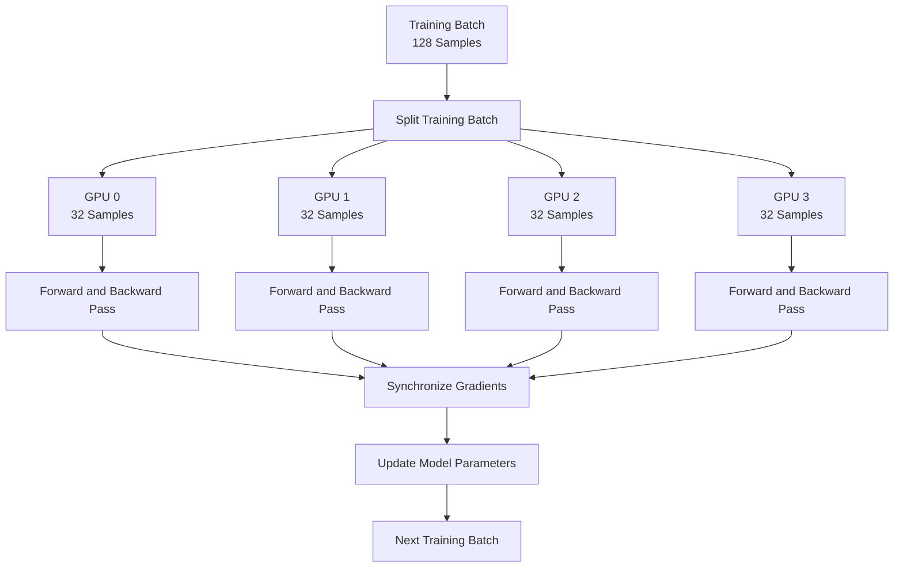
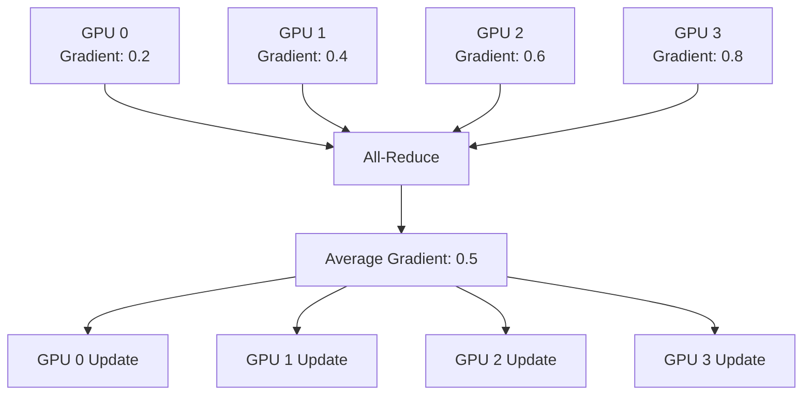
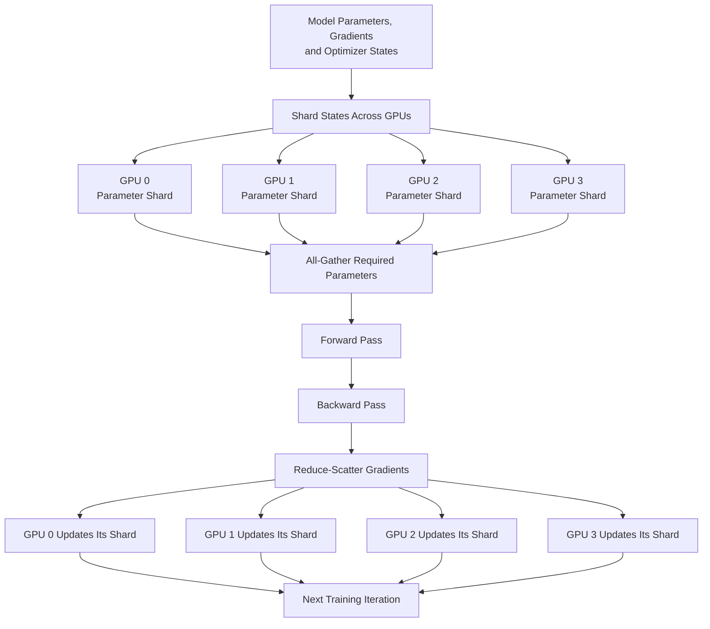
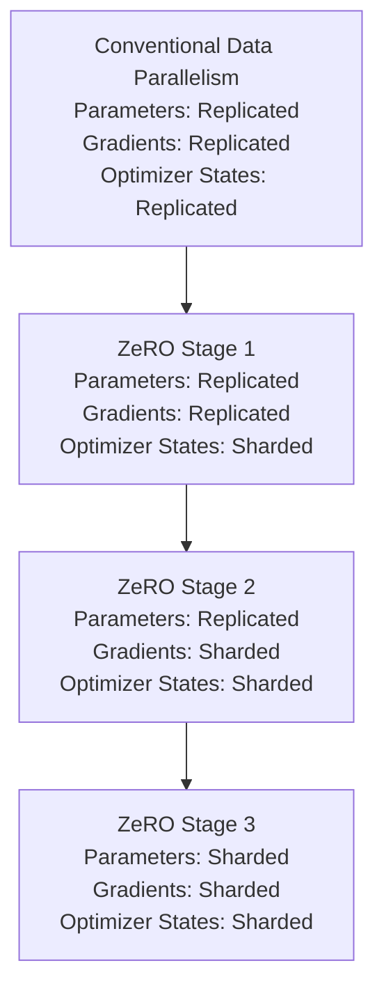

# Distributed Training

Training a large language model requires enormous computational resources. As the number of model parameters and training tokens increases, the amount of computation and memory required to train the model also grows. A model that requires more memory than a single GPU can provide cannot be trained on that GPU alone, regardless of how much time we are willing to spend.

One way to address this limitation is to use multiple GPUs instead of relying on a single device. However, simply connecting several GPUs does not automatically make training faster or allow a larger model to fit into memory. The training workload must be divided across devices, and the devices must coordinate their computations and exchange the information required to update the model.

This is the purpose of **distributed training**. It refers to techniques that allow multiple GPUs, potentially spread across multiple machines, to work together on the training of a model. Depending on the technique, the system may distribute the training data, the model parameters, the gradients, or the optimizer states across devices.

There are several approaches to distributed training, each addressing a different limitation. Multi-GPU training provides the foundation for using multiple devices, Distributed Data Parallel (DDP) replicates the model across GPUs and distributes the training data, while Fully Sharded Data Parallel (FSDP) and Zero Redundancy Optimizer (ZeRO) reduce memory duplication by distributing model-related states across devices.

Understanding these approaches is important because training a large model is not simply a matter of adding more GPUs. It requires choosing how computation and memory should be distributed while keeping the model's training process mathematically consistent.

## Multi-GPU Training

Multi-GPU training is the practice of using multiple GPUs to train a model instead of performing the entire training process on a single GPU. Each GPU contributes computational resources, allowing the training workload to be divided across devices.

Consider a model that takes several hours to process a training batch on one GPU. If the workload can be divided among four GPUs, each GPU can process part of the batch simultaneously. The results are then combined so that the model can continue training.

For example, suppose we have a training batch containing 128 samples and four GPUs. Instead of processing all 128 samples on one GPU, we can distribute the batch across the four devices, giving each GPU 32 samples.

Each GPU performs its forward and backward computations on its assigned samples. The training system then coordinates the results so that the model parameters can be updated consistently.

### How Multi-GPU Training Works

A typical multi-GPU training process involves the following steps:

1. The training batch is divided into smaller portions and distributed across the available GPUs.
2. Each GPU performs a forward pass using its assigned portion of the batch.
3. Each GPU calculates the loss and computes gradients through backpropagation.
4. The gradients or other required training information are communicated between GPUs.
5. The training system combines the required results and updates the model parameters.
6. The process repeats for subsequent training batches.

The following diagram illustrates this process using four GPUs.

<div style={{textAlign: 'center'}}>



</div>

The important point is that all GPUs participate in the same training process, but each GPU handles only a portion of the computation.

### Why Use Multiple GPUs?

Multi-GPU training addresses two important challenges.

#### Faster Training

Multiple GPUs can process different portions of a training batch simultaneously, increasing the amount of computation performed in a given period. This can significantly reduce the time required to train a model, provided that the workload is distributed efficiently and communication overhead does not become a bottleneck.

#### Larger Training Workloads

A large training workload may exceed the computational capacity of a single GPU. Multiple GPUs provide additional aggregate memory and processing capacity, allowing training systems to support larger batches or more complex training configurations.

However, there is an important distinction between having more aggregate GPU memory and being able to use that memory for a single model.

If every GPU stores a complete copy of the model, each individual GPU must still have enough memory to hold that complete copy and its associated training states. Simply adding more GPUs does not solve this particular memory limitation.

This is why distributed training strategies differ in how they distribute the model and its training states.

### Data Parallelism and Model Parallelism

There are two fundamental ways to distribute a training workload across multiple GPUs: data parallelism and model parallelism.

#### Data Parallelism

In data parallelism, each GPU maintains a complete copy of the model, but processes a different portion of the training data. The GPUs calculate gradients independently and synchronize them so that all copies of the model remain consistent.

For example, if four GPUs process four different portions of a batch, each GPU computes gradients using its assigned samples. The gradients are then combined, and every GPU applies the same parameter update.

The main advantage is that data parallelism is relatively straightforward to implement and can improve training throughput. However, it does not reduce the memory required to store the complete model on each GPU.

#### Model Parallelism

In model parallelism, the model itself is distributed across multiple GPUs instead of being fully replicated on every device. Different GPUs are responsible for different portions of the model, allowing the combined GPU memory to accommodate a model that would not fit on a single GPU.

For example, one GPU might hold one group of model layers while another GPU holds the remaining layers. During the forward pass, intermediate activations are transferred between the devices so that the computation can proceed through the complete model.

Model parallelism can make it possible to train larger models, but it introduces communication between devices and requires coordination of computations across the distributed model.

| Aspect               | Data Parallelism             | Model Parallelism                                            |
| -------------------- | ---------------------------- | ------------------------------------------------------------ |
| What is distributed? | Training data                | Model computation or parameters                              |
| Model storage        | Complete model on each GPU   | Model divided across GPUs                                    |
| Primary objective    | Increase training throughput | Support models that exceed one GPU's capacity                |
| Communication        | Gradient synchronization     | Exchange of intermediate results or other model-related data |
| Main limitation      | Model must fit on each GPU   | Communication and coordination overhead                      |

The distinction between these two approaches provides the foundation for understanding DDP, FSDP, and ZeRO.

## Distributed Data Parallel (DDP)

Distributed Data Parallel (DDP) is a data-parallel training strategy in which each GPU maintains its own complete copy of the model and processes a different portion of the training data.

DDP is commonly used when the model can fit into the memory of an individual GPU, but training can benefit from the additional computational capacity of multiple GPUs.

Unlike a basic sequential approach where one GPU performs the entire training workload, DDP allows multiple GPUs to execute the forward and backward passes simultaneously. The gradients are then synchronized so that all GPUs update their model parameters consistently.

### How DDP Works

Suppose we want to train a model using four GPUs and a global batch size of 128. DDP distributes the batch across the four GPUs, giving each GPU 32 samples.

Each GPU maintains an identical copy of the model, including its parameters. The training process then follows these steps:

#### Step 1: Model Replication

The complete model is initialized on every GPU. All replicas begin with the same model parameters.

#### Step 2: Data Distribution

The global training batch is divided into smaller batches, and each GPU receives a different portion of the data.

#### Step 3: Forward Pass

Every GPU independently performs a forward pass using its assigned training samples. It calculates the predictions and the corresponding loss.

#### Step 4: Backward Pass

Each GPU performs backpropagation and calculates gradients for the model parameters using its local batch.

At this stage, the gradients may differ because each GPU has processed different training samples.

#### Step 5: Gradient Synchronization

DDP synchronizes the gradients across all GPUs using a collective communication operation called **All-Reduce**.

All-Reduce combines values from multiple devices and makes the resulting combined values available to every participating device. For gradient synchronization, this typically means calculating the average gradient across GPUs.

#### Step 6: Parameter Update

Every GPU applies the same averaged gradients to its local copy of the model. Since all replicas started with identical parameters and receive the same gradients, their updated parameters remain identical.

The process repeats for the next training batch.

### Understanding All-Reduce

All-Reduce is one of the most important operations in distributed data-parallel training because it allows GPUs to combine their locally calculated gradients.

Consider a model parameter whose gradient is calculated independently on four GPUs:

- GPU 0 calculates a gradient of 0.2.
- GPU 1 calculates a gradient of 0.4.
- GPU 2 calculates a gradient of 0.6.
- GPU 3 calculates a gradient of 0.8.

The average gradient is:

```text
Average Gradient = (0.2 + 0.4 + 0.6 + 0.8) / 4 = 0.5
```

After the All-Reduce operation, every GPU receives the averaged gradient of 0.5 and uses it to update its local model parameters.

As a result, all four model replicas remain synchronized.

<div style={{textAlign: 'center'}}>



</div>

In practice, gradients are large tensors containing values for many model parameters, so All-Reduce operates on entire gradient tensors rather than just one value.

### What Is a Collective Communication Operation?

All-Reduce belongs to a broader category called collective communication operations. These operations allow multiple processes or devices to communicate and coordinate their data.

Some important collective operations include:

| Operation      | What It Does                                                                                               |
| -------------- | ---------------------------------------------------------------------------------------------------------- |
| Broadcast      | Sends data from one device to all other participating devices.                                             |
| Reduce         | Combines values from multiple devices and stores the result on a designated device.                        |
| All-Reduce     | Combines values from all devices and distributes the result to every device.                               |
| All-Gather     | Collects data from all devices and makes the complete gathered data available to every device.             |
| Reduce-Scatter | Reduces data across devices and distributes different portions of the reduced result to different devices. |

These operations are particularly important in distributed training because GPUs frequently need to exchange gradients, parameters, or other training-related information.

### Advantages and Limitations of DDP

DDP offers a relatively simple way to scale training across multiple GPUs. Since every GPU performs its forward and backward computations independently, the system can achieve high computational throughput when the workload is sufficiently large.

However, DDP has an important memory limitation: every GPU stores the complete model, its gradients, and its optimizer states.

For example, suppose a model requires 40 GB of GPU memory for its parameters, gradients, optimizer states, and other training requirements. Even if we use four GPUs, conventional DDP still requires each GPU to accommodate its own complete copy of those states.

The system therefore has four copies of the same model-related training state.

This duplication becomes expensive when training very large models, which is why more memory-efficient distributed training strategies are needed.

## Fully Sharded Data Parallel (FSDP)

Fully Sharded Data Parallel (FSDP) is a distributed training strategy that reduces GPU memory consumption by distributing model parameters, gradients, and optimizer states across multiple GPUs.

Unlike DDP, where every GPU maintains a complete copy of the model and its training states, FSDP divides these states into smaller portions and assigns them to different GPUs.

This technique is called **sharding**.

Sharding allows the aggregate memory of multiple GPUs to be used for storing a model's training states. As a result, FSDP can support models that would otherwise exceed the memory capacity of a single GPU.

### Understanding Sharding

Consider a model with 12 billion parameters that is being trained using four GPUs.

With DDP, every GPU maintains all 12 billion parameters. Each GPU also maintains the associated gradients and optimizer states.

With FSDP, the model-related states can be divided into four shards, with each GPU responsible for one portion.

For example:

| GPU   | Assigned Parameter Shard |
| ----- | ------------------------ |
| GPU 0 | Parameters 1–3 billion   |
| GPU 1 | Parameters 3–6 billion   |
| GPU 2 | Parameters 6–9 billion   |
| GPU 3 | Parameters 9–12 billion  |

Each GPU stores only its assigned portion of the model parameters rather than the complete set.

The same principle applies to gradients and optimizer states, allowing the memory requirements of these components to be distributed across the GPUs.

However, a GPU cannot independently execute a complete forward or backward pass using only an arbitrary portion of the model. It must temporarily obtain the parameter shards required for the computation.

This is where FSDP's communication process becomes important.

### How FSDP Works

FSDP uses collective communication operations to make the required parameter data available during training.

A simplified FSDP training process involves the following steps:

#### Step 1: Shard Model States

The model parameters, gradients, and optimizer states are divided into shards and distributed across GPUs.

#### Step 2: Gather Parameters

When a particular section of the model needs to execute its forward pass, the relevant parameter shards are gathered from the participating GPUs.

This operation is performed using All-Gather, which makes the complete parameters required for that computation available to the relevant devices.

#### Step 3: Forward Pass

The GPUs execute the forward computation using the temporarily gathered parameters.

#### Step 4: Backward Pass

During backpropagation, the system calculates gradients for the parameters used in the computation.

#### Step 5: Synchronize and Shard Gradients

The gradients are combined and distributed across the GPUs using Reduce-Scatter. Each GPU receives the gradient shard corresponding to the parameters it owns.

#### Step 6: Update Parameters

Each GPU updates its assigned parameter shard using the corresponding optimizer state.

The updated shards collectively represent the updated model.

The process repeats for subsequent training batches.

### FSDP Training Flow

<div style={{textAlign: 'center'}}>



</div>

The diagram illustrates the general sharded training process. Actual FSDP implementations can overlap communication with computation, prefetch parameter shards, and release temporary parameter copies at different points to improve efficiency.

### Why Does FSDP Need All-Gather and Reduce-Scatter?

The reason is that FSDP distributes the model states, but the computation still requires the complete parameters of the model section currently being executed.

All-Gather collects the required parameter shards from the GPUs so that the complete parameters are available for the computation.

Once the backward pass calculates gradients, Reduce-Scatter combines the gradients and distributes the resulting portions back to the GPUs responsible for those parameter shards.

This allows each GPU to retain ownership of only a portion of the training state while still participating in the complete model's training process.

### Advantages and Limitations of FSDP

FSDP significantly reduces memory duplication compared with DDP because it distributes model parameters, gradients, and optimizer states across GPUs.

This makes it possible to train models that cannot fit into the memory of a single GPU.

However, sharding introduces communication overhead. GPUs must exchange parameter shards before computation and distribute gradients after computation. If communication is slow or poorly overlapped with computation, training performance can suffer.

FSDP is therefore particularly useful when model memory requirements are the primary constraint, but its effectiveness depends on the available interconnect, GPU configuration, and communication efficiency.

## Zero Redundancy Optimizer (ZeRO)

Zero Redundancy Optimizer (ZeRO) is a memory optimization approach designed to reduce the redundant storage of model-related training states across multiple GPUs.

It was introduced in the DeepSpeed training framework to address the memory limitations of conventional data-parallel training.

The central idea behind ZeRO is straightforward: when multiple GPUs maintain identical copies of the same training information, much of that storage is redundant. Instead of storing every component on every GPU, the system can distribute ownership of those components across devices.

To understand why this matters, consider the memory required during model training.

A GPU generally needs memory for three major categories of model-related training states:

1. **Model Parameters:** The weights that define the model and are updated during training.
2. **Gradients:** The gradient values calculated through backpropagation, which determine how model parameters should be updated.
3. **Optimizer States:** Additional information maintained by the optimizer, such as the first and second moments used by Adam.

In conventional DDP, every GPU stores all three categories.

ZeRO reduces this duplication progressively by partitioning these training states across GPUs.

### The Core Idea Behind ZeRO

Suppose we are training a model using four GPUs.

In conventional DDP, every GPU maintains:

- 100% of the model parameters.
- 100% of the gradients.
- 100% of the optimizer states.

This means that the same model-related information is replicated four times across the system.

ZeRO avoids this unnecessary duplication by assigning different portions of the training states to different GPUs.

Rather than requiring every GPU to own the complete set of states, each GPU stores only the portions it is responsible for.

The amount of sharding depends on the ZeRO stage being used.

## ZeRO Stages 1, 2 and 3

ZeRO introduces three stages of memory optimization. Each stage distributes an additional category of model-related training states across the GPUs.

The progression is:

- Stage 1 shards optimizer states.
- Stage 2 shards optimizer states and gradients.
- Stage 3 shards optimizer states, gradients, and model parameters.

Understanding this progression is essential because it explains how ZeRO gradually reduces the memory requirements of distributed training.

### ZeRO Stage 1: Optimizer State Sharding

In ZeRO Stage 1, optimizer states are partitioned across the GPUs, while model parameters and gradients remain replicated.

For example, consider four GPUs training a model with Adam.

Adam maintains two moment estimates for each parameter:

- First moment: An estimate of the average gradient.
- Second moment: An estimate of the average squared gradient.

In conventional DDP, every GPU stores both moment estimates for every model parameter.

With ZeRO Stage 1, these optimizer states are divided across the four GPUs. Each GPU stores only the optimizer states corresponding to its assigned portion of the parameters.

The model parameters and gradients are still replicated across all GPUs.

#### What gets sharded?

Optimizer states only.

#### What remains replicated?

Model parameters and gradients.

#### Why is it useful?

Optimizer states can consume a substantial amount of GPU memory, particularly when using optimizers such as Adam. Distributing them reduces memory duplication without requiring the model parameters or gradients to be sharded.

### ZeRO Stage 2: Optimizer State and Gradient Sharding

ZeRO Stage 2 extends Stage 1 by partitioning gradients in addition to optimizer states.

Each GPU stores only the gradient portion corresponding to the parameters whose optimizer states it owns.

During backpropagation, gradients are calculated across the distributed training workload. The system uses Reduce-Scatter to combine the gradients and distribute the appropriate portions to their owning GPUs.

The model parameters, however, remain replicated.

#### What gets sharded?

- Optimizer states.
- Gradients.

#### What remains replicated?

Model parameters.

#### Why is it useful?

Gradient tensors can consume a significant amount of memory, especially for large models. Sharding them further reduces the memory required on each GPU.

### ZeRO Stage 3: Model Parameter, Gradient and Optimizer State Sharding

ZeRO Stage 3 extends the previous stages by partitioning model parameters as well.

At this stage, all three major categories of model-related training states are distributed across GPUs:

- Model parameters.
- Gradients.
- Optimizer states.

Each GPU owns only a portion of the complete model-related training state.

When a particular model section needs to execute, the required parameter shards are temporarily gathered from the GPUs. After the computation, the system can release temporary copies and return to the sharded representation.

This is conceptually similar to the fully sharded approach used by FSDP.

#### What gets sharded?

- Model parameters.
- Gradients.
- Optimizer states.

#### What remains replicated?

None of these three major training-state categories needs to remain fully replicated across every GPU.

#### Why is it useful?

Stage 3 provides the greatest reduction in memory duplication and is particularly useful for training very large models whose parameters and associated training states cannot fit on individual GPUs.

### Comparing the Three ZeRO Stages

| Training State             | Stage 1    | Stage 2    | Stage 3      |
| -------------------------- | ---------- | ---------- | ------------ |
| Model Parameters           | Replicated | Replicated | Sharded      |
| Gradients                  | Replicated | Sharded    | Sharded      |
| Optimizer States           | Sharded    | Sharded    | Sharded      |
| Memory Reduction           | Moderate   | Higher     | Highest      |
| Communication Requirements | Lower      | Higher     | Higher still |

The following diagram illustrates how each stage progressively distributes more training states across GPUs.

<div style={{textAlign: 'center'}}>



</div>

### Understanding the Memory Reduction

Consider a simplified example with four GPUs and a model that requires the following memory:

| Component        | Total Memory |
| ---------------- | -----------: |
| Model Parameters |        16 GB |
| Gradients        |        16 GB |
| Optimizer States |        32 GB |
| **Total**        |    **64 GB** |

Assume that these memory requirements are evenly distributed across four GPUs when a particular component is sharded. The example excludes activations, temporary buffers, communication overhead, and other framework-specific allocations.

With conventional DDP, every GPU stores all three components, requiring 64 GB per GPU.

With ZeRO, the memory requirements change as follows:

| Approach     | Parameters per GPU | Gradients per GPU | Optimizer States per GPU | Total per GPU |
| ------------ | -----------------: | ----------------: | -----------------------: | ------------: |
| DDP          |              16 GB |             16 GB |                    32 GB |         64 GB |
| ZeRO Stage 1 |              16 GB |             16 GB |                     8 GB |         40 GB |
| ZeRO Stage 2 |              16 GB |              4 GB |                     8 GB |         28 GB |
| ZeRO Stage 3 |               4 GB |              4 GB |                     8 GB |         16 GB |

The example demonstrates how progressively sharding more training states reduces the memory required on each GPU.

Notice that ZeRO Stage 3 reduces the memory requirement from 64 GB to 16 GB per GPU in this simplified example.

This does not mean the complete model requires only 16 GB of memory across the entire system. The complete training state still occupies 64 GB collectively; it is simply distributed across four GPUs.

Also, Stage 3 can require temporary parameter gathering during computation, so actual peak GPU memory usage can be higher than the simplified 16 GB figure.

## Model, Gradient and Optimizer State Sharding

Model, gradient, and optimizer state sharding are the three fundamental memory-distribution techniques used by ZeRO and fully sharded training approaches.

Although these techniques are often discussed together, each addresses a different part of the training memory requirement. Understanding what each component represents makes it easier to understand why sharding is effective.

### Model Parameter Sharding

Model parameter sharding means dividing the model's weights across multiple GPUs instead of storing the complete set of weights on every device.

For example, consider a model with 12 billion parameters distributed across four GPUs.

Each GPU owns approximately three billion parameters.

```text
Complete Model: 12 Billion Parameters

GPU 0: Parameters  1B – 3B
GPU 1: Parameters  4B – 6B
GPU 2: Parameters  7B – 9B
GPU 3: Parameters 10B – 12B
```

The exact parameter assignment depends on the implementation and sharding strategy, but the principle is the same: each GPU stores only its assigned portion of the model.

When a computation requires parameters that are stored on other GPUs, the system gathers the required values temporarily.

This technique reduces the memory needed to store model weights, which becomes increasingly important as model parameter counts grow.

### Gradient Sharding

Gradient sharding means distributing the gradients across GPUs instead of keeping a complete copy of all gradients on every device.

During the backward pass, the training system calculates gradients that describe how each model parameter should change to reduce the loss.

In ordinary DDP, each GPU calculates gradients using its local training batch. All-Reduce combines the gradients and distributes the complete averaged gradient tensor to every GPU.

Every GPU therefore stores the full gradient tensor.

With gradient sharding, the system uses Reduce-Scatter to combine gradients and distribute different portions to the GPUs. Each GPU retains only the gradient shard corresponding to the parameters it owns.

For example:

```text
Complete Gradient Tensor

GPU 0: Gradient Shard 1
GPU 1: Gradient Shard 2
GPU 2: Gradient Shard 3
GPU 3: Gradient Shard 4
```

This reduces the amount of gradient memory required on each GPU.

### Optimizer State Sharding

Optimizer state sharding distributes the additional information maintained by an optimizer across GPUs.

To understand this, consider the Adam optimizer, which maintains two estimates for each model parameter.

**First Moment (m):** Tracks an exponentially weighted average of past gradients. It helps the optimizer understand the general direction in which a parameter has been changing.

**Second Moment (v):** Tracks an exponentially weighted average of squared gradients. It helps the optimizer adjust the effective update size based on the magnitude and variability of the gradients.

These estimates are maintained throughout training and consume GPU memory in addition to the model parameters and gradients.

In conventional DDP, every GPU maintains the complete set of Adam optimizer states.

With optimizer state sharding, each GPU stores only the optimizer states associated with its assigned parameter shard.

For example:

```text
Complete Model: 12 Billion Parameters

GPU 0: Optimizer states for Parameters 1B – 3B
GPU 1: Optimizer states for Parameters 4B – 6B
GPU 2: Optimizer states for Parameters 7B – 9B
GPU 3: Optimizer states for Parameters 10B – 12B
```

When an optimizer update is required, each GPU updates the parameters for which it owns the corresponding optimizer states.

This avoids maintaining unnecessary copies of the same optimizer information across all GPUs.

### Putting the Three Sharding Techniques Together

The three techniques address different memory requirements:

| Sharding Technique       | What Is Distributed?                                    | Memory Reduced   |
| ------------------------ | ------------------------------------------------------- | ---------------- |
| Model Parameter Sharding | Model weights                                           | Parameter memory |
| Gradient Sharding        | Gradients calculated during backpropagation             | Gradient memory  |
| Optimizer State Sharding | Optimizer-maintained information such as Adam's moments | Optimizer memory |

When all three techniques are applied together, each GPU stores only a portion of the model parameters, gradients, and optimizer states.

This is the foundation of ZeRO Stage 3 and fully sharded training.

The important distinction is that sharding does not eliminate the need for the complete model or its training information. It changes where that information is stored and when it needs to be temporarily gathered for computation.

## Summary

Distributed training allows multiple GPUs to work together to train large models by distributing computation and memory across devices. The main challenge is deciding how to divide the training workload while minimizing communication overhead and avoiding unnecessary duplication of model-related information.

DDP uses data parallelism, where every GPU stores a complete copy of the model and processes a different portion of the training data. The GPUs synchronize their gradients using All-Reduce so that all model replicas remain consistent.

FSDP reduces memory duplication by sharding model parameters, gradients, and optimizer states across GPUs. It gathers the required parameters before computation and distributes gradients back to their owning GPUs during training.

ZeRO follows a progressive sharding approach. Stage 1 distributes optimizer states, Stage 2 distributes optimizer states and gradients, and Stage 3 distributes all three major training-state categories, including model parameters.

The following table summarizes the major differences:

| Technique    | Model Parameters | Gradients  | Optimizer States | Primary Purpose                    |
| ------------ | ---------------- | ---------- | ---------------- | ---------------------------------- |
| DDP          | Replicated       | Replicated | Replicated       | Scale training throughput          |
| ZeRO Stage 1 | Replicated       | Replicated | Sharded          | Reduce optimizer memory            |
| ZeRO Stage 2 | Replicated       | Sharded    | Sharded          | Further reduce memory              |
| ZeRO Stage 3 | Sharded          | Sharded    | Sharded          | Maximize memory efficiency         |
| FSDP         | Sharded          | Sharded    | Sharded          | Fully sharded distributed training |

Ultimately, distributed training makes it possible to train models that would otherwise be impractical to train using a single GPU. DDP primarily improves computational throughput, while FSDP and ZeRO address the memory limitations that arise when training increasingly large models.
