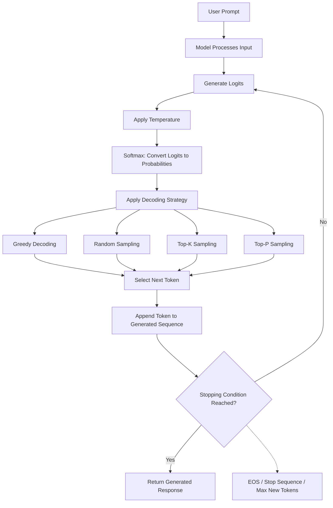

# Inference Configuration

Once a Large Language Model has been trained, it can be used to generate responses to user prompts. However, generating a response is not simply a matter of retrieving an already existing sentence from the model. The model generates its response one token at a time, repeatedly predicting what should come next based on the tokens it has already received or generated.

Although the model determines which tokens are likely to come next, the way those predictions are converted into actual output can be controlled through several inference configuration parameters. These parameters influence whether the model produces predictable responses, explores alternative possibilities, generates longer answers, or stops at a particular point.

For example, consider a user asking an LLM to complete the sentence:

"The capital of France is"

The model might assign a high probability to the token "Paris", while also assigning smaller probabilities to other possible tokens. How the model selects one of these candidates determines what gets generated next.

This process is controlled by several techniques and configuration parameters, including Greedy Decoding, Random Sampling, Top-K Sampling, Top-P Sampling, and Temperature.

In this section, we will understand how an LLM generates tokens, how different decoding strategies influence token selection, and how configuration parameters such as Max New Tokens and Stop Tokens control the generation process.

## Token Generation and Softmax

### How Does an LLM Generate Text?

A Large Language Model generates text through a process called autoregressive generation, where it predicts one token at a time using the tokens that are already available in its context.

When a user provides a prompt, the model processes the input and produces predictions for what the next token could be. After selecting a token, that token is added to the existing sequence, and the model performs another prediction to generate the next token.

This process continues until a stopping condition is reached, such as generating an end-of-sequence token or reaching the configured generation limit.

Consider the following prompt:

"The capital of France is"

The model might generate the following sequence:

1. Predict the next token: "Paris"
2. Add "Paris" to the existing sequence.
3. Predict the next token: "."
4. Add "." to the existing sequence.
5. Continue predicting subsequent tokens until the response is complete.

The final output becomes:

"The capital of France is Paris."

The important point is that the model does not necessarily generate the entire sentence at once. It repeatedly predicts and generates the next token based on the sequence available at that moment.

### What Are Logits?

When an LLM processes a prompt, its final output layer produces a numerical score for every possible token in its vocabulary.

These scores are called **logits**.

A logit represents how strongly the model currently favours a particular token as the next token in the sequence. Higher logits generally indicate that the model considers a token more likely than tokens with lower logits.

For example, suppose the model has the following vocabulary candidates after receiving the prompt "The capital of France is":

| Candidate Token | Logit |
| --------------- | ----: |
| Paris           |   5.2 |
| London          |   1.4 |
| Berlin          |   0.8 |
| Rome            |   0.2 |
| Tokyo           |  -0.5 |

These values represent the model's raw scores, not probabilities.

For example, a logit of 5.2 does not mean there is a 5.2% or 520% probability of selecting "Paris". Logits can be positive, negative, or zero, and they are not restricted to the range between 0 and 1.

We therefore need a way to convert these raw scores into probabilities that can be interpreted as a probability distribution over the possible next tokens.

This is where the Softmax function becomes important.

### What Is Softmax?

Softmax is a mathematical function that converts a collection of numerical scores, such as logits, into probabilities.

It transforms the raw scores into values between 0 and 1, ensuring that the probabilities across all candidate tokens add up to 1.

The Softmax function works by first applying the exponential function to each logit and then dividing each resulting value by the sum of all the exponentiated values.

In simple terms:

- Higher logits receive higher probabilities.
- Lower logits receive lower probabilities.
- Every candidate receives a non-negative probability.
- The sum of all probabilities equals 1.

For example, consider the following logits:

| Candidate Token | Logit | Approx. Probability |
| --------------- | ----: | ------------------: |
| Paris           |   5.2 |               96.4% |
| London          |   1.4 |                2.2% |
| Berlin          |   0.8 |                1.2% |
| Rome            |   0.2 |                0.7% |
| Tokyo           |  -0.5 |                0.3% |
| **Total**       |       |            **100%** |

The model now has a probability distribution describing how likely each candidate token is to be selected as the next token.

The exact probabilities depend on all the logits in the vocabulary, not just the individual token's own score.

### Why Is Softmax Important?

Softmax provides the probability distribution used by many token-selection strategies during inference.

Once the logits have been converted into probabilities, the generation system can use different decoding strategies to determine which token should be selected next.

For example:

- Greedy Decoding selects the token with the highest probability.
- Random Sampling selects a token randomly according to its probability.
- Top-K Sampling restricts selection to the `K` most probable candidates.
- Top-P Sampling restricts selection to a dynamically determined group of candidates.

Therefore, Softmax is an important part of the token-generation process because it converts the model's raw predictions into a form that can be used for token selection.

## Greedy Decoding

### What Is Greedy Decoding?

Greedy Decoding is a token-generation strategy in which the model always selects the token with the highest probability at each generation step.

Instead of considering alternative candidates or randomly selecting among possible tokens, the decoding strategy simply chooses the most probable token.

For example, suppose the model produces the following probability distribution:

| Candidate Token | Probability |
| --------------- | ----------: |
| Paris           |       96.4% |
| London          |        2.2% |
| Berlin          |        1.2% |
| Rome            |        0.7% |
| Tokyo           |        0.3% |

Greedy Decoding selects "Paris" because it has the highest probability.

The same process is repeated for every subsequent token.

### How Greedy Decoding Works

Consider the prompt:

"Machine learning is"

Suppose the model predicts the following probabilities for the next token:

| Candidate Token | Probability |
| --------------- | ----------: |
| transforming    |         45% |
| changing        |         30% |
| revolutionizing |         15% |
| improving       |         10% |

Greedy Decoding selects "transforming".

The model then processes the updated sequence:

"Machine learning is transforming"

It predicts the next token using this updated context and again selects whichever token has the highest probability.

This process continues until generation stops.

### Characteristics of Greedy Decoding

#### Deterministic Selection

For a fixed model, prompt, and inference configuration, greedy selection produces the same next token at each step. It does not randomly choose among alternative candidates.

#### Computational Simplicity

The strategy is straightforward because it only needs to identify the candidate with the highest probability at each generation step.

#### Predictable Output

It is useful when consistency and predictable token selection are more important than exploring alternative responses.

#### Limited Diversity

Since the most probable token is always selected, the generated response can become repetitive or overly predictable, particularly for creative or open-ended tasks.

Another important limitation is that choosing the most probable token at every individual step does not necessarily produce the most probable complete sequence of tokens. A locally optimal choice can influence subsequent predictions in ways that lead to a less desirable overall response.

### When Is Greedy Decoding Useful?

Greedy Decoding can be useful for straightforward tasks where predictable output is desirable, such as simple text completion, constrained responses, or certain extraction tasks.

However, for creative writing, conversational responses, and tasks where multiple valid answers exist, other decoding strategies may produce more varied and natural results.

## Random Sampling

### What Is Random Sampling?

Random Sampling is a token-generation strategy in which the model selects the next token randomly according to the probability distribution produced by the model.

Unlike Greedy Decoding, which always selects the highest-probability candidate, Random Sampling allows lower-probability candidates to be selected as well.

However, this does not mean that every candidate has an equal chance of being selected. Each token's probability determines how likely it is to be chosen.

Consider the following probability distribution:

| Candidate Token | Probability |
| --------------- | ----------: |
| transforming    |         45% |
| changing        |         30% |
| revolutionizing |         15% |
| improving       |         10% |

Random Sampling uses these probabilities to select the next token.

This means "transforming" is the most likely choice, but the model can also select "changing", "revolutionizing", or "improving".

### How Random Sampling Works

Suppose the model generates a response to:

"Machine learning is"

The model first produces a probability distribution for the next token.

Random Sampling then selects a token based on that distribution. For example, it might select "revolutionizing" even though "transforming" has a higher probability.

The updated sequence becomes:

"Machine learning is revolutionizing"

The model then generates a new probability distribution based on the updated context and performs another sampling operation.

This process continues until the response is complete.

### Characteristics of Random Sampling

#### Greater Diversity

Random Sampling allows the model to explore alternative token sequences instead of always selecting the highest-probability candidate.

#### Probabilistic Selection

Tokens with higher probabilities are more likely to be selected, but lower-probability tokens remain possible.

#### Non-deterministic Output

Repeated generation with the same prompt can produce different responses because token selection involves randomness.

#### Possibility of Unexpected Output

Sampling from the entire vocabulary can occasionally select tokens that are unlikely to be appropriate for the current context, particularly when their probabilities are very small.

### Why Do We Need More Controlled Sampling Strategies?

Random Sampling introduces diversity, but allowing every possible token to participate in the selection process is not always desirable.

For example, a model's vocabulary may contain thousands or even hundreds of thousands of tokens. Most of these tokens will have extremely small probabilities for a particular generation step.

Allowing all candidates to participate can introduce unnecessary possibilities.

This motivates more controlled sampling techniques such as Top-K and Top-P Sampling, which restrict the candidate tokens before performing random selection.

## Top-K Sampling

### What Is Top-K Sampling?

Top-K Sampling is a token-generation strategy that restricts the candidate tokens to the `K` most probable tokens before performing Random Sampling.

Instead of sampling from the entire vocabulary, the model first identifies the `K` candidates with the highest probabilities and removes all other candidates from consideration.

Random Sampling is then performed using the probability distribution of the remaining candidates, normalized so that their probabilities add up to 1.

The value of `K` determines how many candidate tokens are allowed to participate in the selection process.

### How Top-K Sampling Works

Consider the following probability distribution:

| Candidate Token | Original Probability |
| --------------- | -------------------: |
| transforming    |                  40% |
| changing        |                  25% |
| revolutionizing |                  15% |
| improving       |                  10% |
| evolving        |                   6% |
| declining       |                   3% |
| disappearing    |                   1% |

Suppose we configure `K = 3`.

The model selects the three highest-probability candidates:

| Candidate Token | Original Probability |
| --------------- | -------------------: |
| transforming    |                  40% |
| changing        |                  25% |
| revolutionizing |                  15% |

All remaining candidates are excluded.

However, the probabilities of the remaining candidates must now be normalized because the original probabilities add up to only 80%.

The new probability distribution becomes:

| Candidate Token | Normalized Probability |
| --------------- | ---------------------: |
| transforming    |                    50% |
| changing        |                 31.25% |
| revolutionizing |                 18.75% |

Random Sampling is then performed using this restricted distribution.

The model can select any of these three candidates, but it cannot select "improving", "evolving", or the other excluded tokens.

### How Does the Value of `K` Affect Generation?

The value of `K` controls the number of candidates available during sampling.

#### Small `K`

A smaller `K` restricts the model to fewer candidate tokens, generally making generation more focused and reducing diversity.

For example, `K = 1` effectively becomes Greedy Decoding because only the highest-probability token remains available.

#### Large `K`

A larger `K` allows more candidate tokens to participate in sampling, increasing the range of possible outputs.

As `K` becomes sufficiently large to include the entire vocabulary, Top-K Sampling approaches ordinary Random Sampling.

### Characteristics of Top-K Sampling

#### Controlled Candidate Selection

Only the `K` most probable tokens are considered during generation.

#### Reduced Unlikely Selections

Tokens outside the top `K` candidates cannot be selected, reducing the possibility of generating unexpected low-probability tokens.

#### Adjustable Diversity

Changing `K` allows us to control how many alternatives remain available.

#### Fixed Candidate Count

The main limitation is that `K` remains constant even when the probability distribution changes significantly between generation steps.

For example, one generation step might have only two highly probable candidates, while another might have twenty reasonably probable candidates. A fixed `K` does not adapt to these differences.

This limitation motivates Top-P Sampling.

## Top-P (Nucleus) Sampling

### What Is Top-P Sampling?

Top-P Sampling, also known as Nucleus Sampling, is a token-generation strategy that selects a group of candidate tokens whose cumulative probability reaches or exceeds a configured threshold `P`.

Unlike Top-K Sampling, which always selects a fixed number of candidates, Top-P Sampling dynamically determines how many candidates should participate based on their probability distribution.

The model first sorts the candidate tokens in descending order of probability. It then adds their probabilities cumulatively until the total reaches or exceeds the configured `P` value.

Only the tokens in this group remain eligible for Random Sampling.

### How Top-P Sampling Works

Consider the following probability distribution:

| Candidate Token | Probability | Cumulative Probability |
| --------------- | ----------: | ---------------------: |
| transforming    |         40% |                    40% |
| changing        |         25% |                    65% |
| revolutionizing |         15% |                    80% |
| improving       |         10% |                    90% |
| evolving        |          6% |                    96% |
| declining       |          3% |                    99% |
| disappearing    |          1% |                   100% |

Suppose we configure `P = 0.80`, or 80%.

The model starts adding the probabilities from the highest-probability candidate:

- "transforming": 40%
- "changing": `40% + 25% = 65%`
- "revolutionizing": `65% + 15% = 80%`

The cumulative probability has now reached the configured threshold.

Therefore, the candidate set contains:

- transforming
- changing
- revolutionizing

All other candidates are excluded.

The remaining probabilities are normalized, and Random Sampling is performed using the restricted distribution.

### How Does the Value of `P` Affect Generation?

The `P` value determines how much of the probability distribution is retained.

#### Lower `P`

A lower `P` generally produces a smaller candidate set, restricting the model to the most probable tokens and reducing diversity.

#### Higher `P`

A higher `P` generally produces a larger candidate set, allowing more possible tokens to participate in sampling and increasing diversity.

For example:

- `P = 0.50` retains enough candidates to cover at least 50% of the cumulative probability.
- `P = 0.80` retains enough candidates to cover at least 80%.
- `P = 0.95` retains enough candidates to cover at least 95%.

The actual number of candidates depends on the probability distribution at each generation step.

### Characteristics of Top-P Sampling

#### Dynamic Candidate Selection

Unlike Top-K Sampling, the number of candidate tokens changes according to the probability distribution.

#### Adaptive Diversity

When the model is highly confident about the next token, fewer candidates may be sufficient to reach the threshold. When the probability distribution is more spread out, more candidates may be retained.

#### Reduced Low-Probability Candidates

Tokens outside the selected nucleus cannot participate in sampling.

#### More Flexible Than Fixed `K`

Top-P adapts to the model's confidence distribution rather than relying on a fixed candidate count.

### Top-K vs Top-P Sampling

Both techniques restrict the candidate tokens before performing Random Sampling, but they use different selection criteria.

| Aspect             | Top-K Sampling                           | Top-P Sampling                           |
| ------------------ | ---------------------------------------- | ---------------------------------------- |
| Selection criteria | Fixed number of candidates               | Cumulative probability threshold         |
| Candidate count    | Fixed `K`                                | Dynamically determined                   |
| Adaptability       | Less adaptive                            | More adaptive                            |
| Main parameter     | `K`                                      | `P`                                      |
| Sampling           | Random sampling from retained candidates | Random sampling from retained candidates |

Top-K is useful when we want to explicitly control the number of possible candidates, whereas Top-P is useful when we want the candidate set to adapt to the probability distribution.

## Temperature

### What Is Temperature?

Temperature is an inference configuration parameter that controls how sharply or uniformly the model's probability distribution is shaped during token generation.

It modifies the logits before they are passed through the Softmax function.

A lower temperature makes the probability distribution more concentrated around higher-scoring tokens, while a higher temperature makes the distribution more uniform.

This means Temperature influences how strongly the model favours its most probable tokens relative to alternative candidates.

### How Does Temperature Work?

To understand Temperature, remember that the model initially produces logits for possible next tokens.

Before applying Softmax, the logits are divided by the configured Temperature value.

The resulting values are then passed through Softmax to produce the adjusted probability distribution.

For example, suppose the original logits are:

| Candidate Token | Original Logit |
| --------------- | -------------: |
| transforming    |            5.0 |
| changing        |            4.0 |
| revolutionizing |            3.0 |

With a Temperature of `1.0`, the logits remain unchanged before Softmax.

However, when Temperature is changed, the relative differences between the logits are scaled.

#### Low Temperature: `T = 0.5`

Dividing the logits by 0.5 doubles their values, increasing the differences between them.

The highest-scoring candidate becomes more dominant, and the probability distribution becomes more concentrated.

#### Normal Temperature: `T = 1.0`

The logits remain unchanged before Softmax, producing the original probability distribution.

#### High Temperature: `T = 2.0`

Dividing the logits by 2 reduces the differences between them.

The probability distribution becomes more uniform, giving alternative candidates a greater chance of being selected during sampling.

### How Does Temperature Affect Output?

Temperature changes the distribution from which sampling strategies select tokens.

#### Low Temperature

- Makes the model favour high-probability tokens.
- Reduces randomness in sampling.
- Produces more predictable and focused responses.
- Can make responses repetitive or overly conservative.

#### High Temperature

- Makes alternative tokens more competitive.
- Increases diversity during sampling.
- Can produce more creative or unexpected responses.
- Can also increase the possibility of irrelevant or incoherent output.

#### `Temperature = 1`

Preserves the original probability distribution produced by Softmax, assuming no other transformations are applied.

### Important Distinction: Temperature vs Sampling Strategy

Temperature and sampling strategies are related, but they are not the same thing.

Temperature changes the probability distribution by modifying the logits before Softmax.

Sampling strategies determine how the next token is selected from the resulting probability distribution.

For example:

- Greedy Decoding selects the highest-probability token.
- Random Sampling selects according to the probability distribution.
- Top-K Sampling restricts the candidates before sampling.
- Top-P Sampling restricts the candidates based on cumulative probability.

Changing Temperature does not automatically mean that the model will select a different token.

For example, Greedy Decoding will generally select the same highest-logit token regardless of Temperature, provided the Temperature is positive and no other processing changes the ranking.

Temperature has a more direct effect when probabilistic sampling is used.

## Max New Tokens

### What Is Max New Tokens?

Max New Tokens is an inference configuration parameter that specifies the maximum number of new tokens the model is allowed to generate in response to a prompt.

It controls the length of the generated response by placing an upper limit on the number of tokens produced during a generation request.

For example, suppose we configure:

```text
Max New Tokens = 100
```

The model can generate up to 100 new tokens. Once it reaches that limit, generation stops, even if the model would otherwise continue producing additional text.

It is important to understand that Max New Tokens controls the generated output, not the total size of the prompt or the entire context window.

### How Does Max New Tokens Work?

Consider the following prompt:

"Explain how a database index improves query performance."

If Max New Tokens is configured as 50, the model can generate up to 50 new tokens.

If the model reaches that limit before completing its explanation, the response may be truncated.

Now consider increasing the configuration to 300 tokens.

The model has more room to produce a detailed explanation, assuming it does not encounter another stopping condition first.

### Why Is Max New Tokens Important?

#### Response Length Control

It prevents the model from generating unnecessarily long responses.

#### Resource Management

Generating additional tokens requires computational resources. Limiting the output can help control inference cost and processing time.

#### Latency Management

Longer generated responses generally require more generation steps, which can increase response latency.

#### Application Constraints

An application may require responses to stay within a specific token budget to satisfy downstream processing or API constraints.

### Max New Tokens vs Context Window

These two concepts are related but serve different purposes.

The Context Window defines the total available token capacity for the model's input and generated output.

Max New Tokens defines the maximum number of new tokens the model is allowed to generate for a particular request.

For example:

- Context Window: 32,000 tokens.
- Input Prompt: 10,000 tokens.
- Max New Tokens: 2,000 tokens.

The model has sufficient context capacity for the input and the configured output limit.

However, configuring Max New Tokens to 30,000 would not necessarily work because the combined input and maximum output would exceed the available context capacity.

Therefore, the generation limit must be considered alongside the model's Context Window.

## Stop Tokens

### What Are Stop Tokens?

Stop Tokens are special tokens or configured stopping markers that indicate when the model should stop generating additional output.

During autoregressive generation, the model continues predicting and producing tokens until a stopping condition is reached.

One important stopping condition is the generation of a special token called the End-of-Sequence (EOS) token.

When the model generates EOS, it indicates that the current output sequence is complete, and generation should stop.

However, applications can also configure additional stopping conditions to control when generation should terminate.

### End-of-Sequence (EOS) Token

An EOS token is a special token in the model's vocabulary that represents the end of a generated sequence.

Unlike ordinary text tokens, EOS is used to signal that the model has completed its response.

For example, consider the following generation:

```text
Input:
What is the capital of France?

Generated:
The capital of France is Paris.

EOS
```

Once the EOS token is generated, the inference system recognizes that the response is complete and stops generating additional tokens.

The actual EOS token representation varies across model architectures and tokenizers.

### Custom Stop Sequences

Apart from EOS, many LLM inference systems support custom stopping conditions, commonly called Stop Sequences.

A Stop Sequence is a configured text pattern or token sequence that tells the generation system to stop when that pattern appears in the generated output.

For example, consider an application that asks an LLM to generate SQL queries.

The application might configure a stopping sequence so that the model stops generating when it reaches a specific delimiter.

Another example is a system that expects the model to produce a response followed by a particular marker. Once the marker appears, the application can terminate generation rather than allowing the model to continue.

Unlike EOS, a custom stop sequence does not necessarily have to be a dedicated special token in the model's vocabulary. It can be an ordinary text sequence recognized by the inference system.

### Stop Tokens vs Max New Tokens

Both mechanisms can terminate text generation, but they work differently.

| Aspect      | Stop Tokens / Stop Sequences                               | Max New Tokens                             |
| ----------- | ---------------------------------------------------------- | ------------------------------------------ |
| Purpose     | Stop generation when a specified stopping condition occurs | Limit the maximum generated token count    |
| Trigger     | EOS or configured stop sequence                            | Reaching the configured token limit        |
| Behaviour   | Can stop before reaching the maximum output length         | Stops when the generation limit is reached |
| Primary use | Detecting completion or application-specific boundaries    | Controlling output length                  |

For example, suppose an application configures Max New Tokens to 500 and also defines a custom Stop Sequence.

If the model generates the configured Stop Sequence after 120 tokens, generation terminates at that point rather than continuing to 500 tokens.

If no stopping condition occurs, generation can continue until it reaches the configured token limit.

One implementation detail worth understanding is that some inference systems exclude the matched custom Stop Sequence from the text returned to the application, while others expose different stopping metadata. This behaviour depends on the serving implementation.

## Putting Everything Together: The Token Generation Process

We have now covered the different techniques and configuration parameters that influence how an LLM generates its output.

It is useful to understand how these concepts work together during a single inference request.

Consider a user asking:

"Write a short explanation of how distributed databases work."

The inference system receives the prompt along with its generation configuration.

The model processes the input and produces logits representing the possible next tokens. These logits are adjusted using Temperature, if configured, and converted into probabilities using Softmax.

The configured decoding strategy then determines which candidate token should be selected. Depending on the configuration, the system might use Greedy Decoding, Random Sampling, Top-K Sampling, or Top-P Sampling.

The selected token is added to the existing sequence, and the model predicts the next token using the updated context.

This process repeats until an EOS token, a configured Stop Sequence, or the Max New Tokens limit is reached.

### Complete Generation Flow

<div style={{textAlign: 'center'}}>



</div>

The diagram represents the conceptual generation process. In an actual inference implementation, candidate filtering for Top-K or Top-P is performed on the probability distribution, and the exact order of sampling-related operations can depend on the inference framework.

## Summary: Understanding the Inference Configuration Parameters

The different techniques covered in this section serve distinct purposes during text generation.

| Concept          | Primary Responsibility                                                          |
| ---------------- | ------------------------------------------------------------------------------- |
| Token Generation | Predicting and generating the next token repeatedly                             |
| Logits           | Representing the model's raw scores for candidate tokens                        |
| Softmax          | Converting logits into a probability distribution                               |
| Greedy Decoding  | Selecting the highest-probability token                                         |
| Random Sampling  | Randomly selecting a token according to its probability                         |
| Top-K Sampling   | Restricting selection to a fixed number of high-probability candidates          |
| Top-P Sampling   | Restricting selection to candidates covering a cumulative probability threshold |
| Temperature      | Controlling the sharpness of the probability distribution                       |
| Max New Tokens   | Limiting the maximum number of generated tokens                                 |
| Stop Tokens      | Terminating generation when a stopping condition is reached                     |
