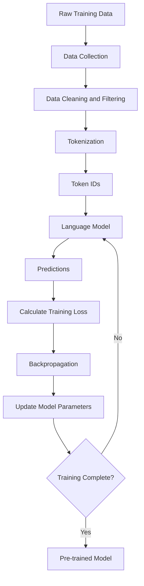
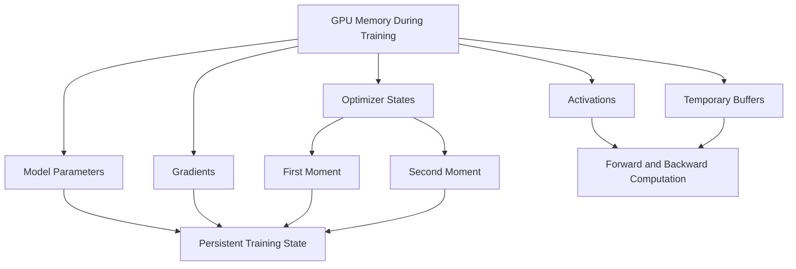

# Model Pre-training and Scaling

A Large Language Model does not begin with the ability to understand instructions, answer questions, summarize documents, or generate meaningful text. These capabilities emerge through a training process in which the model is exposed to large amounts of data and learns patterns, relationships, and statistical structures within that data.

The first major stage in developing an LLM is called **Pre-training**. During this stage, a model is trained on a large and diverse collection of text so that it can learn general language representations and develop the ability to predict or reconstruct parts of the input.

Unlike traditional machine learning systems that are often trained for a specific task, pre-trained language models are designed to acquire general-purpose capabilities that can subsequently be adapted to different applications.

However, training an LLM is considerably more complicated than simply providing a large dataset to a model. It involves collecting and processing training data, converting text into numerical representations, selecting an appropriate training objective, determining the model's size, and managing the computational resources required to train it.

As model sizes increase, these requirements become increasingly challenging. Training larger models requires more GPU memory, greater computational capacity, and careful management of numerical precision. Techniques such as FP16, BFLOAT16, and INT8 help address some of these challenges by reducing the amount of memory and computational resources required for numerical operations.

In this section, we will understand how LLM pre-training works, how training datasets are prepared, how different training objectives are used, and how model size, GPU memory, and numerical precision influence the overall training process.

## LLM Pre-training Overview

### What Is Pre-training?

Pre-training is the initial training stage in which a language model learns general patterns and representations from a large collection of data before being adapted to specific tasks or applications.

During pre-training, the model is exposed to enormous amounts of text collected from different sources, such as books, articles, websites, documentation, and other publicly or privately available datasets.

The objective is to develop a model that can recognize relationships between tokens, understand language patterns, and learn how different pieces of information relate to one another.

For example, consider the following sentence:

"The application stores user information in a database."

After processing millions or billions of similar examples, the model gradually learns relationships between concepts such as applications, users, information, and databases.

It learns that certain words and concepts frequently appear together, that sentences follow grammatical structures, and that the meaning of a word can depend on its surrounding context.

These learned patterns form the foundation for the model's subsequent capabilities.

### How Does Pre-training Work?

The pre-training process can be understood through a sequence of steps.

#### Step 1: Collect Training Data

The first step is to gather a sufficiently large and diverse collection of text from different sources.

For example, a training dataset might contain:

- Books and educational material.
- Websites and online articles.
- Technical documentation.
- Research papers.
- Programming code.
- Publicly available datasets.

The purpose is to expose the model to a broad range of language patterns, topics, and information.

#### Step 2: Process and Clean the Data

Raw text collected from different sources often contains duplicate content, formatting issues, irrelevant material, and low-quality information.

The dataset must therefore be cleaned and filtered before it is used for training.

This process improves the quality of the training material and reduces unnecessary or harmful information.

#### Step 3: Tokenize the Data

The cleaned text is converted into tokens using a tokenizer.

These tokens are then mapped to numerical token IDs that the model can process.

For example:

"The application is ready."

Might be represented as:

[The, application, is, ready, .]

The actual tokenization depends on the tokenizer and its vocabulary; a word may also be split into multiple subword tokens.

#### Step 4: Feed the Data into the Model

The token IDs are provided to the model as training input.

The model processes these tokens and produces predictions according to its training objective.

For example, a model trained using Causal Language Modeling attempts to predict the next token in a sequence, whereas a model trained using Masked Language Modeling attempts to predict deliberately hidden tokens.

#### Step 5: Calculate the Training Loss

The model's predictions are compared with the expected target tokens.

The difference between the predictions and the actual targets is measured using a loss function.

A lower loss generally indicates that the model is becoming better at performing its training objective.

#### Step 6: Update Model Parameters

The training process uses backpropagation to calculate gradients and an optimization algorithm to update the model's parameters.

The objective is to gradually reduce the training loss by adjusting the numerical values of the model's parameters.

These steps are repeated across large amounts of training data, allowing the model to progressively improve its ability to perform the selected prediction task.

### Understanding the Complete Pre-training Pipeline

The following diagram illustrates the major stages involved in pre-training a language model.

<div style={{textAlign: 'center'}}>



</div>

The important point is that pre-training is an iterative process. The model repeatedly processes training examples, evaluates its predictions, and updates its parameters until the training process reaches its configured stopping criteria.

### What Does a Model Learn During Pre-training?

Pre-training does not explicitly teach the model every possible task it might eventually perform. Instead, it exposes the model to a large amount of data and allows it to learn general patterns that can be useful across different tasks.

Some important capabilities that can emerge include:

#### Language Understanding

The model learns grammatical structures, word relationships, sentence patterns, and contextual associations.

#### Semantic Relationships

It learns that different words and phrases can represent related concepts, even when they are not identical.

For example, the words "car", "vehicle", and "automobile" have closely related meanings.

#### General Knowledge

By processing information from diverse sources, the model learns statistical associations about people, places, technologies, history, science, and many other subjects.

#### Contextual Relationships

The model learns that the interpretation of a word can change depending on the surrounding text.

For example, the word "bank" can refer to a financial institution or the side of a river, depending on the sentence.

#### Language Generation Patterns

The model learns how sequences of tokens are commonly structured, allowing it to generate coherent text when given an appropriate prompt.

### Pre-training vs Fine-tuning

Pre-training and Fine-tuning are two different stages in the development of an LLM.

Pre-training provides the model with broad, general-purpose capabilities, whereas Fine-tuning adapts an already trained model to a more specific task, domain, or desired behaviour.

Consider an LLM being developed for customer support.

During pre-training, the model learns general language patterns from a large collection of text.

During fine-tuning, the model can be trained further using customer support conversations, categorized support requests, and examples of appropriate responses.

| Aspect           | Pre-training               | Fine-tuning                              |
| ---------------- | -------------------------- | ---------------------------------------- |
| Starting point   | Initial model parameters   | Pre-trained model                        |
| Training data    | Large and diverse dataset  | Task-specific or domain-specific dataset |
| Objective        | Learn general capabilities | Adapt existing capabilities              |
| Training scope   | Broad                      | More specialized                         |
| Model parameters | Updated                    | Updated further                          |

Pre-training establishes the foundation, while fine-tuning specializes the model for a particular purpose.

## Training Data Collection and Data Quality Filtering

### Why Is Training Data Important?

The quality of a language model depends significantly on the data used during training.

A model learns patterns from the information it processes. If its training dataset contains inaccurate information, excessive duplication, poorly formatted text, or irrelevant material, these issues can influence the quality of the resulting model.

For example, consider training a language model using a dataset containing millions of duplicated articles, broken sentences, advertisements, and incorrectly extracted text.

Although the dataset might contain a very large number of tokens, a considerable portion of those tokens may provide little useful information.

This is why collecting large amounts of data is not sufficient. The data must also be relevant, diverse, and of sufficient quality.

### Sources of Training Data

LLM training datasets are generally assembled from multiple sources to provide a diverse representation of language and knowledge.

Some common sources include:

#### Websites and Online Content

Web pages provide large amounts of publicly accessible information covering different topics, industries, and writing styles.

Examples include educational websites, technical blogs, documentation, and informational articles.

#### Books and Publications

Books provide long-form content with more developed explanations, structured narratives, and detailed subject matter.

#### Research Papers

Scientific publications and research papers provide specialized knowledge, technical terminology, and detailed explanations of complex subjects.

#### Programming Code

Code repositories and technical documentation can help models learn programming syntax, common programming patterns, and relationships between code and natural-language explanations.

#### Encyclopedias and Reference Material

Structured reference sources provide organized information about different subjects and can contribute to the model's general knowledge.

#### Licensed and Proprietary Datasets

Some organizations use licensed content or internally collected datasets as part of their training pipelines, subject to applicable permissions and restrictions.

A diverse dataset is important because relying too heavily on a narrow set of sources can limit the range of information and language patterns the model encounters.

### Why Does Raw Data Need Filtering?

Raw datasets collected from the internet and other sources are rarely suitable for direct use in large-scale training.

They can contain several problems:

- Duplicate articles and repeated paragraphs.
- Broken HTML and formatting artifacts.
- Spam and automatically generated content.
- Irrelevant advertisements and navigation elements.
- Incomplete or corrupted documents.
- Low-quality machine-generated text.
- Incorrect information.
- Personally identifiable information.
- Toxic or harmful material.

If these issues are not handled appropriately, they can waste computational resources and negatively influence the model's learned patterns.

Data quality filtering is therefore an important part of the pre-training pipeline.

### Data Quality Filtering Techniques

Several techniques are commonly used to improve the quality of training datasets.

#### Data Cleaning

Data cleaning removes unnecessary formatting and irrelevant elements from raw documents.

For example, a web page might contain:

```text
Home | Products | Pricing | Contact

How Database Indexing Works

A database index improves query performance...

Subscribe to our newsletter.

Copyright 2026.
```

The cleaning process attempts to extract the meaningful article content while removing navigation elements, advertisements, and unrelated page information.

This helps ensure that the model primarily processes useful textual information.

#### Deduplication

Deduplication identifies and removes repeated content from the training dataset.

Duplicates can occur when the same article is available on multiple websites, when documents are copied, or when the same content appears in different dataset collections.

For example:

```text
Document A:
A database index improves query performance.

Document B:
A database index improves query performance.
```

If both documents are included repeatedly, the model may encounter the same information unnecessarily many times.

Deduplication can be performed at different levels:

- Exact document deduplication.
- Near-duplicate document detection.
- Paragraph-level deduplication.
- Sentence-level deduplication.

Exact deduplication identifies identical content, while near-duplicate detection attempts to identify content that is substantially similar even if minor wording or formatting differences exist.

Techniques such as hashing, MinHash, and similarity-based comparisons can help identify duplicated or near-duplicated documents.

#### Quality Filtering

Quality filtering attempts to remove documents that are unlikely to provide useful training information.

For example, documents containing excessive spelling errors, broken sentences, random characters, or extremely repetitive content may be classified as low quality.

Some pipelines use heuristic rules, statistical features, or trained classifiers to estimate document quality.

#### Language Filtering

Large datasets can contain text in many different languages.

Depending on the model's intended scope, the training pipeline may identify the language of each document and select the appropriate material.

For example, a multilingual model may retain documents across many languages, whereas a model focused primarily on English may apply stricter language-based filtering.

#### Toxicity and Safety Filtering

Training datasets may contain abusive, hateful, or otherwise harmful material.

Filtering systems can identify and remove certain categories of harmful content, depending on the model's intended purpose and data policies.

It is important to understand that removing all potentially harmful content is not always desirable. Some models may need carefully selected examples of harmful content for safety evaluation or other legitimate purposes.

#### Personally Identifiable Information Filtering

Training data can contain sensitive information such as email addresses, phone numbers, and other personal identifiers.

Privacy-related filtering attempts to identify and remove or appropriately handle such information before it enters the training dataset.

This is particularly important when working with data collected from public websites or internal organizational sources.

### Deduplication vs Quality Filtering

These two techniques are related but solve different problems.

| Aspect       | Deduplication                          | Quality Filtering                        |
| ------------ | -------------------------------------- | ---------------------------------------- |
| Purpose      | Remove repeated content                | Remove unsuitable content                |
| Main concern | Redundancy                             | Data quality                             |
| Example      | Identical articles                     | Broken or meaningless text               |
| Techniques   | Hashing, MinHash, similarity detection | Heuristics, classifiers, quality scoring |

A document can be high quality but duplicated, or unique but extremely poor quality. Therefore, both techniques are important.

### Data Mixing and Dataset Composition

After collecting and filtering data, the training pipeline must also determine how different sources should be combined.

This is known as dataset composition or data mixing.

For example, a training dataset might contain:

- General web content.
- Books and educational material.
- Scientific publications.
- Programming code.
- Reference documents.

The proportion of each source influences the information and patterns the model encounters during training.

If the dataset contains too much low-quality web content and very little technical documentation, the model may receive a different learning signal than a dataset with a more balanced composition.

Therefore, dataset composition is an important consideration when developing general-purpose and specialized language models.

### Data Leakage

Another important concern during dataset preparation is data leakage.

Data leakage occurs when information that should be reserved for evaluation or testing unintentionally becomes part of the training data.

For example, suppose a model is evaluated using a collection of benchmark questions. If the exact questions and their answers are already present in the training dataset, the evaluation may overestimate the model's actual generalization ability.

The model might reproduce information it has previously encountered instead of demonstrating that it can independently solve the problem.

Deduplication, dataset tracking, and careful evaluation-data management help reduce this risk.

The important takeaway is that the quality of a training dataset depends not only on how much data is collected, but also on how effectively that data is selected, cleaned, filtered, and organized.

## Tokenization and Embeddings in Pre-training

### Why Do We Need Tokenization?

Language models operate on numerical representations rather than directly processing ordinary human-readable text.

Before textual data can be used for training, it must be converted into a representation that the model can process.

Tokenization is the process of dividing text into smaller units called tokens.

A token can represent an entire word, a part of a word, punctuation, or another textual unit, depending on the tokenizer.

For example, consider the sentence:

"Building scalable applications."

A tokenizer might represent it as:

```text
["Building", " scalable", " applications", "."]
```

However, another tokenizer might divide the same sentence into a different sequence of tokens.

The important point is that tokenization converts text into a sequence of manageable units that can be mapped to numerical identifiers.

### What Is a Token ID?

Once text is divided into tokens, each token is mapped to a unique numerical identifier called a Token ID.

A tokenizer maintains a vocabulary containing the tokens it recognizes and their corresponding IDs.

For example:

| Token        | Token ID |
| ------------ | -------: |
| Building     |     1542 |
| scalable     |     8271 |
| applications |     3918 |
| .            |       13 |

The sentence can now be represented as:

```text
[1542, 8271, 3918, 13]
```

These numerical identifiers are what the model receives as its tokenized input.

The actual token IDs depend on the vocabulary and tokenizer being used. They are not universal across different models.

### Why Not Simply Use Individual Words?

One approach would be to create a vocabulary containing every possible word and assign each word a unique identifier.

However, natural language contains an enormous number of words, spelling variations, compound terms, technical expressions, and newly created words.

A word-level tokenizer would also struggle with unfamiliar words that were not included in its vocabulary.

For example, consider a newly introduced technical term.

If the tokenizer does not recognize that word, it would need some mechanism to represent it.

Subword tokenization addresses this problem by dividing words into smaller, reusable units.

### Subword Tokenization

Subword tokenization divides words into smaller units that can be reused across different words.

For example:

```text
"unbelievable"

Possible tokenization:

["un", "believ", "able"]
```

Instead of requiring the complete word to exist in the vocabulary, the tokenizer can represent it using smaller components.

This offers several advantages:

#### Smaller Vocabulary

The tokenizer does not need to maintain a separate entry for every possible word.

#### Handling Unseen Words

Unfamiliar words can often be represented using combinations of known subword tokens.

#### Reusable Components

The same subword units can appear in many different words, making the vocabulary more efficient.

### Common Tokenization Algorithms

Several algorithms are used to construct subword vocabularies.

#### Byte Pair Encoding (BPE)

BPE starts with smaller units, often individual characters or bytes, and repeatedly merges frequently occurring adjacent units to construct larger tokens.

For example, suppose a training corpus frequently contains the character sequence:

```text
l o w
```

The algorithm may learn to merge these units into a single token:

```text
low
```

Repeated merges gradually build a vocabulary containing frequently occurring subword units.

BPE is widely used in language-model tokenization.

#### WordPiece

WordPiece is another subword tokenization approach that builds a vocabulary by selecting combinations of smaller units based on how effectively they represent the training corpus.

It is associated with BERT and uses a scoring-based vocabulary construction approach.

A tokenization might look like:

```text
"playing"

["play", "##ing"]
```

The prefix notation indicates that the subword continues a preceding word.

#### Unigram Language Model Tokenization

The Unigram approach begins with a relatively large collection of possible subword tokens and progressively removes tokens that contribute less to the overall tokenization objective.

It selects a tokenization based on the probabilities assigned to possible segmentations.

SentencePiece is a commonly used tokenization framework that supports Unigram and BPE algorithms.

### What Are Embeddings?

Token IDs are numerical identifiers, but the identifiers themselves do not contain meaningful semantic information.

For example, consider these two tokens:

```text
Database  -> 1542
Storage   -> 8271
```

The numerical difference between 1542 and 8271 does not tell us that databases and storage are related concepts.

This is where Embeddings become important.

An embedding is a numerical vector representing a token in a multidimensional space.

Instead of using a single integer to represent a token, the model maps its Token ID to a vector containing multiple numerical values.

For example:

```text
Database -> [0.21, -0.43, 0.87, 0.15, ...]
Storage  -> [0.19, -0.38, 0.82, 0.22, ...]
```

These vectors are learned numerical representations. During training, the model adjusts its embedding parameters so that the representations become useful for the tasks it is learning.

### How Are Embeddings Learned During Pre-training?

An embedding layer typically contains a trainable matrix called the embedding matrix.

Suppose a model has:

- Vocabulary size: 50,000 tokens.
- Embedding dimension: 768.

Its embedding matrix contains 50,000 rows and 768 columns.

Each row represents the learned embedding vector associated with one token in the vocabulary.

When the model receives a Token ID, it retrieves the corresponding row from the embedding matrix.

For example:

```text
Token ID: 1542

          Embedding Matrix
    +---------------------------+
    | Token 0   -> [ ... ]      |
    | Token 1   -> [ ... ]      |
    | Token 2   -> [ ... ]      |
    | ...                       |
    | Token 1542-> [ ... ]      |
    | ...                       |
    | Token 49999 -> [ ... ]    |
    +---------------------------+

Output: Numerical embedding vector
```

The embedding matrix is generally initialized before training and its parameters are updated through the training process.

As the model learns, these representations become useful for capturing statistical and semantic relationships between tokens.

An important distinction is that token embeddings are not fixed dictionary definitions. Their values are learned through optimization and depend on the training process.

### Token Embeddings vs Contextual Representations

A token embedding represents a token using its learned embedding vector, whereas a contextual representation reflects how that token is interpreted within a particular input sequence.

Consider the word "bank":

"The bank approved the loan."

"The river bank was covered with trees."

The same token can appear in both sentences, but its contextual meaning is different.

The initial token embedding is associated with the token itself. As the model processes the surrounding sequence, its internal representations incorporate contextual information.

This distinction is important because the model must be able to interpret the same token differently depending on the information surrounding it.

### Why Are Tokenization and Embeddings Important for Pre-training?

Tokenization and embeddings provide the numerical foundation required for training language models.

Tokenization converts raw text into token IDs, while embeddings convert those IDs into numerical vectors that the model can learn from.

Together, they allow a language model to process large textual datasets using numerical operations.

## Model Pre-training Objectives

### What Is a Pre-training Objective?

A pre-training objective defines what a language model is expected to learn during training and how its predictions are evaluated.

In other words, it determines the prediction or reconstruction task that the model repeatedly performs while processing the training dataset.

The model is given some input, produces a prediction, and compares that prediction with an expected target.

The difference between the prediction and the target is measured using a loss function, which is then used to update the model's parameters.

Different pre-training objectives teach models to learn language in different ways.

Three important objectives are:

1. Masked Language Modeling (MLM).
2. Causal Language Modeling (CLM).
3. Span Corruption.

### Masked Language Modeling (MLM)

#### What Is Masked Language Modeling?

Masked Language Modeling is a pre-training objective in which selected tokens in an input sequence are hidden or replaced with a special mask token, and the model is trained to predict the original tokens.

Instead of predicting the next token in a sequence, the model attempts to reconstruct missing information using the surrounding context.

For example, consider the sentence:

"The developer deployed the application because it was ready."

A training example might look like:

```text
Input:
The developer deployed the [MASK] because it was ready.

Expected Prediction:
application
```

The model must use the surrounding words to infer the missing token.

#### How Does MLM Work?

The process involves the following steps:

##### Step 1: Select Tokens for Masking

A subset of tokens is selected from the original input sequence.

In the original BERT training setup, approximately 15% of the input tokens are selected as prediction targets.

##### Step 2: Replace Selected Tokens

The selected tokens are modified to create a corrupted input.

In the original BERT approach, the selected positions are handled using a mixture of strategies:

- 80% are replaced with the special [MASK] token.
- 10% are replaced with a random token.
- 10% are left unchanged.

These percentages apply to the selected prediction positions, not to the entire input sequence.

##### Step 3: Process the Corrupted Input

The model processes the sequence containing the masked or modified tokens.

##### Step 4: Predict the Original Tokens

The model produces predictions for the selected positions.

##### Step 5: Calculate Loss

The predicted tokens are compared against the original tokens, and the resulting loss is used to update the model's parameters.

#### Why Is MLM Useful?

MLM allows the model to learn relationships between tokens using information from both sides of the missing position.

For example:

```text
The developer deployed the [MASK] because it was ready.
```

The model can use the words before and after the masked position to infer the missing token.

This makes MLM particularly useful for learning contextual language representations.

#### Example: BERT

BERT (Bidirectional Encoder Representations from Transformers) is a well-known model that uses Masked Language Modeling as one of its original pre-training objectives.

BERT learns to predict masked tokens using the surrounding context, making it particularly useful for tasks involving language understanding, classification, and information extraction.

### Causal Language Modeling (CLM)

#### What Is Causal Language Modeling?

Causal Language Modeling is a pre-training objective in which the model learns to predict the next token in a sequence using only the preceding tokens.

Unlike Masked Language Modeling, which hides selected tokens and reconstructs them using surrounding context, Causal Language Modeling follows a left-to-right prediction process.

For example, consider the sentence:

"The developer deployed the application because it was ready."

The model is trained to predict each token using the tokens that appear before it.

```text
Input:
The

Target:
developer
```

The next prediction becomes:

```text
Input:
The developer

Target:
deployed
```

And the process continues:

```text
Input:
The developer deployed

Target:
the
```

Each prediction depends on the preceding sequence.

#### How Does CLM Work?

##### Step 1: Prepare a Token Sequence

The training text is tokenized and converted into numerical token IDs.

##### Step 2: Provide the Input Sequence

The model receives a sequence of tokens.

##### Step 3: Predict the Next Token

For each position, the model predicts the token that should follow the available preceding context.

##### Step 4: Calculate Loss

The predictions are compared with the actual next tokens in the training sequence.

##### Step 5: Update Model Parameters

The training process uses the loss to update the model's parameters.

This process is repeated across the training dataset.

#### Understanding the Training Objective

Consider:

"The developer deployed the application."

The training process can be represented as:

| Available Context          | Expected Next Token |
| -------------------------- | ------------------- |
| The                        | developer           |
| The developer              | deployed            |
| The developer deployed     | the                 |
| The developer deployed the | application         |

The model learns to predict the next token based on the preceding sequence.

In mathematical terms, the training objective attempts to maximize the probability of the observed token sequence:

```text
P(x1, x2, x3, ..., xn)
```

This probability can be decomposed into conditional probabilities:

```text
P(x1) × P(x2 | x1) × P(x3 | x1, x2) × ... × P(xn | x1, ..., xn-1)
```

The model learns to estimate these conditional probabilities during training.

#### Why Is CLM Useful?

CLM directly trains the model to generate text by predicting what comes next.

This objective is particularly suitable for applications involving:

- Text generation.
- Conversational AI.
- Code generation.
- Story generation.
- General-purpose language completion.

#### Example: GPT

GPT models are well-known examples of models trained using Causal Language Modeling.

They learn to generate text by predicting subsequent tokens based on the preceding context.

This is one of the foundations of autoregressive language generation.

### Span Corruption

#### What Is Span Corruption?

Span Corruption is a pre-training objective in which contiguous groups of tokens, rather than individual tokens, are removed from an input sequence and the model is trained to reconstruct the missing spans.

A span is simply a continuous sequence of tokens.

Unlike Masked Language Modeling, which generally selects individual token positions for masking, Span Corruption focuses on hiding complete portions of text.

For example, consider:

"The developer deployed the application because it was ready."

A span-corrupted version might look like:

```text
Original:
The developer deployed the application because it was ready.

Corrupted:
The developer <extra_id_0> because it was ready.

Expected Missing Span:
<extra_id_0> the application
```

Here, the phrase "deployed the application" has been removed and replaced by a special sentinel token.

The model is trained to reconstruct the missing span.

#### How Does Span Corruption Work?

##### Step 1: Identify Text Spans

The training pipeline selects contiguous groups of tokens from the original text.

##### Step 2: Replace the Spans

Each selected span is replaced with a special sentinel token, which identifies the location of the missing content.

##### Step 3: Construct the Target

The removed spans are collected into a target sequence, usually associated with their corresponding sentinel tokens.

##### Step 4: Predict the Missing Content

The model receives the corrupted input and learns to generate the missing spans in the expected order.

##### Step 5: Calculate Loss

The generated reconstruction is compared with the expected target sequence, and the loss is used to update the model's parameters.

#### Example: T5

T5 (Text-to-Text Transfer Transformer) uses a Span Corruption objective during its original pre-training process.

It replaces selected spans with sentinel tokens and trains the model to generate the missing content.

For example:

```text
Input:
The developer <extra_id_0> because it was ready.

Target:
<extra_id_0> deployed the application <extra_id_1>
```

The model learns to reconstruct the missing span using the remaining input context.

#### Why Is Span Corruption Useful?

Span Corruption allows the model to learn how larger missing sections of text relate to their surrounding context.

Instead of reconstructing isolated missing tokens, the model learns to generate complete missing sequences.

This makes it useful for text reconstruction and text-to-text learning objectives.

### Comparison: MLM vs CLM vs Span Corruption

These objectives differ primarily in what information is hidden or provided to the model and what the model is expected to predict.

| Aspect             | MLM                                              | CLM                      | Span Corruption                              |
| ------------------ | ------------------------------------------------ | ------------------------ | -------------------------------------------- |
| Training objective | Predict masked tokens                            | Predict next tokens      | Reconstruct missing spans                    |
| Input              | Sequence with selected tokens masked or modified | Preceding token sequence | Sequence with selected spans removed         |
| Prediction         | Selected token positions                         | Next token               | Missing token spans                          |
| Context used       | Surrounding context                              | Previous context         | Remaining context and reconstruction targets |
| Example model      | BERT                                             | GPT                      | T5                                           |

The three approaches represent different ways of teaching a language model to learn from text.

MLM focuses on reconstructing individual missing tokens, CLM focuses on predicting subsequent tokens, and Span Corruption focuses on reconstructing larger missing sections of text.

## Model Size and Scaling

### What Is Model Size?

The size of a language model is commonly described by the number of parameters it contains.

Parameters are the numerical values learned during training that determine how the model processes information and generates predictions.

For example, a model might contain:

- 125 million parameters.
- 1 billion parameters.
- 7 billion parameters.
- 70 billion parameters.
- 175 billion parameters.

These are often referred to as 125M, 1B, 7B, 70B, and 175B parameter models.

A model with 7 billion parameters contains approximately seven billion learned numerical values.

In general, increasing the number of parameters increases the model's capacity to represent complex patterns and relationships.

However, a larger model does not automatically guarantee better performance. Its effectiveness also depends on training data, training quality, architecture, optimization, and the amount of computational resources available.

### Why Do We Increase Model Size?

A model with a larger parameter count has more numerical capacity available to learn and represent patterns from its training data.

Consider two language models:

#### Model A: 125M Parameters

This model has a relatively limited number of parameters and therefore a smaller capacity to represent complex patterns.

#### Model B: 7B Parameters

This model has substantially more parameters and can potentially learn more complex relationships and representations.

When trained appropriately, the larger model may perform better on a broader range of tasks.

However, increasing model size also increases the computational resources required for training and inference.

### Understanding Parameters

A parameter is a numerical value that the training process adjusts to improve the model's predictions.

For example, a model might contain billions of parameters distributed across its internal layers.

During training, the model calculates gradients that indicate how its parameters should be adjusted to reduce the training loss.

An optimization algorithm then updates these values.

Over many training iterations, the parameters gradually adapt to the patterns present in the training dataset.

The total number of parameters therefore provides an approximate indication of the model's capacity and the amount of learned numerical information it contains.

### Scaling the Model

Scaling refers to increasing the resources and dimensions involved in training a language model to improve its capabilities.

There are several dimensions that can be scaled:

#### Model Size

Increasing the number of model parameters gives the model greater representational capacity.

For example, moving from a 1B-parameter model to a 7B-parameter model increases the number of learned parameters substantially.

#### Training Data

Increasing the amount of training data exposes the model to more language patterns, examples, and information.

However, the additional data must also be sufficiently diverse and high quality to provide meaningful value.

#### Computational Resources

Larger models and larger training datasets require more computational work.

Increasing the available GPU resources can help process more training data and perform more operations within a given amount of time.

#### Training Duration

Training for additional steps can allow the model to process more data and continue improving its predictions, provided that the training setup and data support further learning.

### Why Doesn't Increasing Model Size Always Improve Performance?

Increasing model size without appropriately scaling the other training resources can produce diminishing returns.

For example, consider training a very large model using a relatively small dataset.

Although the model contains many parameters, it may not receive enough useful training examples to learn effectively across its full capacity.

Similarly, increasing the dataset size without providing sufficient computational resources may make training prohibitively expensive.

Model development therefore involves balancing model capacity, training data, computational resources, and training duration.

The relationship between these variables is an important subject in understanding how modern language models are developed.

## Computational Challenges

### Why Is Training an LLM Computationally Expensive?

Training an LLM requires performing an enormous number of numerical operations across billions of model parameters and potentially trillions of training tokens.

Each training iteration involves processing input data, calculating predictions, evaluating the loss, computing gradients, and updating model parameters.

These operations require substantial GPU compute, memory bandwidth, and storage resources.

As the model size and training dataset increase, the computational requirements grow considerably.

### Major Computational Challenges

#### High Computational Requirements

Training involves performing large numbers of matrix multiplications and other numerical operations.

For a large model, these operations must be repeated across many training batches and iterations.

GPUs are particularly suitable for this workload because they can perform large numbers of parallel numerical operations.

However, training very large models can require multiple high-performance GPUs working together.

#### GPU Memory Limitations

A GPU has a finite amount of memory, commonly referred to as VRAM.

During training, the GPU must store model parameters, gradients, optimizer states, activations, and temporary computation data.

As the model grows, these memory requirements can exceed the capacity of an individual GPU.

This creates a significant challenge when training large language models.

#### Training Time

Large models require substantial computational work across enormous datasets.

Even with powerful GPUs, completing pre-training can take considerable time.

The total duration depends on several factors, including:

- Number of model parameters.
- Number of training tokens.
- GPU performance.
- Number of GPUs.
- Training batch size.
- Numerical precision.
- Efficiency of the training implementation.

#### Energy Consumption

High-performance GPUs consume substantial electrical power, especially when used continuously across large training clusters.

Training large models therefore creates significant energy and infrastructure costs.

#### Memory Bandwidth

Training requires continuously moving data between different parts of the GPU's memory hierarchy.

Even when sufficient memory is available, memory bandwidth can become a performance bottleneck if data cannot be supplied to computational units quickly enough.

#### Numerical Stability

Training involves repeatedly updating model parameters using numerical calculations.

Using lower numerical precision can reduce memory requirements and improve computational throughput, but it can also introduce rounding errors and numerical instability.

This is why choosing an appropriate numerical precision is important when training large models.

### Why Are GPUs Used for LLM Training?

GPUs are designed to perform many numerical operations in parallel, making them particularly effective for the matrix computations involved in neural network training.

A CPU generally has fewer, more sophisticated processing cores optimized for a broad range of workloads.

A GPU contains many processing units designed to execute large numbers of similar operations simultaneously.

This makes GPUs especially useful for workloads involving large matrices and tensors.

For example, consider a matrix multiplication involving large collections of numerical values.

A GPU can distribute portions of the computation across multiple processing units, allowing many operations to execute concurrently.

This parallelism significantly accelerates the computations required for training neural networks.

### What Is a GPU Cluster?

When a single GPU cannot provide sufficient compute or memory capacity, multiple GPUs can be used together.

A collection of GPUs connected through a high-speed interconnect and configured to work together is commonly referred to as a GPU cluster.

For example, a training setup might use:

- 8 GPUs on a single server.
- Multiple servers containing 8 GPUs each.
- High-speed networking between servers.

This allows large training workloads to use computational resources across multiple devices.

However, using multiple GPUs introduces additional challenges involving data movement, synchronization, communication overhead, and memory management.

We will cover these distributed training techniques separately in Part 7.

### The Cost of Scaling

The computational cost of training a model increases as its parameter count and training workload increase.

A commonly used approximation for the computational cost of dense Transformer training is:

```text
FLOPs ≈ 6 × Number of Parameters × Number of Training Tokens
```

Here, `FLOPs` refers to floating-point operations.

For example, consider a model with 1 billion parameters trained on 100 billion tokens.

Using the approximation:

```text
6 × 1,000,000,000 × 100,000,000,000
```

The approximate training computation is:

```text
600,000,000,000,000,000,000 FLOPs
```

Or approximately 600 exaFLOPs.

This is a simplified estimate for dense-model training. Actual computational requirements depend on the model architecture, training implementation, sequence lengths, and other factors.

The important takeaway is that training an LLM is not merely a data-processing problem. It is also a major computational and infrastructure challenge.

## GPU Memory Requirements for Training

### Why Is GPU Memory Important?

GPU memory is one of the most important constraints when training large language models.

A GPU must store several categories of information while the model is being trained.

These include:

1. Model parameters.
2. Gradients.
3. Optimizer states.
4. Activations.
5. Temporary computation buffers.

Understanding these components helps explain why a model containing only a few billion parameters can require considerably more GPU memory than the size of its parameters alone would suggest.

### Model Parameters

Model parameters are the learned numerical values that determine the model's behaviour.

During training, the GPU needs to store these parameters so that they can be used in forward and backward computations.

The memory required depends on:

- Number of parameters.
- Numerical precision used to represent them.

For example, a model with 7 billion parameters stored using FP32 requires:

```text
7 billion × 4 bytes
```

This equals approximately 28 GB of memory, using decimal units.

If the same parameters are stored using FP16 or BFLOAT16, each parameter requires 2 bytes.

The corresponding memory requirement becomes approximately 14 GB.

This illustrates why numerical precision has a major influence on GPU memory consumption.

### Gradients

During training, the model calculates gradients to determine how its parameters should be adjusted to reduce the training loss.

A gradient represents how the loss changes with respect to a particular model parameter.

Since the model contains billions of parameters, it also needs to calculate and store gradients for those parameters.

For example, if a model contains 7 billion parameters and its gradients are stored using FP32, the gradient memory requirement is approximately:

```text
7 billion × 4 bytes = 28 GB
```

Therefore, gradients can consume an amount of memory comparable to the model parameters themselves, depending on the training configuration.

### Optimizer States

An optimizer is responsible for updating the model parameters using the calculated gradients.

Some optimizers maintain additional information about previous gradients and their statistical properties.

For example, Adam is a widely used optimizer that maintains two additional states:

#### First Moment Estimate

This maintains an exponentially weighted average of previous gradients.

It helps estimate the direction in which parameters should be updated.

#### Second Moment Estimate

This maintains an exponentially weighted average of squared gradients.

It helps estimate the magnitude and variability of the gradients.

These two states require additional GPU memory.

If both are stored using FP32, they collectively require 8 bytes per parameter.

For a model containing 7 billion parameters:

```text
7 billion × 8 bytes = 56 GB
```

Optimizer states can therefore consume a substantial amount of memory during training.

### Activations

Activations are the intermediate numerical values produced while the model processes training inputs.

During the forward pass, the model performs computations across its layers and produces intermediate outputs.

These values are often required again during backpropagation to calculate gradients.

As a result, the training process must retain some of these intermediate values in GPU memory.

Activation memory depends on several factors:

- Batch size.
- Sequence length.
- Model architecture.
- Number of layers.
- Hidden dimension.
- Numerical precision.

Increasing the batch size or sequence length generally increases activation memory.

This is one reason why training a model with very long input sequences can become computationally expensive even when the number of model parameters remains unchanged.

### Temporary Buffers and Additional Memory

Apart from parameters, gradients, optimizer states, and activations, training also requires memory for temporary computations.

Examples include:

- Intermediate matrix multiplication results.
- Attention-related computation buffers.
- Memory used by GPU kernels.
- Temporary tensors.
- Allocator overhead.

These requirements vary according to the model architecture, GPU framework, and training implementation.

Therefore, the total GPU memory required is generally higher than the sum of the basic parameter and optimizer-state calculations.

### Understanding Total GPU Memory Requirements

Consider a model with 7 billion parameters trained using FP32 parameters, FP32 gradients, and the Adam optimizer with FP32 moment estimates.

The approximate memory requirements are:

| Component        | Memory Per Parameter | Total Memory |
| ---------------- | -------------------: | -----------: |
| Model Parameters |              4 bytes |        28 GB |
| Gradients        |              4 bytes |        28 GB |
| First Moment     |              4 bytes |        28 GB |
| Second Moment    |              4 bytes |        28 GB |
| **Total**        |         **16 bytes** |   **112 GB** |

This estimate excludes activation memory, temporary buffers, and other overhead.

It demonstrates an important point: a 7B-parameter model does not necessarily require only 28 GB of GPU memory to train.

The actual training memory requirement can be several times larger than the memory required just to store its parameters.

### Memory Requirements with Mixed Precision

Using lower-precision numerical formats can significantly reduce training memory requirements.

For example, a common mixed-precision Adam training setup might use:

- FP16 model parameters: 2 bytes.
- FP16 gradients: 2 bytes.
- FP32 master parameters: 4 bytes.
- FP32 first moment: 4 bytes.
- FP32 second moment: 4 bytes.

The approximate memory requirement becomes:

```text
2 + 2 + 4 + 4 + 4 = 16 bytes per parameter
```

For 7 billion parameters, this is approximately 112 GB, excluding activations and additional overhead.

This particular example illustrates an important nuance: mixed precision does not always halve the total training memory requirement because master weights and optimizer states may still be stored using FP32.

Different training frameworks and optimizers use different memory layouts, so actual requirements can vary.

### Understanding the Memory Breakdown

<div style={{textAlign: 'center'}}>



</div>

The important takeaway is that GPU memory requirements are influenced by much more than the model's parameter count.

Reducing parameter precision, managing activation memory, and selecting appropriate training configurations are all important when working with large models.

## Quantization

### What Is Quantization?

Quantization is the process of representing numerical values using a lower-precision numerical format to reduce memory consumption and potentially improve computational efficiency.

Neural networks perform many numerical operations using weights, activations, and other intermediate values.

Traditionally, these values may be represented using 32-bit floating-point numbers.

However, storing and processing every value using 32 bits can be expensive, particularly for models containing billions of parameters.

Quantization reduces the number of bits used to represent numerical values.

For example:

- FP32 uses 32 bits.
- FP16 uses 16 bits.
- BFLOAT16 uses 16 bits.
- INT8 uses 8 bits.

Using fewer bits generally reduces the amount of memory required to store a model's numerical values.

However, lower precision also means that the represented values may be less accurate than their full-precision counterparts.

Therefore, quantization involves balancing memory efficiency, computational performance, and model quality.

### Understanding Numerical Precision

Before exploring the different numerical formats, it is important to understand what numerical precision means.

A computer cannot represent every possible real number exactly using a finite number of bits.

Instead, numerical formats allocate a fixed number of bits to represent values.

For example, a 32-bit floating-point number uses 32 bits to represent a numerical value, while an 8-bit integer uses only 8 bits.

The number of available bits influences the range of representable values and the precision with which those values can be represented.

Different numerical formats make different trade-offs between range, precision, and storage requirements.

### FP32 (32-bit Floating Point)

FP32 is a 32-bit floating-point numerical format commonly used in traditional deep learning computations.

It uses:

- 1 bit for the sign.
- 8 bits for the exponent.
- 23 bits for the fraction.

The exponent determines the approximate magnitude of the number, while the fraction contributes to its precision.

FP32 offers a relatively large numerical range and good precision, making it useful for calculations where numerical accuracy is important.

#### Advantages

- High numerical precision compared with lower-precision alternatives.
- Large representable numerical range.
- Generally stable for many training computations.
- Widely supported by machine-learning frameworks and hardware.

#### Disadvantages

- Requires 4 bytes per numerical value.
- Consumes more GPU memory.
- Can require more memory bandwidth.
- May provide lower computational throughput than hardware-supported lower-precision formats.

#### Example

If a model contains 7 billion parameters, storing all its parameters using FP32 requires approximately 28 GB.

FP32 is therefore accurate but can become expensive for very large models.

### FP16 (16-bit Floating Point)

FP16, also called Half Precision, is a 16-bit floating-point format that uses half the storage of FP32.

It uses:

- 1 bit for the sign.
- 5 bits for the exponent.
- 10 bits for the fraction.

Because FP16 uses fewer bits, it requires only 2 bytes per numerical value.

This reduces memory requirements and can improve computational performance on GPUs that support efficient FP16 operations.

#### Advantages

- Uses half the memory of FP32.
- Can provide higher computational throughput on supported GPUs.
- Reduces memory bandwidth requirements.
- Useful for mixed-precision training and inference.

#### Disadvantages

- Has a smaller numerical range than FP32.
- Can experience numerical overflow or underflow.
- Has lower precision than FP32.
- May require loss scaling during training.

#### What Is Loss Scaling?

During training, gradients can sometimes become extremely small.

When using FP16, these small gradient values may become too small to represent accurately and can effectively turn into zero.

This is known as underflow.

Loss scaling helps address this problem.

The training process multiplies the loss by a scaling factor before calculating gradients. This increases the magnitude of the gradients, helping them remain representable in FP16.

Before applying the optimizer update, the gradients are divided by the same scaling factor to recover their original magnitude.

Dynamic loss scaling can automatically adjust the scaling factor depending on whether numerical overflow is detected.

This helps make FP16 training more numerically stable.

### BFLOAT16 (Brain Floating Point 16)

BFLOAT16, commonly called BF16, is another 16-bit floating-point format designed for machine-learning workloads.

It uses:

- 1 bit for the sign.
- 8 bits for the exponent.
- 7 bits for the fraction.

The important distinction between FP16 and BF16 is how their 16 bits are distributed.

FP16 uses more bits for the fraction, whereas BF16 uses more bits for the exponent.

BF16 therefore has approximately the same exponent range as FP32 but lower precision in the fraction.

This makes BF16 particularly useful for large-scale neural network training, where maintaining a sufficiently large numerical range is important.

#### Advantages

- Uses half the memory of FP32.
- Has a much larger numerical range than FP16.
- Reduces the likelihood of overflow and underflow.
- Often works well for mixed-precision training without requiring loss scaling.

#### Disadvantages

- Has lower numerical precision than FP16.
- Has fewer fraction bits.
- Requires hardware support for efficient BF16 operations.

#### FP16 vs BFLOAT16

Although both formats use 16 bits, their numerical characteristics are different.

| Aspect             | FP16         | BFLOAT16             |
| ------------------ | ------------ | -------------------- |
| Total bits         | 16           | 16                   |
| Sign bits          | 1            | 1                    |
| Exponent bits      | 5            | 8                    |
| Fraction bits      | 10           | 7                    |
| Numerical range    | Smaller      | Similar to FP32      |
| Fraction precision | Higher       | Lower                |
| Loss scaling       | Often useful | Usually not required |
| Memory per value   | 2 bytes      | 2 bytes              |

BFLOAT16 is particularly attractive for large-scale training because its larger exponent range helps avoid numerical overflow and underflow.

FP16 provides more fraction precision, but its smaller exponent range can make training more challenging.

### INT8 (8-bit Integer)

INT8 is an 8-bit integer numerical format that represents values using a much smaller number of bits than traditional floating-point formats.

Unlike FP16 and FP32, which use floating-point representations, INT8 represents values using integers.

An 8-bit signed integer can represent values between -128 and 127.

However, neural network weights and activations are not generally restricted to this range.

Quantization therefore maps floating-point values into a smaller integer range using a scaling factor and, optionally, a zero-point offset.

A common quantization representation is:

```text
Quantized Value = Round(Original Value / Scale) + Zero Point
```

The exact mapping and clipping behaviour depend on the quantization scheme.

For example, suppose a floating-point value is 2.5 and the quantization scale is 0.1, with a zero point of 0.

The quantized representation becomes:

```text
Round(2.5 / 0.1) = 25
```

The original value can approximately be reconstructed by multiplying the integer representation by the scale:

```text
25 × 0.1 = 2.5
```

In real applications, quantization introduces rounding and representation errors, so the reconstructed value may not always equal the original value.

#### Why Is INT8 Useful?

INT8 can significantly reduce the memory required to store model weights.

For example, consider a model containing 7 billion parameters:

- FP32: approximately 28 GB.
- FP16: approximately 14 GB.
- INT8: approximately 7 GB.

These figures represent parameter storage only, using decimal units.

INT8 can also improve inference performance on hardware with efficient integer arithmetic support.

##### Advantages

- Uses one-quarter of the memory of FP32.
- Uses half the memory of FP16.
- Can improve inference throughput.
- Reduces memory bandwidth requirements.
- Makes larger models easier to deploy on resource-constrained hardware.

##### Disadvantages

- Introduces quantization error.
- Can reduce model accuracy if quantization is not handled carefully.
- Requires suitable hardware and software support for efficient execution.
- May need calibration or additional training techniques to maintain model quality.

INT8 is particularly common in model optimization and deployment, although quantization techniques can also be incorporated into training workflows.

### Comparing FP32, FP16, BFLOAT16, and INT8

The following table summarizes the numerical formats covered so far.

| Format   | Bits | Memory Per Value | Primary Characteristic                                  |
| -------- | ---: | ---------------: | ------------------------------------------------------- |
| FP32     |   32 |          4 bytes | Higher numerical precision                              |
| FP16     |   16 |          2 bytes | Reduced memory with higher fraction precision than BF16 |
| BFLOAT16 |   16 |          2 bytes | Large numerical range with lower fraction precision     |
| INT8     |    8 |           1 byte | Compact integer representation                          |

The key distinction is that FP32, FP16, and BFLOAT16 are floating-point formats, whereas INT8 is an integer format commonly used for quantized representations.

### Post-Training Quantization (PTQ)

Post-Training Quantization is a technique in which an already trained model is converted to a lower-precision representation without performing a full additional training process.

For example, suppose we have a model trained using FP32.

After training is complete, we can convert its weights into INT8 representations to reduce the memory required for deployment.

The resulting model can use significantly less memory while attempting to preserve as much of its original performance as possible.

Some post-training quantization methods also use a calibration dataset to determine appropriate quantization ranges for weights and activations.

Calibration helps the quantization process understand the numerical distributions encountered during model execution.

PTQ is attractive because it does not require repeating the expensive pre-training process.

However, aggressive quantization can introduce accuracy degradation, particularly for models that are sensitive to numerical precision.

### Quantization-Aware Training (QAT)

Quantization-Aware Training is a training technique in which the model is trained or further trained while accounting for the numerical effects of quantization.

Unlike ordinary post-training quantization, which converts an already trained model after training, QAT exposes the model to simulated quantization effects during training.

The objective is to help the model adapt to the rounding and precision limitations introduced by lower-bit numerical representations.

#### How Does QAT Work?

Consider a model that will eventually be deployed using INT8 weights.

If we train the model entirely using FP32 and only convert it to INT8 at the end, the quantization process may introduce errors that negatively affect its predictions.

QAT attempts to reduce this problem.

##### Step 1: Start with a Model

The process can begin with a pre-trained model or a model undergoing training.

##### Step 2: Introduce Fake Quantization

During training, fake quantization operations simulate the effects of converting numerical values into a lower-precision representation.

The model's computations account for the rounding and quantization effects that will occur during deployment.

##### Step 3: Calculate Predictions and Loss

The model generates predictions using the simulated quantization behaviour.

The predictions are compared with the expected targets, and the training loss is calculated.

##### Step 4: Update Model Parameters

The training process updates the model parameters so that the model becomes more resilient to the simulated quantization errors.

##### Step 5: Export the Quantized Model

After training or fine-tuning is complete, the model can be converted into the intended lower-precision representation, such as INT8.

#### What Is Fake Quantization?

Fake quantization simulates the effect of quantization during training without necessarily storing every parameter as an actual low-bit integer throughout the training process.

For example, the model might maintain floating-point parameters while applying simulated rounding and clipping operations during the forward pass.

The training process then uses these simulated effects to help the model adapt to the eventual lower-precision representation.

#### Why Is QAT Useful?

QAT can improve the accuracy of a quantized model compared with applying aggressive post-training quantization without additional adaptation.

It is particularly useful when:

- Model accuracy must be preserved.
- Lower-precision deployment is required.
- Post-training quantization produces unacceptable degradation.
- A suitable training or fine-tuning dataset is available.

However, QAT introduces additional training complexity and computational cost compared with ordinary post-training quantization.

### Post-Training Quantization vs Quantization-Aware Training

| Aspect                               | PTQ                            | QAT                                       |
| ------------------------------------ | ------------------------------ | ----------------------------------------- |
| When it happens                      | After model training           | During training or additional fine-tuning |
| Additional training                  | Generally not required         | Required                                  |
| Quantization effects during training | Not simulated                  | Simulated                                 |
| Computational cost                   | Lower                          | Higher                                    |
| Accuracy preservation                | Depends on quantization method | Can provide better accuracy retention     |
| Main purpose                         | Efficient model conversion     | Adapt model to quantization               |

The important distinction is that PTQ converts an already trained model, whereas QAT makes the model account for quantization effects while its parameters are being optimized.

### Quantization vs Mixed-Precision Training

It is important not to confuse quantization with mixed-precision training.

Both techniques use lower-precision numerical representations, but their purposes and implementations can differ.

#### Mixed-Precision Training

Mixed-precision training uses different numerical precisions during training to improve computational efficiency and reduce memory consumption.

For example, a model might perform many computations using FP16 or BFLOAT16 while retaining certain sensitive values, such as optimizer states, in FP32.

#### Quantization

Quantization focuses on representing model weights, activations, or other numerical values using lower-bit formats, such as INT8.

It is commonly used to reduce model storage and inference memory requirements, although it can also be incorporated into training through QAT.

| Aspect                   | Mixed-Precision Training            | Quantization                                   |
| ------------------------ | ----------------------------------- | ---------------------------------------------- |
| Common formats           | FP16, BFLOAT16, FP32                | INT8 and other low-bit formats                 |
| Primary purpose          | Improve training efficiency         | Reduce numerical storage and computation costs |
| Typical use              | Training                            | Primarily deployment and inference             |
| Numerical representation | Different floating-point precisions | Lower-bit representations, often integers      |
| Accuracy considerations  | Numerical stability                 | Quantization error                             |

Both approaches help make large models more computationally efficient, but they address different aspects of the problem.

## Summary: Understanding the Complete Pre-training Process

We have covered the major components involved in preparing and training a Large Language Model.

The process begins with collecting a large and diverse training dataset, followed by cleaning, filtering, and organizing the data to ensure that the model receives useful training examples.

The cleaned text is then tokenized into smaller units and converted into numerical token IDs. These IDs are mapped to learned embeddings so that the model can process the textual information through numerical operations.

The model is trained using a pre-training objective that determines what it should predict or reconstruct. Masked Language Modeling teaches the model to reconstruct hidden tokens, Causal Language Modeling teaches it to predict subsequent tokens, and Span Corruption teaches it to reconstruct missing sequences of tokens.

As model size increases, the training process requires more computational resources and GPU memory. Parameters, gradients, optimizer states, activations, and temporary buffers all contribute to the total memory requirements.

Finally, numerical precision techniques help address these resource constraints. FP32 offers higher precision, FP16 and BFLOAT16 reduce memory requirements using 16-bit representations, and INT8 provides a more compact representation that is particularly useful for model optimization and deployment. Quantization-Aware Training helps a model adapt to the numerical effects of quantization during training.

### Key Concepts at a Glance

| Topic                       | What It Addresses                                                |
| --------------------------- | ---------------------------------------------------------------- |
| LLM Pre-training            | Learning general-purpose language capabilities                   |
| Training Data Collection    | Gathering information for model training                         |
| Data Quality Filtering      | Improving the quality and usefulness of training data            |
| Tokenization                | Converting text into tokens and numerical IDs                    |
| Embeddings                  | Representing tokens as learned numerical vectors                 |
| Masked Language Modeling    | Predicting hidden tokens                                         |
| Causal Language Modeling    | Predicting subsequent tokens                                     |
| Span Corruption             | Reconstructing missing spans of text                             |
| Model Size                  | Measuring the number of learned parameters                       |
| Computational Challenges    | Managing the compute requirements of training                    |
| GPU Memory                  | Storing parameters, gradients, optimizer states, and activations |
| FP32                        | Higher-precision floating-point representation                   |
| FP16                        | Lower-precision floating-point representation                    |
| BFLOAT16                    | 16-bit representation with a large numerical range               |
| INT8                        | Compact integer representation                                   |
| Quantization                | Reducing the number of bits used to represent numerical values   |
| Quantization-Aware Training | Adapting a model to quantization effects during training         |

### Final Takeaway

Pre-training is the foundation of a Large Language Model. It is the process through which a model learns general language patterns and develops the capabilities that can later be adapted for different applications.

However, successfully training an LLM requires more than selecting a model and feeding it a large dataset. The quality of training data, the chosen prediction objective, the number of model parameters, and the available computational resources all influence the final result.

As models grow larger, GPU memory and numerical precision become increasingly important. Techniques such as mixed-precision training and quantization help make the training and deployment of large models more efficient while balancing computational cost and model quality.
