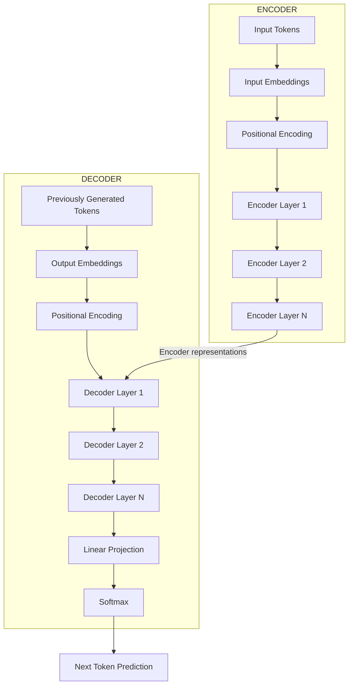
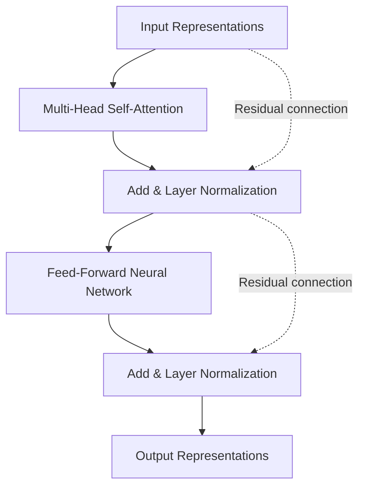
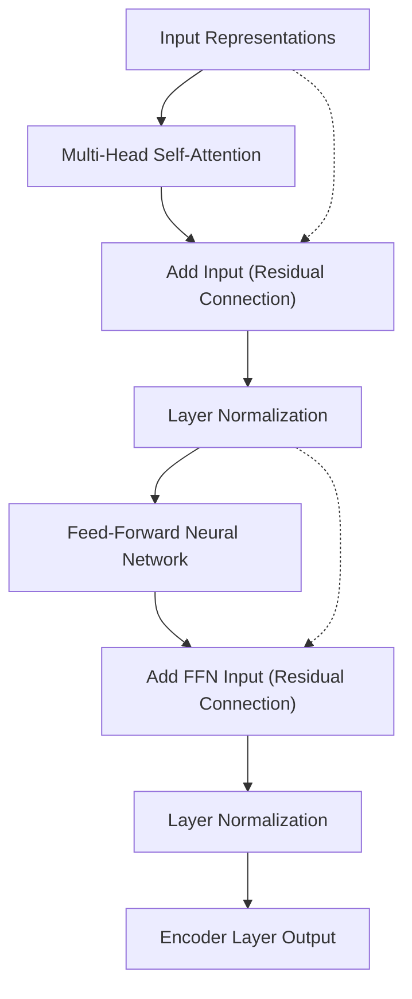
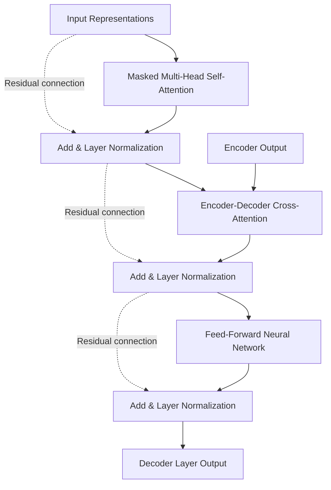
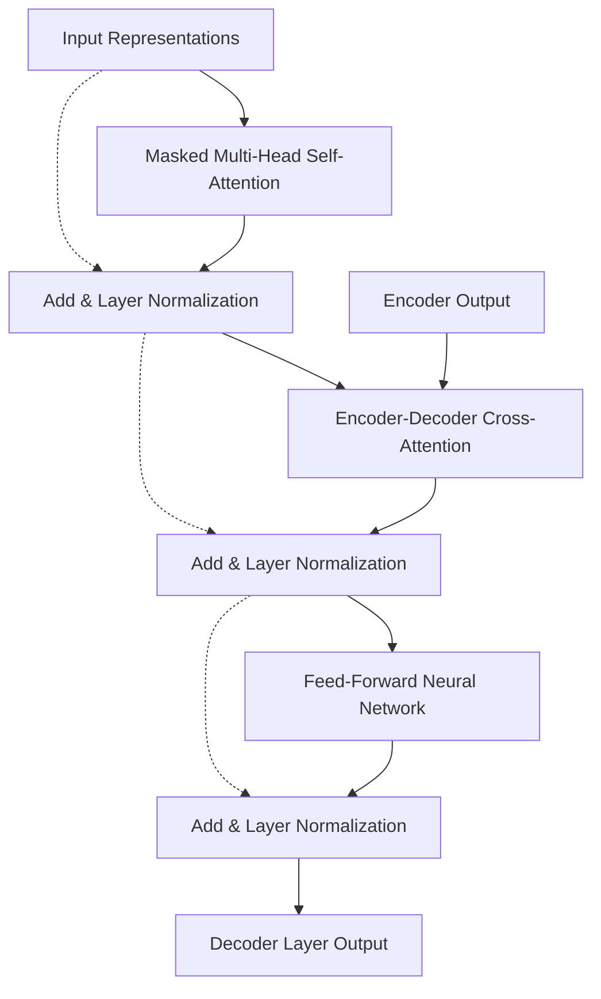
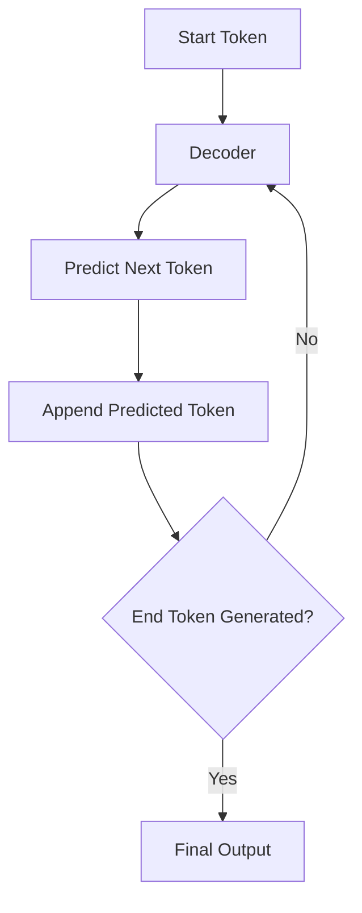

# Introduction

The Transformer is a neural network architecture designed to process sequential data, particularly natural language, by using attention mechanisms to understand relationships between different elements in a sequence. Introduced in the 2017 research paper _Attention Is All You Need_, it changed how neural networks process language by replacing recurrent processing with an architecture that can establish relationships between tokens directly and process multiple token positions in parallel during training.

Before the Transformer, sequence-processing models commonly relied on Recurrent Neural Networks (RNNs), including Long Short-Term Memory networks (LSTMs), and Convolutional Neural Networks (CNNs). Although these architectures were effective for many tasks, they had limitations when processing long sequences. RNNs processed tokens sequentially, meaning the representation of a token depended on computations performed for earlier tokens, which made parallel processing difficult. CNNs could process multiple positions simultaneously, but capturing relationships between distant tokens often required stacking multiple convolutional layers or using larger convolution windows.

The Transformer introduced a different approach: it uses attention to establish direct relationships between token positions, allowing each token to retrieve relevant information from other tokens in the sequence. This makes it easier to capture long-range dependencies while allowing the model to process multiple positions simultaneously during training.

The original Transformer architecture was designed for sequence-to-sequence tasks, such as translating a sentence from one language into another. It consists of two major components:

- **Encoder:** Processes the input sequence and produces contextualized representations that capture the meaning of the input tokens.
- **Decoder:** Uses the Encoder's representations and previously generated output tokens to generate the target sequence.

Both components contain multiple layers stacked on top of one another. Each layer performs a specific set of operations, including attention, feed-forward computation, residual connections, and layer normalization.

Understanding the Transformer requires looking beyond attention itself. Attention allows tokens to exchange information, but a complete Transformer also needs a way to represent token positions, transform the information collected by attention, preserve information across layers, and produce the final output. The architecture combines these operations into a repeated structure that can learn increasingly complex representations of language.

## High-Level Overview of the Transformer

Consider a machine translation task in which a model must translate an English sentence into French.

**Input:**

```text
The developer deployed the application.
```

**Expected output:**

```text
Le développeur a déployé l'application.
```

The Transformer handles this task in two stages. First, the Encoder reads the complete English sentence and produces a contextualized representation for every input token. These representations contain information about each token as well as its relationships with the other tokens. Next, the Decoder uses these representations to generate the French translation, producing one output token at a time.

The high-level architecture looks like this:

<div style={{textAlign: 'center'}}>



</div>

The Encoder and Decoder are composed of repeated layers. The original Transformer paper used six Encoder layers and six Decoder layers, although modern Transformer implementations can use different numbers of layers depending on the model's size and design.

The important distinction is that the Encoder processes the input sequence to build representations, whereas the Decoder generates the output sequence using both its own previous outputs and the information received from the Encoder.

To understand how this works, we first need to examine the individual components that make up a Transformer layer.

## Input Embeddings and Positional Encoding

Before tokens can be processed by the Transformer, they must be converted into numerical representations. Neural networks operate on numerical data rather than directly understanding words, so the input text must first go through tokenization and embedding.

### Tokenization

Tokenization is the process of splitting text into smaller units called tokens. Depending on the tokenizer, a token can represent a complete word, a subword, a character, or even punctuation.

For example, consider the sentence:

```text
The developer deployed the application.
```

A tokenizer might produce:

```text
["The", "developer", "deployed", "the", "application", "."]
```

Each token is then mapped to a numerical token ID from the model's vocabulary.

For example:

```text
The          → 101
developer    → 2456
deployed     → 8921
the          → 102
application  → 5678
.            → 103
```

These numbers are illustrative token IDs, not actual IDs from a specific tokenizer.

The resulting sequence of token IDs is what the model receives as its initial input.

### Input Embeddings

Token IDs are discrete identifiers, so they cannot directly provide the continuous numerical representations needed by the neural network. The Transformer therefore uses an embedding layer to convert each token ID into a dense vector of a fixed dimension.

An embedding matrix contains a learned vector for every token in the vocabulary. When a token ID is provided, the model retrieves the corresponding row from this matrix.

For example, if the model uses an embedding dimension of 512, every token is represented by a vector containing 512 numerical values.

```text
Token: "developer"

Embedding:
[0.21, -0.14, 0.73, 0.08, ..., -0.32]
```

For a sequence containing six tokens, the resulting embedding matrix has six rows and 512 columns.

```text
Input Embeddings: (6 × 512)
```

The embedding dimension is the size of the vector used to represent each token. It determines how much numerical information the model can maintain in each token representation.

However, token embeddings alone do not tell the Transformer where a token appears in the sequence.

Consider these two sentences:

```text
The dog chased the cat.
The cat chased the dog.
```

They contain the same words, but the order of the words changes their meaning. If the model receives only token embeddings without positional information, it has no explicit indication of which token appeared first, second, or later in the sequence.

This is why the Transformer requires positional information.

### Positional Encoding

Unlike an RNN, the Transformer does not process tokens sequentially. Its attention operations can process all token positions simultaneously, so it needs an explicit way to represent the position of each token.

Positional encoding provides this information by assigning a position-dependent vector to every token. The positional vector is combined with the token embedding before the sequence enters the first Transformer layer.

The resulting representation contains two types of information:

- **Token information:** What token is being represented.
- **Positional information:** Where that token appears in the sequence.

The original Transformer paper used sinusoidal positional encoding, where sine and cosine functions generate position-dependent values.

The formulas are:

```text
PE(pos, 2i) = sin(pos / 10000^(2i / d_model))

PE(pos, 2i + 1) = cos(pos / 10000^(2i / d_model))
```

Here:

- `pos` represents the position of the token in the sequence.
- `i` represents the dimension index used to calculate the positional value.
- `d_model` represents the embedding dimension of the model.
- `PE` represents the positional encoding vector.

The sine function is used for even dimensions, while the cosine function is used for odd dimensions. Different dimensions use different frequencies, allowing the model to represent positions at multiple scales.

The positional encoding is added element-wise to the token embedding:

```text
Input Representation = Token Embedding + Positional Encoding
```

For example, if a token embedding contains 512 values, its positional encoding also contains 512 values. The two vectors are added together to produce the final input representation.

```text
Token Embedding:       [0.21, -0.14, 0.73, 0.08]
Positional Encoding:   [0.10,  0.85, 0.02, 0.91]
                       -------------------------
Final Representation:  [0.31,  0.71, 0.75, 0.99]
```

The numbers above are illustrative. The important point is that the resulting vector carries information about both the token and its position.

There are other positional encoding approaches used in modern Transformer models, including learned positional embeddings and Rotary Position Embeddings (RoPE). These approaches differ in how positional information is represented and incorporated into attention, but they address the same fundamental requirement: the model needs information about token positions.

## Understanding an Encoder Layer

The Encoder is responsible for processing the input sequence and producing contextualized representations. It consists of multiple identical Encoder layers stacked on top of one another.

In the original Transformer architecture, each Encoder layer contains two major sublayers:

1. Multi-Head Self-Attention.
2. Position-wise Feed-Forward Neural Network.

Each sublayer is also surrounded by a residual connection and a Layer Normalization operation.

The structure looks like this:

<div style={{textAlign: 'center'}}>



</div>

The same Encoder layer is applied to every token position. Its attention operation allows tokens to exchange information, while its feed-forward network transforms each token's representation independently.

Let's examine these two sublayers.

### Multi-Head Self-Attention

The first sublayer is Multi-Head Self-Attention, which allows every token to gather information from other tokens in the input sequence.

For example, consider:

```text
The developer deployed the application because it was ready.
```

When the model processes the token `it`, it needs to understand which entity `it` refers to. The word `it` may assign a higher attention weight to `application` than to `developer`, depending on the context and what the model has learned.

Self-attention calculates relationships between tokens using Queries, Keys, and Values. Multi-Head Attention performs this operation through multiple attention heads, allowing the model to capture different types of relationships in parallel.

For an Encoder layer, the Query, Key, and Value representations all come from the same input sequence. This is why the operation is called self-attention.

The output of the attention sublayer contains contextualized representations, where each token can incorporate relevant information from other tokens.

The attention calculation is:

```text
Attention(Q, K, V) = Softmax((Q × Kᵀ) / √d_k) × V
```

In Multi-Head Attention, this calculation is performed independently by multiple heads, and their outputs are combined through an output projection.

The Encoder uses unmasked self-attention, meaning each token can attend to all valid token positions in the input sequence, including positions that appear later in the sentence.

This is important because the Encoder needs to understand the complete input rather than process it from left to right.

### Add and Layer Normalization

After Multi-Head Self-Attention produces its output, the Transformer applies a residual connection followed by Layer Normalization in the original architecture.

A residual connection adds the original input of a sublayer to the output produced by that sublayer. Instead of completely replacing the input representation, the model learns an additional transformation that is added to the existing representation.

The operation is:

```text
Residual Output = Input + Sublayer Output
```

For the attention sublayer:

```text
Attention Residual Output = Input + Attention(Input)
```

Why is this useful?

As neural networks become deeper, training can become difficult because gradients may become very small as they propagate backward through many layers. This is known as the vanishing gradient problem.

Residual connections provide a more direct path for information and gradients to travel through the network. They allow a layer to learn modifications to an existing representation instead of having to reconstruct the entire representation from scratch.

After the residual addition, Layer Normalization is applied to stabilize the values within the representation.

Layer Normalization calculates the mean and variance across the features of an individual token representation and uses them to normalize the values.

The normalization process is:

```text
Mean = Sum of all feature values / Number of features

Variance = Sum of (feature - Mean)² / Number of features

Normalized Value = (Value - Mean) / √(Variance + ε)

LayerNorm(x) = γ × Normalized Value + β
```

Here:

- `x` represents the input vector.
- `Mean` represents the average of the feature values.
- `Variance` represents how much the feature values vary around the mean.
- `ε` is a small constant added for numerical stability.
- `γ` is a learnable scaling parameter.
- `β` is a learnable shifting parameter.

The scaling and shifting parameters allow the network to learn an appropriate representation after normalization rather than being restricted to the normalized values.

Layer Normalization helps stabilize training and makes optimization more reliable, particularly in deep neural networks.

The original Transformer uses the following ordering:

```text
Output = LayerNorm(Input + Sublayer(Input))
```

This is commonly called Post-Layer Normalization or Post-LN because normalization happens after the residual addition.

Modern Transformer architectures may instead use Pre-Layer Normalization, where normalization happens before the sublayer:

```text
Output = Input + Sublayer(LayerNorm(Input))
```

Both approaches use residual connections and Layer Normalization, but their ordering differs. Pre-LN is common in modern large language models because it can improve training stability for deeper networks.

### Position-wise Feed-Forward Neural Network

After Multi-Head Self-Attention and its residual-normalization operation, the Encoder applies a Feed-Forward Neural Network (FFN).

Attention allows tokens to exchange information with other tokens, but the Feed-Forward Network performs a different operation: it transforms the information contained in each token representation.

The network is called position-wise because the same Feed-Forward Network is independently applied to every token position. It does not directly exchange information between different tokens.

The original Transformer uses a two-layer Feed-Forward Network with a ReLU activation function.

Its operation is:

```text
FFN(x) = ReLU(x × W_1 + b_1) × W_2 + b_2
```

Here:

- `x` is the input representation of a token.
- `W_1` is the first weight matrix.
- `b_1` is the first bias vector.
- `W_2` is the second weight matrix.
- `b_2` is the second bias vector.
- `ReLU` is the activation function applied between the two linear transformations.

The ReLU activation function is:

```text
ReLU(x) = max(0, x)
```

It replaces negative values with zero while keeping positive values unchanged.

The purpose of this network is to introduce additional nonlinear transformations, allowing the model to learn more complex relationships within each token's representation.

Consider a Transformer with the following dimensions:

```text
Model Dimension (d_model) = 512
Feed-Forward Dimension (d_ff) = 2048
```

The first linear layer expands the representation from 512 dimensions to 2048 dimensions. After applying the activation function, the second linear layer projects it back to 512 dimensions.

```text
Input:       512 dimensions
      |
      v
Linear 1:    2048 dimensions
      |
      v
ReLU:        2048 dimensions
      |
      v
Linear 2:    512 dimensions
      |
      v
Output:      512 dimensions
```

The expansion gives the network a larger intermediate representation in which it can perform nonlinear transformations before projecting the information back to the model dimension.

The Feed-Forward Network is applied independently to each token, but its weights are shared across all token positions. This means the same transformation is used for the first token, second token, and every subsequent token.

### Add and Layer Normalization After the Feed-Forward Network

The output of the Feed-Forward Network is also combined with its original input through a residual connection and then passed through Layer Normalization.

The operation is:

```text
Encoder Layer Output = LayerNorm(FFN Input + FFN Output)
```

This completes one Encoder layer.

The output has the same model dimension as its input, which allows it to be passed directly into the next Encoder layer.

### Complete Encoder Layer

Putting everything together, the original Encoder layer follows this structure:

<div style={{textAlign: 'center'}}>



</div>

The first sublayer allows tokens to gather information from other tokens, while the second sublayer transforms the resulting representation independently at each position.

This combination is repeated across multiple Encoder layers. As the information passes through the stack, each layer can build on the contextualized representations produced by the previous layer.

## Understanding a Decoder Layer

The Decoder generates the output sequence using the representations produced by the Encoder and the tokens generated so far.

Unlike the Encoder, which can examine the complete input sequence, the Decoder must generate output tokens without accessing future output tokens. Otherwise, during training, it could simply look at the correct answer instead of learning how to predict it.

To prevent this, the Decoder uses masked self-attention.

Each Decoder layer in the original Transformer contains three major sublayers:

1. Masked Multi-Head Self-Attention.
2. Encoder-Decoder Cross-Attention.
3. Position-wise Feed-Forward Neural Network.

Each sublayer is surrounded by a residual connection and Layer Normalization.

The structure looks like this:

<div style={{textAlign: 'center'}}>



</div>

The Decoder contains one additional attention sublayer compared with the Encoder. This additional sublayer allows the Decoder to retrieve information from the Encoder's output.

Let's examine each component.

### Masked Multi-Head Self-Attention

The first sublayer in the Decoder is Masked Multi-Head Self-Attention.

It allows each output token to gather information from previously generated tokens while preventing it from accessing future positions.

Consider the target sequence:

```text
Le développeur a déployé l'application.
```

When predicting the next token, the Decoder should only use the tokens that have already been generated.

For example:

```text
Position 1: Le
Position 2: développeur
Position 3: a
Position 4: déployé
Position 5: l'application
```

When predicting the token at position 3, the model can use positions 1, 2, and 3, but it must not access positions 4 and 5.

This is achieved through a causal mask, also known as a look-ahead mask.

The mask prevents a token from attending to future positions by replacing their attention scores with negative infinity before the Softmax operation.

The resulting attention weights for those positions become zero.

For example, the attention mask for a sequence of four tokens can be represented as:

```text
             Key Positions
             1    2    3    4

Query 1      1    0    0    0
Query 2      1    1    0    0
Query 3      1    1    1    0
Query 4      1    1    1    1
```

Here:

- `1` means the position is allowed to be attended to.
- `0` means the position is blocked by the causal mask.

For example, the token at position 2 can attend to positions 1 and 2, but it cannot attend to positions 3 and 4.

The causal mask is applied to attention scores before Softmax:

```text
Masked Scores = Attention Scores + Causal Mask

Attention Weights = Softmax(Masked Scores)
```

The blocked positions receive zero attention weight after Softmax.

This ensures that the prediction at any position depends only on information available up to that position.

The original Transformer uses this masked self-attention in its Decoder so that output generation follows an autoregressive process.

### Encoder-Decoder Cross-Attention

The second sublayer is Encoder-Decoder Cross-Attention, commonly called Cross-Attention.

Unlike self-attention, where Queries, Keys, and Values originate from the same sequence, cross-attention allows one sequence to retrieve information from another sequence.

In the original Transformer:

- **Queries (Q)** come from the Decoder's previous sublayer.
- **Keys (K)** come from the Encoder output.
- **Values (V)** come from the Encoder output.

This allows the Decoder to determine which parts of the input sequence are relevant when generating the next output token.

Consider the translation example:

```text
Input:  The developer deployed the application.
Output: Le développeur a déployé l'application.
```

When generating `développeur`, the Decoder can use cross-attention to retrieve relevant information from the Encoder representations of `developer`.

Similarly, when generating `application`, it can retrieve information from the corresponding input token.

The important point is that the Decoder does not need to generate its output using only previously generated words. It can also retrieve information from the complete input sequence through cross-attention.

The attention calculation is:

```text
CrossAttention(Q, K, V) = Softmax((Q × Kᵀ) / √d_k) × V
```

The Query comes from the Decoder, whereas the Key and Value come from the Encoder.

This operation is repeated independently across multiple attention heads, just like Multi-Head Attention in the other sublayers.

The Encoder output is available to every Decoder layer, allowing each layer to retrieve information from the original input representations.

### Position-wise Feed-Forward Neural Network

The third sublayer is the same type of Feed-Forward Neural Network used in the Encoder.

It independently transforms the representation of every token position using two linear transformations and a nonlinear activation function.

In the original Transformer, the operation is:

```text
FFN(x) = ReLU(x × W_1 + b_1) × W_2 + b_2
```

As with the Encoder, the network expands the representation into a larger intermediate dimension and then projects it back to the model dimension.

This allows the Decoder to perform additional nonlinear transformations after combining information from previously generated tokens and the Encoder output.

### Residual Connections and Layer Normalization

Each Decoder sublayer uses a residual connection and Layer Normalization.

In the original Transformer, the operation follows the Post-LN arrangement:

```text
Output = LayerNorm(Input + Sublayer(Input))
```

This applies to all three Decoder sublayers:

- Masked Multi-Head Self-Attention.
- Encoder-Decoder Cross-Attention.
- Feed-Forward Neural Network.

Residual connections preserve the original input information, while Layer Normalization helps stabilize the representations during training.

### Complete Decoder Layer

Combining all three sublayers produces the following Decoder architecture:

<div style={{textAlign: 'center'}}>



</div>

The three sublayers have different responsibilities:

- Masked self-attention allows the Decoder to understand previously generated output tokens.
- Cross-attention allows the Decoder to retrieve relevant information from the Encoder.
- The Feed-Forward Network transforms each token representation independently.

This structure is repeated across multiple Decoder layers, with each layer receiving the output of the previous layer.

## Understanding the Complete Transformer Workflow

Now that the Encoder and Decoder components are clear, we can put them together and follow how information flows through the complete Transformer.

Consider the translation task again:

```text
Input:  The developer deployed the application.
Output: Le développeur a déployé l'application.
```

### Processing the Input Sequence

The input sentence is first tokenized into token IDs. Each token ID is converted into an embedding vector, and positional information is added to the embeddings.

The resulting representations are passed into the first Encoder layer.

```text
Input Tokens
     |
     v
Tokenization
     |
     v
Token IDs
     |
     v
Input Embeddings
     |
     v
Add Positional Encoding
     |
     v
Encoder Layers
```

The Encoder processes the complete input sequence using self-attention and feed-forward networks.

After passing through all Encoder layers, it produces a sequence of contextualized representations.

For a sequence containing `N` tokens and a model dimension of 512, the Encoder output has the shape:

```text
Encoder Output = (N × 512)
```

Each row represents one token, but its representation now contains contextual information gathered from other tokens in the input sequence.

These representations are passed to the Decoder through cross-attention.

### Preparing the Decoder Input

During training, the Decoder receives the target sequence shifted one position to the right. This is known as teacher forcing.

For example, the expected target sequence is:

```text
Le développeur a déployé l'application.
```

The Decoder input is:

```text
<START> Le développeur a déployé
```

The expected predictions are:

```text
Le développeur a déployé l'application.
```

The model learns to predict the next token based on the tokens that came before it.

For example:

```text
Input:  <START>
Target: Le

Input:  <START> Le
Target: développeur

Input:  <START> Le développeur
Target: a

Input:  <START> Le développeur a
Target: déployé
```

The causal mask ensures that each prediction can only use the available preceding tokens, even though the training computation can process multiple positions simultaneously.

The Decoder input also passes through token embeddings and positional encoding before entering the Decoder layers.

### Processing Through the Decoder

The Decoder processes its input through its stacked layers.

Within each layer:

1. Masked self-attention gathers information from previously available output tokens.
2. Cross-attention retrieves relevant information from the Encoder output.
3. The Feed-Forward Network transforms the resulting token representations.

After passing through all Decoder layers, the model produces a final representation for each Decoder position.

These representations are then passed to the output projection.

### Linear Projection and Softmax

The Decoder's final representations must be converted into predictions over the model's vocabulary.

The model uses a linear projection to transform each final Decoder representation into a vector of vocabulary-sized logits.

For example, if the model's vocabulary contains 30,000 tokens, the output projection produces 30,000 scores for each Decoder position.

```text
Decoder Representation: 512 dimensions
              |
              v
Linear Projection
              |
              v
Logits: 30,000 dimensions
              |
              v
Softmax
              |
              v
Probability Distribution
```

The logits are raw scores produced by the model. They are not probabilities, because they can be negative, positive, and have arbitrary magnitudes.

Softmax converts these scores into a probability distribution in which every value is between zero and one and all probabilities sum to one.

The formula is:

```text
Softmax(z_i) = exp(z_i) / Σ_j exp(z_j)
```

Here:

- `z_i` represents the logit for a particular vocabulary token.
- `exp` represents the exponential function.
- The denominator is the sum of the exponential values of all vocabulary logits.

For example, the model might produce:

```text
Token:          Probability:

Le              0.72
La              0.08
Les             0.05
Un              0.03
Other tokens    0.12
```

These values are illustrative.

The model can select the token with the highest probability using greedy decoding, or use another decoding strategy such as beam search or sampling.

### Autoregressive Generation

During inference, the model generates the output sequence one token at a time.

It starts with a special beginning-of-sequence token and predicts the first output token. That predicted token is then added to the Decoder input, and the model predicts the next token.

This process continues until the model generates an end-of-sequence token or reaches a configured generation limit.

<div style={{textAlign: 'center'}}>



</div>

For example:

```text
Step 1:
Input:  <START>
Output: Le

Step 2:
Input:  <START> Le
Output: développeur

Step 3:
Input:  <START> Le développeur
Output: a

Step 4:
Input:  <START> Le développeur a
Output: déployé

Step 5:
Input:  <START> Le développeur a déployé
Output: l'application

Step 6:
Input:  <START> Le développeur a déployé l'application
Output: <END>
```

The final generated sequence is:

```text
Le développeur a déployé l'application.
```

An important distinction is that parallel computation during training does not mean the original Encoder-Decoder Transformer generates all output tokens simultaneously during inference. Autoregressive generation still depends on previously generated output tokens, so the output is produced sequentially.

Modern implementations often use a Key-Value cache to avoid recalculating attention representations for previously generated tokens. This improves generation efficiency, but the fundamental autoregressive process remains the same.

## Understanding the Three Types of Attention in the Original Transformer

The original Transformer uses three attention sublayers, each serving a different purpose.

Although all three use the same underlying attention calculation, they differ in the origin of their Queries, Keys, and Values and in the attention restrictions applied to them.

| Attention type                  | Query   | Key     | Value   | Purpose                                               |
| ------------------------------- | ------- | ------- | ------- | ----------------------------------------------------- |
| Encoder self-attention          | Encoder | Encoder | Encoder | Understand relationships across the input sequence    |
| Decoder masked self-attention   | Decoder | Decoder | Decoder | Understand previously available output tokens         |
| Encoder-Decoder cross-attention | Decoder | Encoder | Encoder | Retrieve relevant information from the input sequence |

### Encoder Self-Attention

The Encoder uses unmasked self-attention, where every input token can attend to every other valid input token.

For example, a token near the beginning of a sentence can directly retrieve information from a token near the end.

This allows the Encoder to construct contextualized representations using the complete input sequence.

### Decoder Masked Self-Attention

The Decoder uses causal masking to prevent a token from accessing future output positions.

This ensures that each prediction depends only on the tokens that have already been generated or are available as input during training.

Without this restriction, the model could access the correct future output tokens during training, which would defeat the purpose of learning to predict them.

### Encoder-Decoder Cross-Attention

Cross-attention connects the Encoder and Decoder.

The Decoder provides the Queries, while the Encoder provides the Keys and Values. This allows the Decoder to selectively retrieve information from the input sequence while generating the output.

For translation, this is what allows the Decoder to refer back to the original English sentence when producing French tokens.

## Why Does the Transformer Need Multiple Layers?

A Transformer does not rely on a single attention operation to understand an entire sequence. Instead, it stacks multiple Encoder or Decoder layers, allowing representations to be transformed repeatedly.

Each layer receives the output of the previous layer and performs additional attention and feed-forward operations.

Consider the sentence:

```text
The developer deployed the application because it was ready.
```

Understanding this sentence requires recognizing relationships between words, including the relationship between `it` and `application`.

The first Encoder layer can begin constructing contextual representations by allowing tokens to retrieve information from relevant positions. Subsequent layers can build on those representations and learn more complex relationships.

The exact behavior of individual layers is learned during training; it is not the case that every layer has a predefined linguistic responsibility.

Stacking layers gives the model multiple opportunities to refine its representations.

The architecture therefore follows a repeated pattern:

```text
Input Representations
        |
        v
Transformer Layer 1
        |
        v
Transformer Layer 2
        |
        v
Transformer Layer 3
        |
        v
       ...
        |
        v
Transformer Layer N
        |
        v
Final Representations
```

Increasing the number of layers generally increases the model's capacity, but it also increases computational requirements and memory usage.

## Computational Complexity of the Transformer

One of the major reasons behind the success of the Transformer is its ability to process token positions in parallel during training. However, its attention mechanism also introduces computational and memory costs that grow with sequence length.

### Attention Complexity

For a sequence containing `N` tokens, self-attention calculates relationships between token positions.

This produces an attention score matrix with the shape:

```text
N × N
```

Every token can calculate an attention score against every other token, so the number of attention scores grows quadratically with sequence length.

The time complexity of the attention score calculation is approximately:

```text
O(N² × d_k)
```

The memory required for storing the attention score matrix is approximately:

```text
O(N²)
```

Here:

- `N` represents the sequence length.
- `d_k` represents the dimension of the Key vectors.

For example:

```text
Sequence length = 1,000

Attention scores = 1,000 × 1,000
                 = 1,000,000
```

If the sequence length increases to 2,000:

```text
Attention scores = 2,000 × 2,000
                 = 4,000,000
```

Doubling the sequence length increases the number of attention scores by four times.

This becomes a significant limitation when processing very long sequences.

### Multi-Head Attention Complexity

Multi-Head Attention performs attention calculations across multiple heads. Although this increases the number of operations, the original Transformer divides the model dimension across the heads.

If the model dimension is `d_model` and there are `h` heads, each head typically uses a dimension of:

```text
d_k = d_model / h
```

The combined attention computation remains approximately quadratic in sequence length and linear in the model dimension:

```text
O(N² × d_model)
```

The projections used to calculate Queries, Keys, and Values also introduce computational costs.

### Feed-Forward Network Complexity

The Feed-Forward Network applies two linear transformations to every token.

Its approximate computational complexity is:

```text
O(N × d_model × d_ff)
```

Here:

- `N` is the sequence length.
- `d_model` is the model dimension.
- `d_ff` is the intermediate Feed-Forward Network dimension.

Unlike attention, this computation grows linearly with sequence length when the model dimensions are fixed.

### Parallelization

Despite the quadratic attention cost, the Transformer has a major advantage over traditional recurrent architectures.

An RNN must process a token before it can process the next token because each step depends on the previous hidden state.

The Transformer can calculate attention for all token positions in a sequence simultaneously during training. This allows it to make better use of parallel hardware such as GPUs.

However, autoregressive generation in the Decoder still produces tokens sequentially during inference.

## Important Design Considerations

The original Transformer architecture introduced several design decisions that influence its performance, scalability, and training behavior.

### Model Dimension

The model dimension, commonly represented by `d_model`, determines the size of the representation maintained for each token throughout the Transformer layers.

For example:

```text
d_model = 512
```

means every token representation contains 512 numerical values.

The model dimension influences the size of the attention projections, Feed-Forward Network, and other components. Increasing it gives the model a larger representation space but also increases computational and memory requirements.

### Number of Attention Heads

Multi-Head Attention uses multiple attention heads to capture different relationships between tokens.

The number of heads determines how many independent attention operations are performed in parallel.

For example:

```text
d_model = 512
Number of Heads = 8

Dimension per Head = 512 / 8
                   = 64
```

Each head works with its own Query, Key, and Value projections, and the outputs are combined to produce the final attention representation.

### Feed-Forward Dimension

The Feed-Forward dimension determines the size of the intermediate representation inside the Feed-Forward Network.

The original Transformer used:

```text
d_model = 512
d_ff = 2048
```

This means the network expands each token representation from 512 dimensions to 2048 dimensions before projecting it back to 512 dimensions.

### Number of Layers

The number of Encoder and Decoder layers determines how many times the representations are transformed.

The original Transformer used six layers in each component, but modern models can use substantially more layers.

Increasing the number of layers generally increases model capacity, although the benefits depend on the architecture, training data, optimization, and computational budget.

### Maximum Sequence Length

The sequence length determines how many tokens the model can process in a single context.

Because standard full self-attention has quadratic complexity with respect to sequence length, increasing the context length can significantly increase memory and computational requirements.

This is one reason modern Transformer research includes techniques such as efficient attention implementations, sliding-window attention, and other approaches to reduce the cost of processing long sequences.

## Variations of the Transformer Architecture

The original Transformer contains both an Encoder and a Decoder, but modern language models do not necessarily use the complete architecture.

Different model families use different parts of the Transformer depending on the tasks they are designed to perform.

The three major architectural categories are Encoder-only, Decoder-only, and Encoder-Decoder.

### Encoder-Only Models

Encoder-only models use the Encoder component of the Transformer without the autoregressive Decoder.

They process the input sequence using bidirectional self-attention, allowing each token to attend to both preceding and following tokens.

This makes them suitable for tasks that require understanding the complete input, such as text classification, sentiment analysis, and extracting information from text.

A well-known example is BERT.

#### BERT — Bidirectional Encoder Representations from Transformers

BERT uses an Encoder-based architecture and was originally trained using objectives such as Masked Language Modeling, where some input tokens are hidden and the model learns to predict them using surrounding context.

For example:

```text
Input:  The developer [MASK] the application.

Target: deployed
```

Because BERT uses bidirectional context, it can use information from both sides of the masked token.

### Decoder-Only Models

Decoder-only models use the Decoder-style causal self-attention architecture, without the Encoder and its cross-attention connection.

They process tokens using causal masking, ensuring that each token can only attend to previous positions and itself.

This makes them suitable for autoregressive text generation.

A well-known example is GPT.

#### GPT — Generative Pre-trained Transformer

GPT models predict the next token based on the tokens that came before it.

For example:

```text
Input:  The developer deployed the

Prediction: application
```

After predicting the next token, the model appends it to the input and repeats the process.

Unlike the original Encoder-Decoder Transformer, a standard decoder-only GPT architecture does not use cross-attention to retrieve information from a separate Encoder. Its causal self-attention operates over the combined sequence of available input and generated tokens.

### Encoder-Decoder Models

Encoder-Decoder models retain both components of the original Transformer.

The Encoder processes the complete input sequence, while the Decoder generates the output using causal self-attention and cross-attention over the Encoder representations.

These models are useful for sequence-to-sequence tasks, including translation, summarization, and text transformation.

A well-known example is T5.

#### T5 — Text-to-Text Transfer Transformer

T5 treats many NLP tasks as text-to-text problems, meaning the model receives text as input and produces text as output.

For example:

```text
Input:  translate English to French:
        The developer deployed the application.

Output: Le développeur a déployé l'application.
```

The model uses an Encoder to process the input and a Decoder to generate the corresponding output.

### Comparing the Three Architectures

| Characteristic  | Encoder-only        | Decoder-only    | Encoder-Decoder                       |
| --------------- | ------------------- | --------------- | ------------------------------------- |
| Main component  | Encoder             | Decoder         | Both                                  |
| Self-attention  | Bidirectional       | Causal          | Encoder bidirectional; Decoder causal |
| Cross-attention | No                  | No              | Yes                                   |
| Typical use     | Understanding input | Text generation | Sequence-to-sequence tasks            |
| Example         | BERT                | GPT             | T5                                    |

The important distinction is not simply whether a model has an Encoder or Decoder. It is how information flows through the architecture and what restrictions are applied to attention.

Encoder-only models can examine the complete input sequence, decoder-only models generate tokens autoregressively, and Encoder-Decoder models combine input understanding with conditional output generation.

## Summary

The Transformer is a neural network architecture that uses attention mechanisms to process sequences and learn relationships between tokens. Its original design contains an Encoder and a Decoder, each constructed from multiple repeated layers.

The Encoder processes the complete input sequence using Multi-Head Self-Attention and Feed-Forward Neural Networks. The Decoder generates the output sequence using masked self-attention, cross-attention over the Encoder representations, and Feed-Forward Neural Networks.

Several additional components make this architecture work effectively:

- **Input Embeddings:** Convert token IDs into dense numerical representations.
- **Positional Encoding:** Provides information about token positions.
- **Multi-Head Self-Attention:** Allows tokens to retrieve information from other positions in the sequence.
- **Masked Self-Attention:** Prevents the Decoder from accessing future output tokens.
- **Cross-Attention:** Allows the Decoder to retrieve information from the Encoder.
- **Feed-Forward Neural Networks:** Apply nonlinear transformations independently to each token position.
- **Residual Connections:** Preserve information and provide direct paths for gradient propagation.
- **Layer Normalization:** Normalizes token representations to help stabilize training.
- **Linear Projection and Softmax:** Convert Decoder representations into probabilities over the vocabulary.

The original Transformer uses both an Encoder and a Decoder, but modern language models use different variations of this architecture. BERT uses an Encoder-only design, GPT uses a Decoder-only design, and T5 retains the Encoder-Decoder structure.

The fundamental contribution of the Transformer is its ability to model relationships between tokens through attention while allowing parallel processing of sequence positions during training. This architecture became the foundation for many modern language models and continues to influence the development of large language models.
