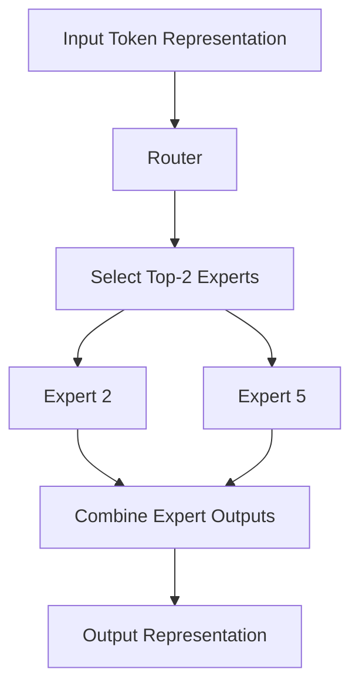
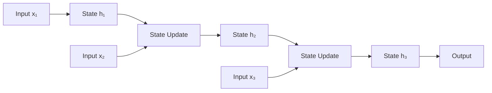
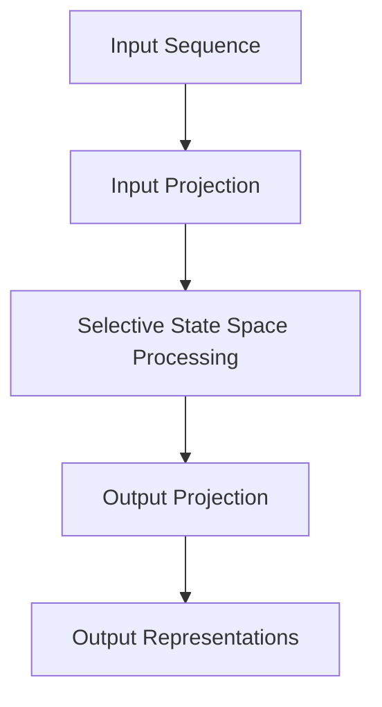
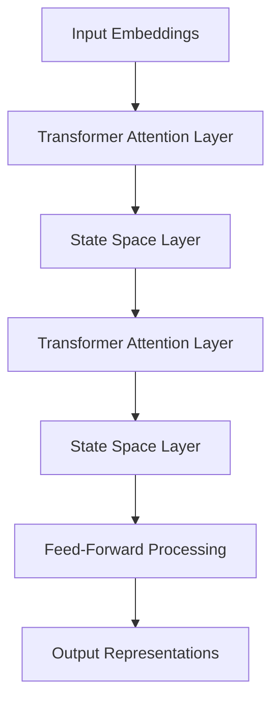
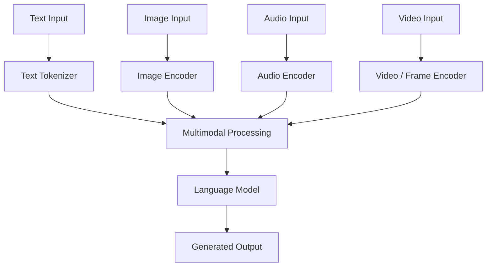
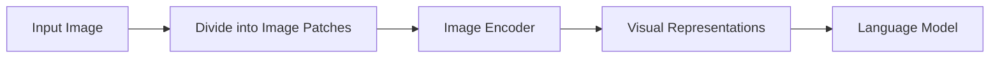
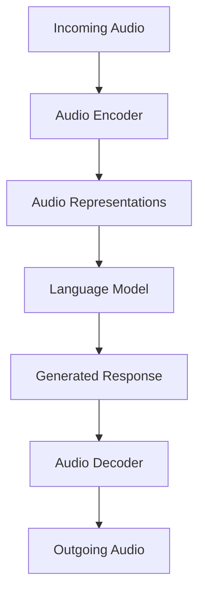
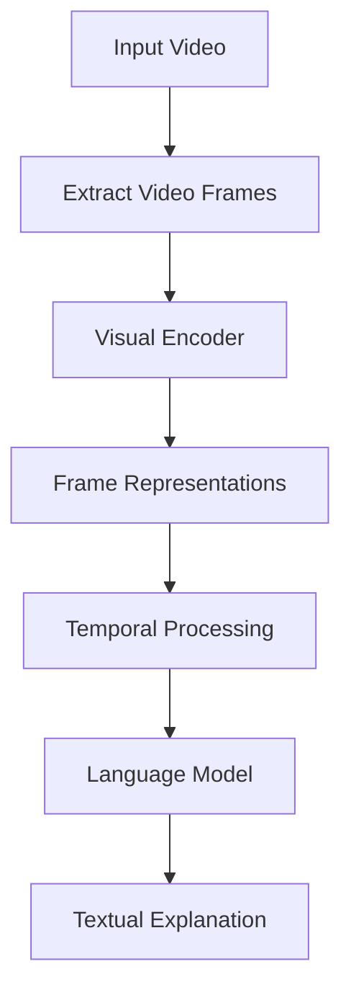
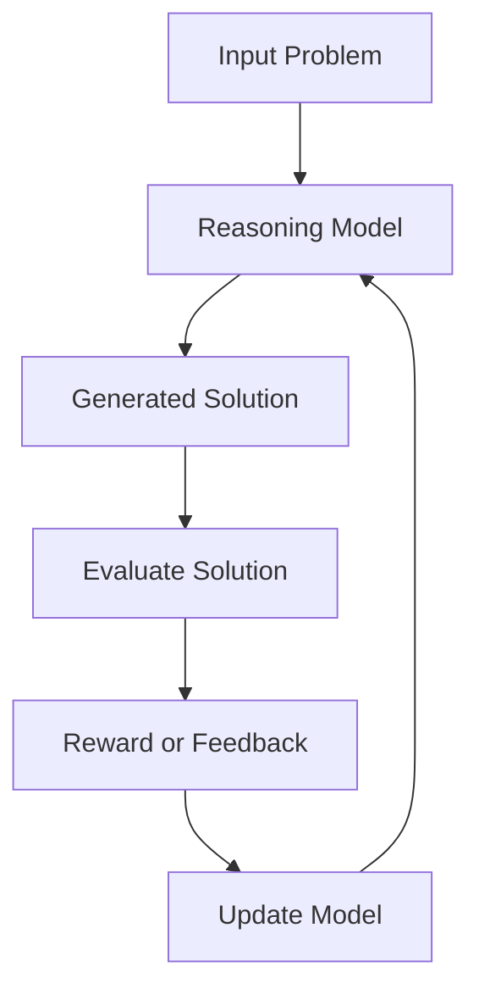

# Modern LLM Architectures

The Transformer architecture introduced a major shift in how neural networks process sequential data, and it became the foundation for many of today's Large Language Models (LLMs). Architectures such as BERT, GPT, and T5 demonstrated how attention-based models could be adapted for different language-processing tasks, eventually leading to increasingly capable models that can understand and generate human language.

However, as LLMs continued to grow in size and capabilities, researchers began exploring architectural improvements to address some of the limitations of traditional Transformer models. Increasing the number of parameters, processing longer sequences, handling different types of input, and solving complex reasoning problems all introduce challenges that cannot always be addressed simply by making the existing architecture larger.

This led to several important developments in modern LLM architectures. Some approaches focus on increasing the model's capacity without activating all its parameters for every token, while others explore alternative ways of processing sequences that can be more efficient for long contexts. Researchers have also experimented with combining different architectural mechanisms, building models that understand multiple modalities such as images and audio, and developing reasoning-oriented models that allocate additional computation to difficult problems.

In this part, we will explore five important developments: **Mixture of Experts (MoE), State Space Models (SSMs), Hybrid Architectures, Multimodal LLMs, and Reasoning Models**. Although these developments address different challenges, they collectively illustrate how modern language models are evolving beyond the traditional dense Transformer architecture.

## Mixture of Experts (MoE)

### Introduction to Mixture of Experts

In a traditional Transformer, each layer contains a Feed-Forward Network (FFN) that processes the representation of every token passing through that layer. Although the representation of each token is different, all tokens use the same set of FFN parameters, meaning that the model applies the same learned transformation to every token regardless of the information it represents.

As models become larger, increasing the size of these Feed-Forward Networks is one way to increase their capacity to learn complex patterns. However, this also increases the computational cost because every token must pass through the expanded network. If a model has a very large number of parameters in its Feed-Forward Networks, those parameters participate in processing every token, even though different tokens may benefit from different parts of the model's learned knowledge.

Mixture of Experts (MoE) addresses this limitation by replacing a single Feed-Forward Network with multiple smaller Feed-Forward Networks, known as **experts**, and introducing a routing mechanism that selects which experts should process each token. Instead of activating every expert for every token, the model activates only a small subset, allowing it to have a large total number of parameters while using considerably fewer parameters for an individual token's computation.

The central idea is that a model can increase its overall capacity without requiring every parameter to participate in every forward pass. Different experts can learn different patterns during training, and the routing mechanism learns which experts are useful for processing particular token representations.

It is important to understand that experts are not usually assigned predefined responsibilities. For example, a developer does not explicitly designate one expert for programming, another for mathematics, and another for language understanding. Instead, the experts develop their own specialisations through training, as the router learns to send different token representations to experts that are useful for processing them.

### Understanding the Components of an MoE Layer

An MoE layer primarily consists of two components: a router and a collection of expert networks. The router decides which experts should process a token, while the experts perform the actual neural network computations on the selected token representations.

#### Router

The router is a trainable component that receives the hidden representation of a token and calculates a score for every available expert. These scores determine how strongly each expert is considered for processing that token, allowing the model to make routing decisions dynamically rather than using the same experts for every input.

#### Experts

Each expert is generally a Feed-Forward Network with its own trainable parameters. The experts receive the token representations selected by the router, process them independently, and produce output representations that are subsequently combined to generate the output of the MoE layer.

Consider an MoE layer containing eight experts. If the model uses a top-2 routing strategy, the router selects only two experts for each token, meaning that six experts remain inactive for that token. Another token in the same sentence may be routed to a different pair of experts because its hidden representation and corresponding routing scores will be different.

The following diagram illustrates this process.

<div style={{textAlign: 'center'}}>



</div>

The important distinction is that the router makes a separate selection for each token, rather than selecting one fixed pair of experts for the entire sentence. Consequently, different tokens can follow different computational paths through the same MoE layer.

### How Does the Router Select Experts?

The router uses a trainable weight matrix to calculate a score for each expert based on the input token's hidden representation. Suppose a token is represented by a vector `x` and the MoE layer contains `N` experts; the router performs a linear transformation to produce `N` scores.

The operation can be represented as:

```text
Router Scores = x × W_router
```

Here, `x` represents the hidden representation of the input token, `W_router` represents the trainable router weight matrix, and the resulting vector contains one score for each available expert.

These scores are commonly converted into probabilities using the Softmax function, which transforms the raw values into a probability distribution whose values sum to 1.

```text
Routing Probabilities = Softmax(Router Scores)
```

For example, imagine that the router produces the following probabilities for a token:

| Expert    | Routing probability |
| --------- | ------------------: |
| Expert 1  |                0.05 |
| Expert 2  |                0.30 |
| Expert 3  |                0.08 |
| Expert 4  |                0.04 |
| Expert 5  |                0.25 |
| Expert 6  |                0.10 |
| Expert 7  |                0.12 |
| Expert 8  |                0.06 |
| **Total** |            **1.00** |

If the model uses top-2 routing, it selects Expert 2 and Expert 5 because they have the two highest routing probabilities. The selected probabilities are then commonly normalised so that they can be used as weights when combining the expert outputs.

The normalisation is performed by dividing each selected probability by the sum of the selected probabilities:

```text
Selected Probability Sum = 0.30 + 0.25
                          = 0.55

Expert 2 Weight = 0.30 / 0.55
                = 0.5455

Expert 5 Weight = 0.25 / 0.55
                = 0.4545
```

The selected experts now have weights that sum to approximately 1. Each expert processes the original token representation independently, and the resulting outputs are combined using these weights.

```text
MoE Output = (0.5455 × Expert 2 Output)
           + (0.4545 × Expert 5 Output)
```

This produces the output representation of the MoE layer, which is passed to the subsequent component of the Transformer. The example illustrates a common top-k routing approach; actual MoE implementations can use different routing and weighting strategies.

### Why Does MoE Improve Computational Efficiency?

One of the biggest limitations of increasing the size of a traditional dense Transformer is that adding more Feed-Forward Network parameters generally increases the computation required for every token. Every token must pass through the same expanded network, even when only a portion of its learned parameters would have been useful for processing that particular input.

MoE changes this relationship by separating the total number of available parameters from the number of parameters activated for each token.

Consider a simplified MoE layer containing eight experts, each with 1 billion parameters, and a routing strategy that activates two experts per token. The total number of expert parameters is 8 billion, but only the parameters belonging to the two selected experts participate in processing an individual token.

```text
Total Expert Parameters = 8 × 1 billion
                        = 8 billion

Active Expert Parameters = 2 × 1 billion
                         = 2 billion
```

Therefore, the model has access to 8 billion expert parameters but activates only 2 billion of them for that token. This is the central computational advantage of sparse expert activation: the model can increase its total parameter capacity without increasing the expert computation proportionally to the total number of available parameters.

However, this does not mean that an MoE model is automatically faster than every dense model with fewer parameters. The model still needs to store its expert parameters, and its attention layers, router, communication between devices, and other components also contribute to the overall computational cost.

There is another important challenge known as **load balancing**. If the router repeatedly sends most tokens to only a few experts, those experts become overloaded while the remaining experts are underutilised. This can reduce the efficiency of the architecture and prevent the model from using its available expert capacity effectively. MoE training therefore commonly includes auxiliary load-balancing objectives or other routing mechanisms to encourage a more balanced distribution of tokens.

### Examples of MoE Models

Several modern LLM architectures use Mixture of Experts to increase model capacity while controlling the amount of computation required for each token.

#### Mixtral

Mixtral 8x7B, developed by Mistral AI, is a well-known sparse MoE language model. It contains eight experts in its MoE layers and selects two experts for each token. The model therefore has access to a large collection of expert parameters while activating only a subset during token processing.

#### DeepSeek-V3

DeepSeek-V3 uses a more advanced MoE architecture with routed experts alongside shared experts. Routed experts are selected dynamically for individual tokens, while shared experts are available to all tokens. This design combines shared processing capacity with token-dependent expert selection.

#### Llama 4

Meta's Llama 4 family includes MoE-based models that use expert routing to support large model capacity with sparse activation. Different model variants use different configurations, so the number of experts and active parameters depends on the particular model.

### Limitations of MoE

Although MoE improves the relationship between total model capacity and computation per token, it introduces additional architectural and operational complexity.

The first challenge is memory consumption. Even when most experts are inactive for a particular token, the model still needs access to their parameters. Consequently, a large MoE model can have substantial memory requirements despite activating only a fraction of its expert parameters during an individual computation.

The second challenge is communication overhead. When experts are distributed across multiple GPUs or machines, tokens may need to be transferred between devices so that the selected experts can process them. This communication can become expensive, particularly when a model has many experts distributed across a large number of devices.

Finally, the router must learn to distribute tokens effectively. Poor routing decisions can result in overloaded experts, underutilised experts, and uneven computational workloads, which can negatively affect both training efficiency and model performance.

MoE therefore provides an effective way to scale model capacity through sparse activation, but it does not eliminate the memory, communication, or training challenges associated with large models.

## State Space Models (SSMs)

### Introduction to State Space Models

Transformers have become the dominant architecture for modern LLMs, largely because Self-Attention allows every token to interact directly with other tokens in the input sequence. However, attention also introduces computational and memory costs that become increasingly important as the context length grows.

In standard full Self-Attention, each token calculates its attention relationship with every other token. For a sequence containing `n` tokens, the attention computation scales approximately with the square of the sequence length, making it increasingly expensive to process very long sequences.

State Space Models (SSMs) provide an alternative approach to sequence processing. Instead of explicitly calculating attention relationships between every pair of tokens, they maintain an internal state that is updated as new tokens arrive. This state carries information from previously processed tokens, allowing the model to process a sequence through a recurrent mechanism.

The underlying idea comes from state space models used in control theory and signal processing, where they describe how a system evolves over time based on its current state and incoming input. Modern neural network architectures adapt this mathematical framework to learn how information should be retained, transformed, and passed through a sequence.

To understand why this is useful for language modelling, consider how a model processes a sentence. When it encounters a new token, it may need information from words that appeared much earlier in the sequence. An SSM attempts to preserve relevant information from previous tokens in its internal state, allowing that information to influence the processing of subsequent tokens without explicitly calculating every possible pairwise token relationship.

### Understanding the State Space Model

A traditional state space model describes a system using two fundamental equations: a state update equation and an output equation.

```text
State Update:

h_t = A × h_{t-1} + B × x_t

Output:

y_t = C × h_t + D × x_t
```

The state update equation describes how the internal state changes when a new input arrives, while the output equation determines how the current state and input contribute to the resulting output.

The variables have the following meanings:

- `x_t` represents the input at time step `t`.
- `h_{t-1}` represents the internal state from the previous time step.
- `h_t` represents the updated internal state.
- `A` controls how the previous state contributes to the new state.
- `B` controls how the current input influences the new state.
- `C` determines how the internal state contributes to the output.
- `D` provides a direct connection between the input and output.

The most important part of this architecture is the state update equation because it explains how information from previous inputs can influence the processing of the current input.

Consider a sequence containing three tokens:

```text
Token 1 → Token 2 → Token 3
```

When the model processes Token 1, it creates an internal state based on that token. When Token 2 arrives, the model combines the previous state with the new input to calculate an updated state. The same operation happens when Token 3 arrives, allowing information from earlier tokens to influence the current representation through the evolving state.

<div style={{textAlign: 'center'}}>



</div>

Unlike Self-Attention, this process does not require the model to calculate an explicit attention score between the current token and every previous token. Instead, information is carried forward through the internal state, which is continuously updated as new inputs arrive.

The model must therefore learn how to preserve useful information, incorporate new information, and allow irrelevant information to fade. This ability to control what is retained in the state is particularly important for language modelling because the relevance of a token depends on the surrounding context.

### How Do SSMs Process Long Sequences?

The recurrent nature of an SSM means that each new input can be processed using the state produced by the previous input. For a sequence containing `n` tokens, the model performs a state update for every token.

```text
h_1 = StateUpdate(h_0, x_1)
h_2 = StateUpdate(h_1, x_2)
h_3 = StateUpdate(h_2, x_3)
...
h_n = StateUpdate(h_{n-1}, x_n)
```

This approach does not require constructing an `n × n` attention matrix to represent all pairwise token interactions. Suitable SSM implementations can therefore achieve computational complexity that scales linearly with sequence length, rather than quadratically as in standard full Self-Attention.

However, there is an important distinction between the recurrent mathematical formulation and its implementation on modern hardware. A straightforward recurrent implementation processes each token after the previous state has been calculated, which limits parallelism because the next state depends on the current state. Modern SSM architectures therefore use mathematical transformations and specialised parallel algorithms to perform sequence computations more efficiently during training.

This is important because GPUs are particularly effective at performing large parallel matrix operations. An architecture that can express its sequence computations in a form suitable for parallel hardware can achieve substantially better practical performance than one that relies exclusively on sequential execution.

### Selective State Space Models

Earlier state space architectures generally used fixed or input-independent state transition parameters. Although this approach can process sequences efficiently, it limits the model's ability to dynamically decide which information should be retained or discarded based on the actual content of each token.

For language modelling, this is a significant limitation because the importance of information depends heavily on context.

Consider the sentence:

> The developer deployed the application because it was ready.

To understand the sentence, the model needs to retain information about the application and its readiness while processing the later words. A useful sequence-processing mechanism should preserve relevant information and avoid allowing unrelated details to dominate the internal state.

Selective State Space Models address this limitation by allowing certain state-space parameters to depend on the current input. Instead of applying exactly the same state update behaviour to every token, the model learns how the current token should influence the state transition and information flow.

This gives the architecture a mechanism for selectively retaining or forgetting information as it processes a sequence.

The word _selective_ is important here because the model is no longer restricted to applying a fixed state transition independently of the input content. It can adapt its information-processing behaviour based on what it is currently reading.

### Mamba Architecture

Mamba is an important example of a Selective State Space Model introduced as an alternative to traditional attention-based sequence processing.

Its central contribution is the introduction of input-dependent selection into the state-space mechanism. The model can dynamically determine how information should flow through its internal state based on the current input, rather than relying entirely on fixed state transitions.

A simplified view of the processing pipeline is:

<div style={{textAlign: 'center'}}>



</div>

Mamba uses selective state-space operations together with efficient algorithms that allow the model to process sequences without explicitly constructing a full attention matrix.

This makes it particularly interesting for applications involving long sequences, where the computational and memory costs of traditional attention can become significant.

Mamba is not simply an ordinary RNN with a different name. It combines state-space mathematical foundations, input-dependent parameter selection, and hardware-aware computation to create a modern sequence modelling architecture.

### Mamba-2

Mamba-2 builds on the original Mamba architecture and introduces a more structured formulation of the state-space computation.

One of its important contributions is the connection between structured state-space models and attention-like matrix operations. This formulation makes it possible to use efficient matrix computations and improve compatibility with modern GPU hardware.

The underlying model still relies on state-space sequence processing rather than conventional full Self-Attention, but the improved formulation makes its computation more efficient and easier to parallelise.

Mamba-2 demonstrates that state-space architectures are not limited to a straightforward recurrent implementation. Their mathematical structure can be reformulated to take better advantage of parallel hardware while retaining the fundamental idea of maintaining and updating an internal state.

### SSMs Compared with Transformers

| Property                | Transformer                                       | State Space Model                                         |
| ----------------------- | ------------------------------------------------- | --------------------------------------------------------- |
| Sequence processing     | Self-Attention                                    | Recurrent state updates                                   |
| Information flow        | Explicit interactions between tokens              | Information carried through internal state                |
| Sequence computation    | Full attention has quadratic sequence-length cost | Suitable SSM implementations can scale linearly           |
| Long-context processing | Attention memory can become expensive             | Often more memory-efficient for long sequences            |
| Parallel processing     | Naturally parallel across tokens during training  | Requires specialised algorithms for efficient parallelism |
| Token relationships     | Explicit attention scores                         | Learned through state transitions                         |

SSMs offer an alternative way to process long sequences, but they do not automatically outperform Transformers on every language modelling task. Transformers provide direct access to previous token representations through attention, whereas SSMs must preserve relevant information through their evolving internal states.

These are different architectural approaches, each with its own advantages and trade-offs. This distinction also explains why researchers have explored architectures that combine both mechanisms rather than relying entirely on one of them.

## Hybrid Architectures

### Introduction to Hybrid Architectures

Transformers and State Space Models approach sequence processing differently. Transformers use Self-Attention to establish direct relationships between tokens, while SSMs maintain an evolving internal state that carries information across a sequence.

Both approaches have useful properties, but each also has limitations. Transformers are effective at modelling complex relationships between tokens because attention allows a token to retrieve information directly from other positions in the sequence. However, full attention can become computationally expensive for long sequences.

SSMs can process long sequences efficiently through state updates, but their information flow is more constrained by the way information is represented and retained in the internal state. Unlike attention, where a token can directly access information from another position, an SSM must preserve useful information through its state transitions.

Hybrid architectures attempt to combine these strengths by integrating Transformer attention with state-space layers or other sequence-processing mechanisms within the same model. Instead of choosing between attention and state-based processing, a hybrid architecture can use different mechanisms for different parts of the computation.

The important idea is that a neural network does not need to use the same type of sequence-processing layer throughout its entire architecture. Different mechanisms can be combined to provide a balance between direct token interactions and efficient sequence processing.

### How Hybrid Architectures Work

A hybrid model can contain a sequence of different layer types, where some layers perform attention-based processing while others perform state-space processing.

For example, a model might use the following arrangement:

<div style={{textAlign: 'center'}}>



</div>

In this simplified architecture, attention layers provide direct token-to-token interactions, while state-space layers process information through their internal states. The output of one layer becomes the input to the next, allowing information to be transformed by different mechanisms as it moves through the network.

The exact arrangement depends on the model. Some architectures alternate between attention and state-space layers, while others combine multiple layer types within larger blocks or use additional mechanisms to control information flow.

A hybrid architecture is therefore not a single fixed design. It describes a broader architectural approach in which different sequence-processing mechanisms are combined within one model.

### Jamba Architecture

Jamba, developed by AI21 Labs, is an example of a hybrid Transformer and State Space Model architecture. It combines Transformer attention layers with Mamba-based state-space layers, along with Mixture of Experts components in its architecture.

This combination allows the model to use different mechanisms for processing sequence information while also benefiting from sparse expert activation. Attention provides direct token interactions, state-space layers provide an alternative approach to sequence processing, and MoE allows the model to increase its parameter capacity without activating every expert for every token.

It is important to distinguish these architectural components because they solve different problems. Attention and SSM layers determine how sequence information is processed, whereas MoE determines which expert networks are activated for a token.

Jamba demonstrates that modern LLM architectures can combine multiple architectural developments rather than treating them as mutually exclusive alternatives.

### Advantages and Challenges of Hybrid Architectures

Hybrid architectures provide flexibility because they can use attention where direct token interactions are useful and state-space processing where efficient sequence modelling is beneficial.

For example, an attention layer can directly connect a token to an important token much earlier in the context, while an SSM layer can efficiently maintain and update information as the sequence progresses. Combining these mechanisms allows the model to use different forms of information processing at different points in the network.

However, combining architectural mechanisms also introduces additional design complexity. The model must determine how many layers of each type to use, where they should be placed, and how information should move between them. The different mechanisms also have different computational characteristics, so their combination must be designed with the target hardware and workload in mind.

There is no universally optimal arrangement, and the effectiveness of a hybrid design depends on the model configuration, training process, hardware, and target applications.

## Multimodal LLMs

### Introduction to Multimodal LLMs

Traditional language models are designed primarily to process text. They receive a sequence of tokens, process the relationships between those tokens, and generate an output sequence of tokens.

However, information in the real world is not limited to text. People communicate through images, audio, and video, and many tasks require an AI system to understand multiple forms of information together. For example, answering a question about a photograph requires the system to understand both the text of the question and the visual information contained in the image.

Multimodal Large Language Models extend the capabilities of language models by allowing them to process and generate information across multiple modalities, such as text, images, audio, and video.

A model that can understand a written question and analyse an accompanying image is multimodal. Similarly, a model that can receive spoken instructions, understand the audio, and generate a spoken response is also multimodal.

The important distinction is that the model is no longer restricted to representing all input information as ordinary text tokens. It needs mechanisms to encode and process different types of data and connect them with its language understanding capabilities.

### How Does a Multimodal Model Process Different Inputs?

Different modalities have different data structures, so they cannot always be processed directly using the same tokenisation mechanism.

Text consists of discrete tokens, while images contain spatial arrangements of pixel values, audio contains time-dependent signals, and video consists of sequences of visual frames that evolve over time.

A multimodal architecture therefore needs components that can convert these different inputs into representations that the model can process. These components are often called encoders, and their purpose is to transform raw input data into numerical representations that capture useful information about the corresponding modality.

A simplified multimodal architecture looks like this:

<div style={{textAlign: 'center'}}>



</div>

The diagram illustrates one common architectural approach in which different modality-specific components convert their inputs into representations that can be integrated with a language model.

The exact implementation varies considerably between models. Some systems use separate encoders and projection layers, while others use more tightly integrated architectures in which different modalities are processed through a shared model. Consequently, there is no single multimodal architecture that applies to every modern LLM.

### Understanding Image Processing

An image is fundamentally different from text because it consists of pixel values arranged in a two-dimensional structure. A language model cannot directly understand an image in the same way it understands a sequence of text tokens without some mechanism for converting visual information into a suitable representation.

A common approach is to divide an image into smaller patches and process those patches using an image encoder. For example, an image can be divided into a grid of patches, with each patch converted into a numerical representation. These representations can then be projected into a space that the language model can process.

<div style={{textAlign: 'center'}}>



</div>

When a user asks, "What is happening in this picture?", the model can process both the text question and the visual representations of the image. It can then combine the information to generate a relevant answer.

For example, if the image contains a person riding a bicycle on a road, the visual encoder produces representations containing information about the objects and their visual relationships. The language model can use these representations together with the user's question to describe the scene, identify objects, or answer questions about the image.

This approach supports tasks such as image description, visual question answering, object recognition, document understanding, and analysis of charts or diagrams.

### Understanding Audio Processing

Audio introduces a different challenge because it contains information distributed over time. Speech includes not only words but also timing, pauses, pronunciation, tone, and other acoustic characteristics.

An audio-capable model must therefore process audio signals or representations derived from those signals. One possible approach is to convert audio into a sequence of acoustic features or audio tokens, which can then be processed by the model.

For speech recognition, the system receives audio and produces text. For text-to-speech generation, the system receives text and generates audio. More advanced multimodal models can process audio directly and generate audio responses without requiring every interaction to pass through a separate text transcription step.

A simplified audio-processing pipeline looks like this:

<div style={{textAlign: 'center'}}>



</div>

This architecture illustrates how an audio-capable model can receive spoken input, process its meaning, and produce a spoken response. The exact design depends on the model, since some architectures use separate audio encoders and decoders while others use more unified representations for audio and text.

### Understanding Video Processing

Video adds another dimension because it contains a sequence of images that change over time. Understanding a video requires more than recognising individual frames; the model must also reason about the relationships between frames and the events occurring across the sequence.

A common approach is to sample frames from a video and process them using visual encoders. The resulting representations can then be combined with temporal information and supplied to the language model.

For example, when analysing a video of someone preparing food, the model may need to identify the objects in each frame, understand the order of actions, and recognise how the scene changes over time. Recognising a knife, a cutting board, and vegetables in a single frame is different from understanding that the person first picks up the knife, then cuts the vegetables, and finally places them in a pan.

A simplified video-processing pipeline is:

<div style={{textAlign: 'center'}}>



</div>

Video understanding therefore combines visual recognition with sequence understanding, allowing the model to answer questions about actions, events, and changes occurring throughout a video.

### Examples of Multimodal LLMs

#### GPT-4o

GPT-4o, developed by OpenAI, is a multimodal model designed to work with text, images, and audio. It supports real-time audio interactions and can process multiple forms of information within a unified model architecture.

Its significance lies in moving beyond a traditional text-only interaction model and supporting more natural interactions involving speech and visual information.

#### Gemini

Gemini, developed by Google, is a family of multimodal models designed to process combinations of text, images, audio, and video. Its multimodal capabilities allow it to work with different forms of input within a single model family.

### Challenges in Multimodal LLMs

One of the main challenges in multimodal modelling is that different modalities have very different structures and statistical properties. The model must learn how to represent these inputs in a way that allows meaningful information to be shared across modalities.

Another challenge is alignment. For example, when a model receives an image and a text question, it must connect the words in the question with the relevant regions or objects in the image. Similarly, understanding audio and video together requires the model to connect spoken words, visual events, and their timing.

Multimodal models can also require substantial computational resources because high-resolution images, long audio recordings, and video sequences can produce large numbers of input representations. Processing all this information can increase memory consumption and inference latency, particularly when the model needs to analyse long recordings or videos containing many frames.

Despite these challenges, multimodal architectures represent an important development in LLMs because they allow models to understand and interact with information in forms that extend far beyond written language.

## Reasoning Models

### Introduction to Reasoning Models

Traditional LLMs generate responses by predicting the next token based on the preceding context. Although this approach allows them to produce fluent text and solve many types of problems, complex tasks can require multiple intermediate steps before a reliable answer can be produced.

For example, solving a multi-step mathematical problem may require identifying the relevant information, selecting the appropriate operations, performing calculations, and checking whether the result is consistent with the original question. Similarly, solving a complex programming problem may require understanding the requirements, identifying an algorithm, considering edge cases, and verifying that the solution works correctly.

A traditional model may attempt to produce the answer directly, but generating a correct response to a complex problem can be difficult when the model does not allocate enough computation to the intermediate problem-solving process.

Reasoning models are designed to improve performance on such tasks by using additional computation during inference and specialised training methods that encourage more effective problem-solving behaviour. Instead of treating every response as a task that should be completed with approximately the same amount of computation, these models can spend more computation on problems that require deeper analysis.

The important distinction is that reasoning models do not abandon the Transformer architecture or stop predicting tokens. They build on language modelling while introducing training and inference approaches designed to improve performance on tasks that require multiple steps of reasoning.

### How Do Reasoning Models Differ from Traditional LLMs?

Traditional LLMs are generally trained to predict the next token in a sequence, and their responses are generated by repeatedly applying this prediction process. They can solve complex problems, but their ability to do so depends on the learned representations, training data, and computation used during inference.

Reasoning models place greater emphasis on the process of solving a problem before producing the final answer. They can allocate additional inference-time computation to work through intermediate steps, evaluate possible solutions, and refine their responses.

Consider the following problem:

> A shop sells an item for ₹1,200 after applying a 20% discount. What was its original price?

The first step is to recognise that the discounted price represents 80% of the original price, because a 20% discount means that the customer pays the remaining 80%.

The original price can then be calculated as follows:

```text
Original Price = Discounted Price / (1 - Discount Rate)

Original Price = 1200 / (1 - 0.20)

Original Price = 1200 / 0.80

Original Price = ₹1,500
```

The calculation is straightforward, but it illustrates an important point: the model must identify the relationship between the original price, the discount, and the final price before it can calculate the answer correctly.

A reasoning model is trained and configured to handle problems that require this type of multi-step processing more reliably, particularly when the problem becomes substantially more complex.

### Inference-Time Computation

One of the most important ideas behind modern reasoning models is **inference-time computation**.

Inference refers to the process of using a trained model to generate a response to an input. Traditional LLM inference generally focuses on generating the next token repeatedly until the response is complete. The model's computation is therefore closely tied to the number of tokens it processes and generates.

Reasoning models can use additional computation during this process, allowing them to spend more resources working through difficult problems before producing the final answer. This may involve generating intermediate reasoning steps, exploring possible approaches, evaluating solutions, or using other internal computation strategies.

For example, a reasoning model may need to understand a problem, identify its constraints, develop an approach, work through intermediate steps, and evaluate whether the proposed solution is consistent. These activities illustrate the general idea of additional problem-solving computation, rather than a fixed sequence of stages that every reasoning model must follow.

The amount of computation allocated during inference can influence both response quality and latency. Spending more computation may improve the model's ability to solve difficult problems, but it also increases the time and computational resources required to generate the response.

This creates an important trade-off: simple questions generally do not need extensive reasoning, whereas complex mathematical, scientific, or programming problems may benefit from additional computation.

### Why Is Additional Computation Useful?

A model's parameters are learned during training, but the amount of computation used to produce a particular response can vary during inference. This distinction is important because a model does not necessarily need to use the same amount of computation for every task.

Consider two questions:

- What is 15 multiplied by 8?
- Prove that a particular mathematical statement holds for every positive integer.

The first question can be answered using a small amount of computation. The second may require identifying a mathematical property, selecting an appropriate proof technique, establishing a base case, and demonstrating that the result holds for subsequent integers.

A reasoning model can allocate more computation to the second problem rather than treating both questions as equally demanding.

This ability to increase computation for difficult tasks is one of the important characteristics of modern reasoning-oriented LLMs. It also explains why reasoning models can be slower than conventional models when answering questions that require extensive problem-solving.

### How Are Reasoning Models Trained?

Reasoning models use specialised training approaches to improve their ability to solve problems that require multiple steps.

A common foundation is supervised fine-tuning, where the model learns from examples of problems and their corresponding solutions. These examples can demonstrate useful problem-solving patterns and help the model produce more structured reasoning behaviour.

Some reasoning models also use reinforcement learning, where the model generates possible solutions and receives feedback based on their quality. For problems with objectively verifiable answers, such as certain mathematical and programming tasks, the correctness of the final result can provide a useful training signal.

The model can then learn which solution-generating behaviours are more likely to produce correct results. Instead of relying exclusively on examples of correct responses, reinforcement learning allows the model to improve through feedback from the outcomes of its generated solutions.

A simplified reinforcement-learning training loop looks like this:

<div style={{textAlign: 'center'}}>



</div>

The diagram illustrates the general feedback process, rather than the complete implementation of any particular reasoning model.

Different reasoning models use different combinations of supervised training, reinforcement learning, and other optimisation techniques. There is no single training procedure that applies identically to every reasoning model.

### Reasoning Models and Chain-of-Thought

Chain-of-Thought (CoT) refers to the idea of generating intermediate reasoning steps rather than producing only a final answer.

For example, when solving a mathematical problem, a model may first identify the relevant quantities, then perform intermediate calculations, and finally arrive at the answer. This approach can help a model solve complex tasks because it allows the problem to be broken into smaller steps rather than requiring the final result to be generated directly.

However, it is important to distinguish ordinary prompted Chain-of-Thought from modern reasoning models. A traditional LLM can be prompted to explain its reasoning step by step, but simply generating a longer explanation does not guarantee that the underlying reasoning is correct.

Modern reasoning models are trained and optimised specifically to improve their problem-solving capabilities, and may use additional inference-time computation beyond simply producing a longer textual explanation.

It is also important to understand that the reasoning process used internally by a model is not necessarily identical to any explanation it presents to the user. Some reasoning models expose summaries or selected reasoning traces, while others do not reveal their full internal reasoning process. Therefore, a model's visible explanation should not automatically be treated as a complete representation of all the computation used to produce its answer.

### Examples of Reasoning Models

#### OpenAI o-series

OpenAI's o-series models are designed for tasks that benefit from additional reasoning and inference-time computation. They are intended to perform well on complex problems involving mathematics, programming, science, and other tasks requiring multiple steps of analysis.

Rather than focusing only on generating a response quickly, these models can allocate additional computation to solving a problem before producing the final answer.

#### DeepSeek-R1

DeepSeek-R1 is a reasoning-oriented model developed by DeepSeek. It uses reinforcement-learning-based training approaches to improve its ability to solve complex reasoning problems.

It is particularly notable for demonstrating how reinforcement learning can be used to develop stronger mathematical and logical problem-solving behaviour in language models.

### Limitations of Reasoning Models

Additional inference-time computation does not guarantee that a model will always reach the correct answer. A reasoning model can still make incorrect assumptions, follow an invalid line of reasoning, or produce a convincing explanation for an incorrect result.

Another limitation is latency. Because reasoning models may spend additional computation before generating their final responses, they can take longer to answer than models optimised for straightforward response generation.

They can also consume more computational resources, making them more expensive to operate for tasks that do not actually require extensive reasoning.

For this reason, reasoning models are particularly useful when the task benefits from deeper problem-solving, but a traditional LLM may remain a more efficient choice for simple questions, summarisation, and routine text generation.

## Comparing the Five Architectural Developments

The five topics discussed in this part represent different ways in which modern LLM architectures are evolving. Although they are often discussed together, they do not all solve the same architectural problem.

| Architecture         | Main idea                                                          | Primary motivation                                               | Examples                      |
| -------------------- | ------------------------------------------------------------------ | ---------------------------------------------------------------- | ----------------------------- |
| Mixture of Experts   | Activate selected expert networks for each token                   | Increase model capacity without activating all expert parameters | Mixtral, DeepSeek-V3, Llama 4 |
| State Space Models   | Process sequences through evolving internal states                 | Efficient sequence processing, particularly for long contexts    | Mamba, Mamba-2                |
| Hybrid Architectures | Combine attention and other sequence-processing mechanisms         | Combine the strengths of different architectural approaches      | Jamba                         |
| Multimodal LLMs      | Process multiple forms of information                              | Extend language models beyond text-only inputs and outputs       | GPT-4o, Gemini                |
| Reasoning Models     | Use specialised training and additional inference-time computation | Improve performance on complex problem-solving tasks             | OpenAI o-series, DeepSeek-R1  |

It is also important to understand that these developments are not mutually exclusive. A single model can combine multiple ideas from this list.

For example, Jamba combines Transformer attention, state-space processing, and Mixture of Experts. Similarly, a multimodal model can also be designed to perform complex reasoning tasks. These developments therefore describe different architectural and computational approaches rather than five completely separate categories of language models.

## Summary

Modern LLM development is not limited to making Transformer models larger. Researchers are exploring different ways to increase model capacity, improve sequence processing, support multiple data modalities, and allocate computation more effectively.

Mixture of Experts provides a mechanism for increasing the total parameter capacity of a model while activating only a subset of its expert networks for each token. State Space Models offer an alternative to attention-based sequence processing by maintaining an evolving internal state, while hybrid architectures combine different sequence-processing mechanisms within the same network.

Multimodal LLMs extend the capabilities of language models beyond text by allowing them to understand and generate information involving images, audio, and video. Reasoning models, meanwhile, focus on improving complex problem-solving through specialised training and additional computation during inference.

Together, these developments represent important directions in modern LLM architecture, showing how the field is moving beyond the traditional dense, text-only Transformer design.
