# Networking and Cluster Coordination

Kafka is fundamentally a distributed system. A Kafka cluster may consist of multiple brokers running across multiple machines, racks, availability zones, or even data centers. For such a distributed system to work correctly, Kafka must solve two major problems:

1. **Networking**

   - How do producers, consumers, and brokers communicate?
   - How does data move across the cluster?
   - How do brokers discover each other?
   - How are connections maintained efficiently?

2. **Cluster Coordination**

   - Who is responsible for managing cluster metadata?
   - How are leaders elected?
   - How do brokers agree on the current cluster state?
   - How are failures detected and handled?

Without these mechanisms, Kafka would simply be a collection of independent servers rather than a fault-tolerant distributed messaging platform.

## Kafka Networking

### Why Networking Matters

Every Kafka operation involves network communication.

Examples:

- Producer sending messages to a broker
- Consumer fetching records
- Broker replicating data to followers
- Controller managing metadata
- Clients requesting cluster information

A single message may traverse multiple network paths before it is finally stored and consumed.

<div style={{textAlign: 'center'}}>

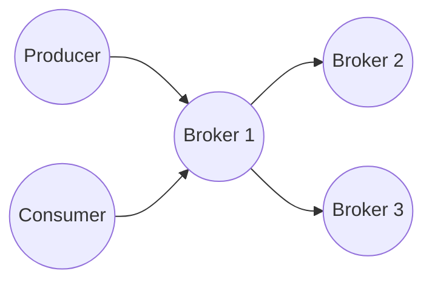

</div>

The producer communicates with the leader broker.

The leader then replicates data to follower brokers.

Consumers fetch records from the leader.

### Kafka Network Architecture

Kafka follows a client-server architecture.

<div style={{textAlign: 'center'}}>

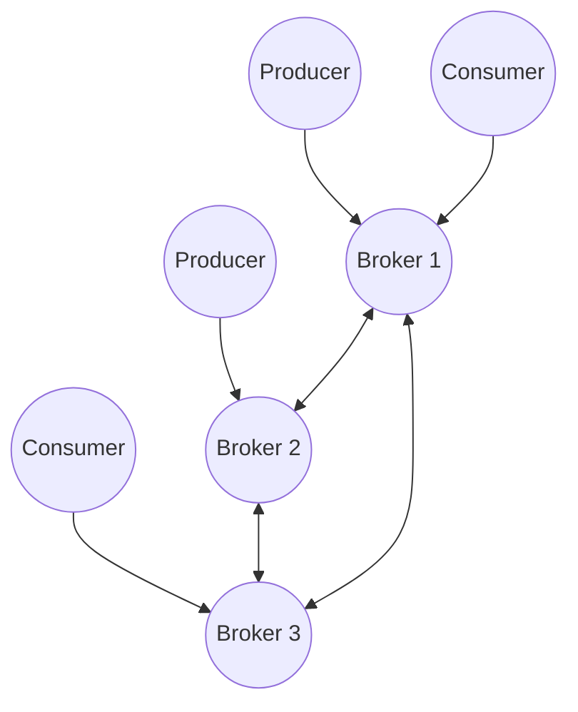

</div>

Each broker is both:

- A server for producers and consumers
- A client when communicating with other brokers

This peer-to-peer communication between brokers is essential for replication and cluster coordination.

### Kafka Network Components

#### Producers

Producers establish TCP connections with brokers.

Their responsibilities include:

- Fetching metadata
- Determining partition leaders
- Sending records
- Retrying failed requests

<div style={{textAlign: 'center'}}>

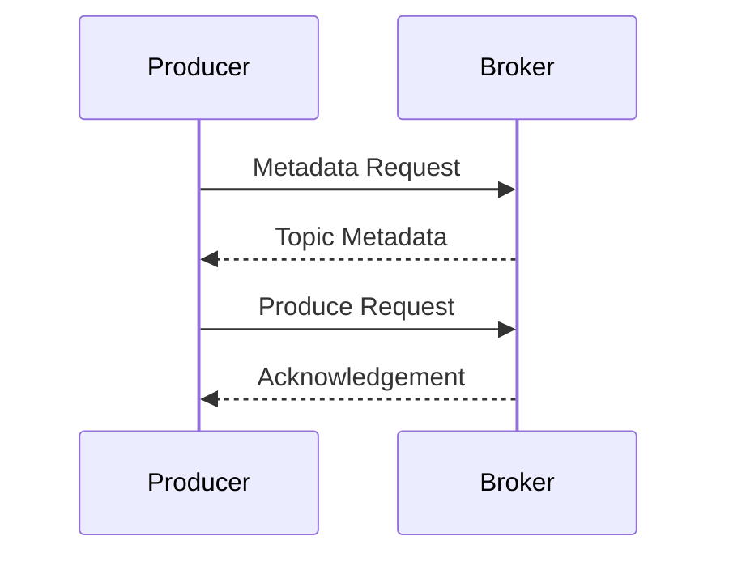

</div>

The producer never broadcasts messages to all brokers.

It sends data directly to the leader of the target partition.

#### Consumers

Consumers also communicate directly with partition leaders.

<div style={{textAlign: 'center'}}>

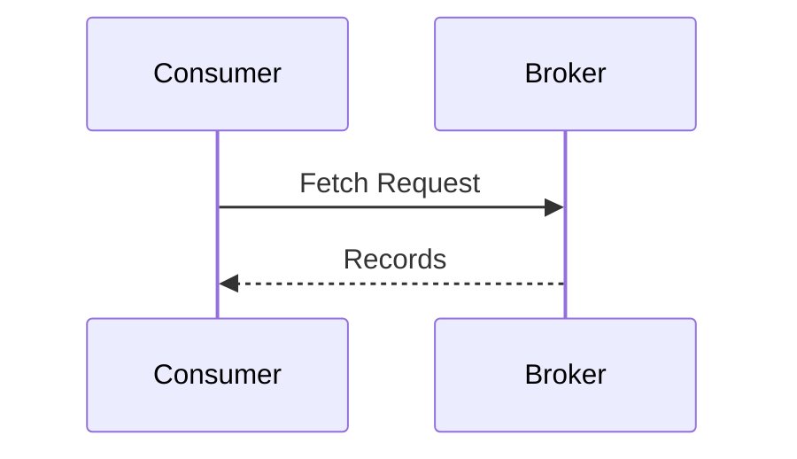

</div>

Consumers periodically:

- Fetch data
- Commit offsets
- Request metadata

#### Brokers

Brokers communicate with:

- Producers
- Consumers
- Other brokers
- Controller

<div style={{textAlign: 'center'}}>

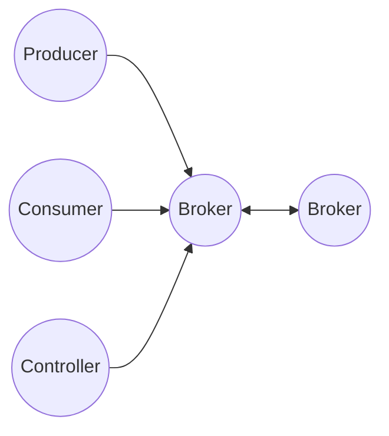

</div>

### Kafka Uses TCP

Kafka uses TCP rather than UDP.

Reasons:

- Reliable delivery
- Ordered packets
- Congestion control
- Error detection

Kafka depends heavily on TCP guarantees because message ordering is critical.

<div style={{textAlign: 'center'}}>

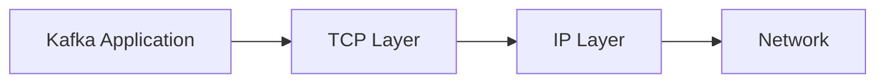

</div>

### Kafka Binary Protocol

Kafka does not use:

- HTTP
- REST
- SOAP

Internally, Kafka uses a custom binary protocol.

Advantages:

- Smaller payload size
- Faster serialization
- Lower CPU overhead
- Higher throughput

Every request contains:

- API key
- API version
- Correlation ID
- Client ID
- Request body

<div style={{textAlign: 'center'}}>

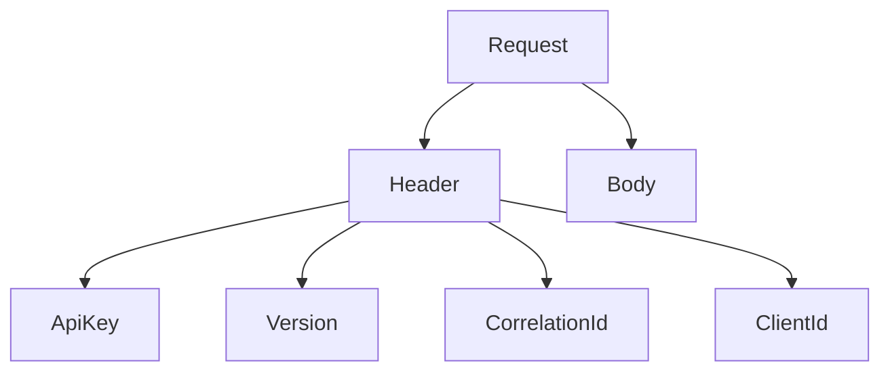

</div>

### Metadata Discovery

One of the first things every client does is fetch metadata.

The client only needs the address of one broker.

<div style={{textAlign: 'center'}}>

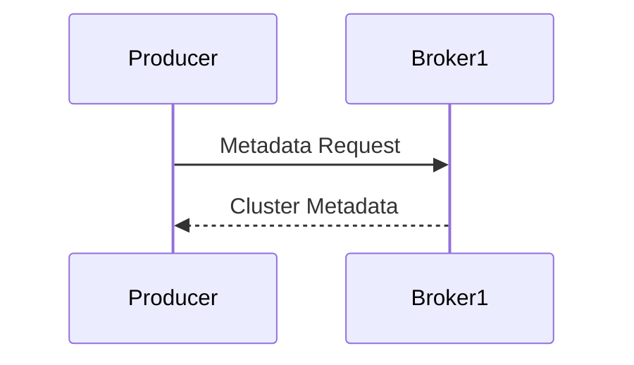

</div>

Returned metadata includes:

- Brokers
- Topics
- Partitions
- Leaders
- Replicas

Example:

```text
Topic: Orders

Partition 0 -> Broker 2
Partition 1 -> Broker 1
Partition 2 -> Broker 3
```

After receiving metadata, the producer can communicate directly with the correct broker.

### Connection Management

Creating TCP connections is expensive.

Kafka therefore keeps connections open.

<div style={{textAlign: 'center'}}>

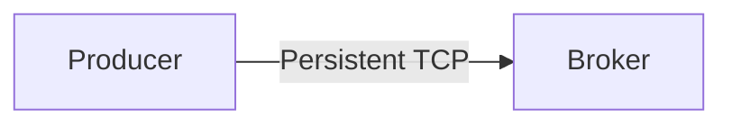

</div>

Benefits:

- Reduced latency
- Lower CPU cost
- Better throughput

Kafka clients maintain connection pools and reuse existing connections whenever possible.

### Network Threads

Every broker contains network threads.

Their job is to:

- Accept connections
- Read requests
- Write responses

<div style={{textAlign: 'center'}}>

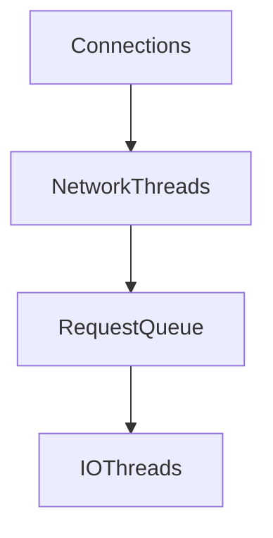

</div>

The broker separates:

- Network handling
- Request processing

This prevents slow processing from blocking incoming connections.

### Request Processing Pipeline

When a producer sends data:

<div style={{textAlign: 'center'}}>

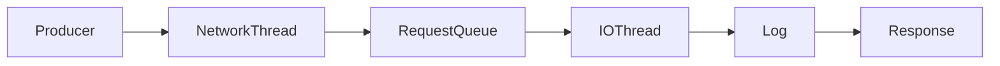

</div>

Steps:

1. Network thread receives request.
2. Request enters queue.
3. I/O thread processes it.
4. Data written to log.
5. Response sent back.

This architecture allows Kafka to process massive request volumes.

### Replication Traffic

Replication also consumes network bandwidth.

<div style={{textAlign: 'center'}}>

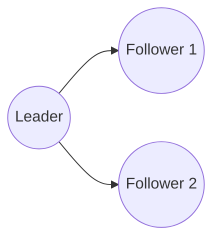

</div>

Follower brokers continuously fetch data from the leader.

This means Kafka networking is not only client traffic.

Broker-to-broker traffic can be extremely large.

### Rack Awareness

Large deployments often span multiple racks.

<div style={{textAlign: 'center'}}>

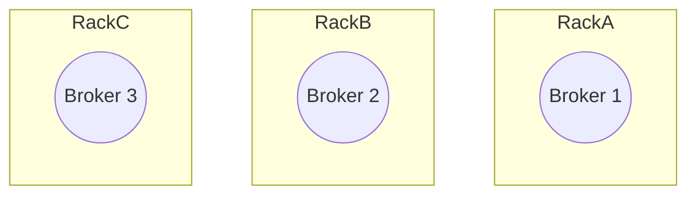

</div>

Kafka can place replicas across racks.

Benefits:

- Improved fault tolerance
- Better availability
- Reduced risk of rack-level failures

### Inter-Broker Communication

Brokers communicate constantly.

Common reasons:

- Replication
- Metadata updates
- Leader elections
- Heartbeats

<div style={{textAlign: 'center'}}>

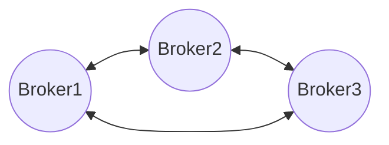

</div>

Without inter-broker networking, replication would not exist.

### Network Failures

Kafka must tolerate:

- Packet loss
- High latency
- Broker crashes
- Network partitions

Example:

<div style={{textAlign: 'center'}}>

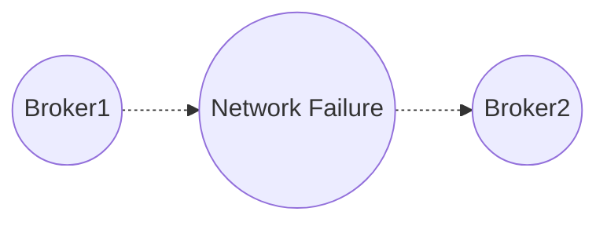

</div>

Kafka uses:

- Timeouts
- Retries
- Leader election
- Replication

to maintain availability during failures.

## Kafka Cluster Coordination

### What is Cluster Coordination?

A distributed system needs agreement.

Questions Kafka must answer:

- Which brokers are alive?
- Which broker is controller?
- Which replica is leader?
- Which replicas are in-sync?
- What topics exist?

Cluster coordination is the mechanism that maintains this shared state.

### Cluster Metadata

Metadata is information about the cluster.

<div style={{textAlign: 'center'}}>

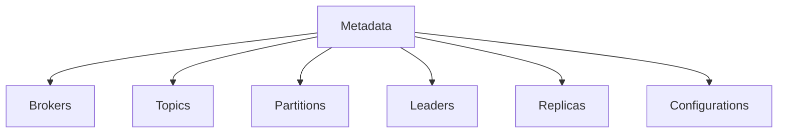

</div>

Every broker must agree on this information.

Otherwise the cluster becomes inconsistent.

### Controller

Kafka elects one broker as the Controller.

<div style={{textAlign: 'center'}}>

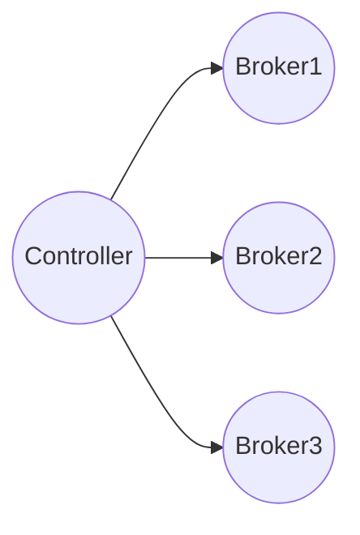

</div>

The Controller is responsible for:

- Broker registration
- Broker failure handling
- Leader election
- Metadata updates
- Partition reassignment

Only one active controller exists at a time.

### ZooKeeper Era

Historically Kafka used ZooKeeper.

<div style={{textAlign: 'center'}}>

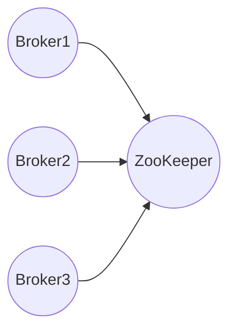

</div>

ZooKeeper stored:

- Metadata
- Controller information
- Broker registrations

Problems:

- Operational complexity
- Additional cluster
- Scalability limitations

Because of these issues Kafka moved toward KRaft.

### KRaft Architecture

Modern Kafka uses KRaft (Kafka Raft).

ZooKeeper is no longer required.

<div style={{textAlign: 'center'}}>

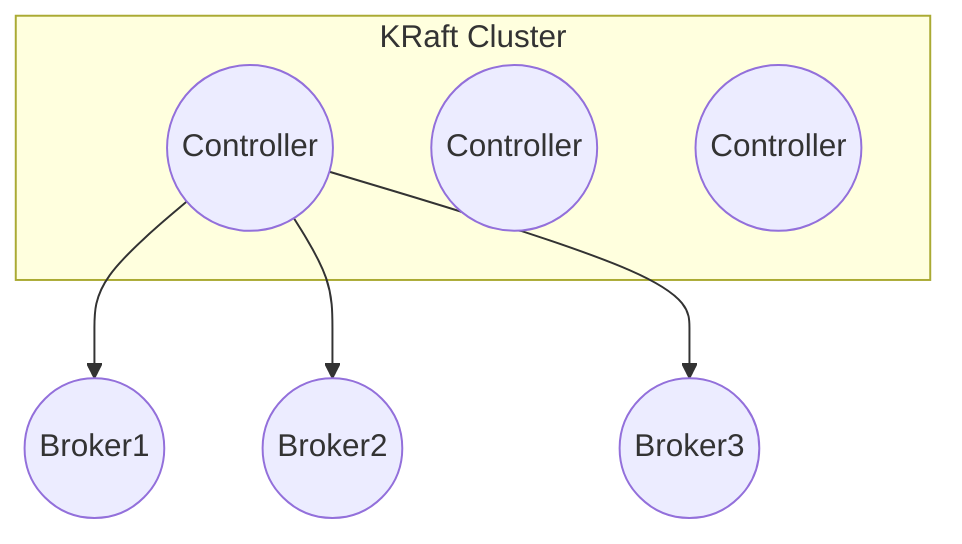

</div>

Metadata is stored inside Kafka itself.

Benefits:

- Simpler deployment
- Better scalability
- Faster failover
- Fewer moving parts

### Metadata Log

KRaft stores metadata in a replicated log.

Think of it as a special Kafka log dedicated to cluster metadata.

<div style={{textAlign: 'center'}}>

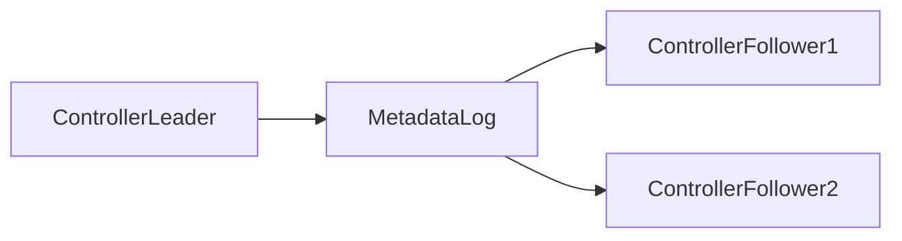

</div>

Examples of metadata records:

- Topic creation
- Topic deletion
- Broker registration
- Configuration changes
- Partition leader changes

### Raft Consensus

KRaft uses the Raft consensus algorithm.

Goal:

All controllers agree on metadata state.

<div style={{textAlign: 'center'}}>

```mermaid
flowchart LR

    Leader((Raft Leader))

    F1((Follower))
    F2((Follower))

    Leader --> F1
    Leader --> F2
```

</div>

Only the leader can commit metadata changes.

Followers replicate the metadata log.

### Controller Quorum

KRaft controllers form a quorum.

Example:

<div style={{textAlign: 'center'}}>

```mermaid
flowchart LR

    C1((Controller))
    C2((Controller))
    C3((Controller))
```

</div>

With three controllers:

- Majority = 2

As long as two controllers remain available, the cluster continues functioning.

### Leader Election

Every partition has one leader.

<div style={{textAlign: 'center'}}>

```mermaid
flowchart LR

    L((Leader))

    F1((Follower))
    F2((Follower))

    L --> F1
    L --> F2
```

</div>

Producers and consumers interact with the leader only.

If the leader fails:

<div style={{textAlign: 'center'}}>

```mermaid
flowchart LR

    OldLeader((Failed Leader))

    F1((Follower))
    F2((Follower))

    F1 --> NewLeader((New Leader))
```

</div>

The controller promotes an eligible follower.

### In-Sync Replicas (ISR)

Not all replicas are equal.

Kafka tracks replicas that are fully caught up.

These replicas form the ISR.

<div style={{textAlign: 'center'}}>

```mermaid
flowchart LR

    Leader((Leader))

    ISR1((ISR))
    ISR2((ISR))

    SlowReplica((Lagging Replica))

    Leader --> ISR1
    Leader --> ISR2
    Leader --> SlowReplica
```

</div>

Only ISR members are considered safe candidates for leader election.

### Broker Registration

When a broker starts:

<div style={{textAlign: 'center'}}>

```mermaid
sequenceDiagram

    participant Broker
    participant Controller

    Broker->>Controller: Register
    Controller-->>Broker: Accepted
```

</div>

The controller updates metadata.

Other brokers learn about the new broker through metadata propagation.

### Failure Detection

Controllers monitor brokers through heartbeats.

<div style={{textAlign: 'center'}}>

```mermaid
sequenceDiagram

    participant Broker
    participant Controller

    loop Heartbeats
        Broker->>Controller: Alive
    end
```

</div>

If heartbeats stop:

<div style={{textAlign: 'center'}}>

```mermaid
flowchart LR

    Broker((Broker))
    Controller((Controller))

    Broker -. heartbeat lost .-> Controller
```

</div>

The controller marks the broker as failed.

### Broker Failure Recovery

Suppose Broker 2 fails.

<div style={{textAlign: 'center'}}>

```mermaid
flowchart LR

    B1((Broker1))
    B2((Failed))
    B3((Broker3))
```

</div>

The controller performs:

1. Failure detection
2. Leader election
3. Metadata update
4. Cluster notification

<div style={{textAlign: 'center'}}>

```mermaid
flowchart TB

    Failure
        --> Detection
        --> Election
        --> MetadataUpdate
        --> Recovery
```

</div>

This process is automatic.

### End-to-End Example

Consider a topic with replication factor 3.


<div style={{textAlign: 'center'}}>

```mermaid
flowchart LR

    P((Producer))

    B1((Leader))
    B2((Follower))
    B3((Follower))

    P --> B1

    B1 --> B2
    B1 --> B3
```

</div>

Normal operation:

1. Producer sends records to B1.
2. B1 writes data locally.
3. B1 replicates data to B2 and B3.
4. Replicas acknowledge.
5. Producer receives acknowledgement.

If B1 crashes:

<div style={{textAlign: 'center'}}>

```mermaid
flowchart LR

    B1((Failed))

    B2((New Leader))
    B3((Follower))

    B2 --> B3
```

</div>

Controller actions:

1. Detect failure.
2. Elect B2.
3. Update metadata.
4. Notify clients.
5. Producers reconnect to B2.

The application continues running with minimal disruption.
